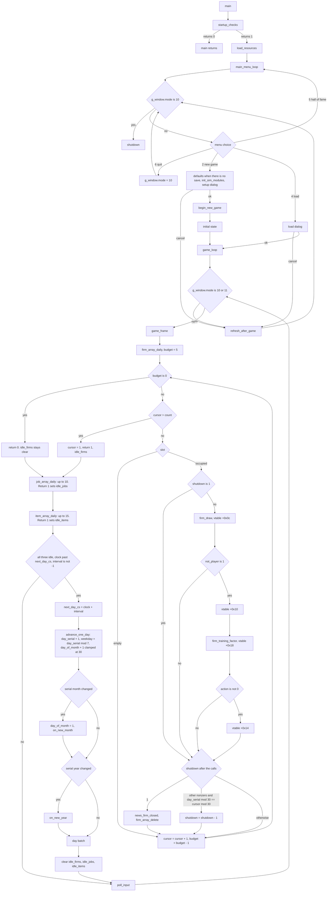

# Capitalism Plus — Technical Specification

Reverse-engineering reference for the binary. Structs, vtables, function
addresses, calling conventions, and decompiler notes.

Names from `notes/names_gameloop.csv`, `notes/names_sim.csv`, and the
structs from `scripts/ApplyGameTypes.java` are applied in the Ghidra
program and in `decomp/`. A fresh import would need those applied again.

## Binary layout

Watcom C/C++ compiler. `watcomreg` calling convention (args in EAX, EDX,
EBX, ECX). Linear Executable (LE) format loaded by DOS4GW.EXE.
Ghidra 12.1.4 with retrokit LE loader.

## Main loop



## Key addresses

| Symbol | Address | Notes |
| --- | --- | --- |
| `main` | `0x10385` | Entry point |
| `game_loop` | `0x114b4` | Main sim loop |
| `game_frame` | `0x1150f` | One frame |
| `poll_input` | `0x11767` | Input polling |
| `set_game_speed` | `0x139b8` | Writes `g_window.speed` and `day_interval_cs` |
| `clock_centiseconds` | `0x98a28` | Centiseconds since `g_clock_base` |
| `advance_one_day` | — | Day serial increment, month/year dispatch |
| `on_new_month` | `0x2762f` | Monthly hooks |
| `on_new_year` | `0x276f8` | Yearly hooks |
| `menu_new_game` | `0x14dfe` | New game setup |
| `begin_new_game` | `0x14eca` | World creation |
| `refresh_after_game` | `0x15155` | Post-game rebuild |

### Speed table

| Speed | `day_interval_cs` | Notes |
| --- | --- | --- |
| 0 | −1 (paused) | Never enters batch |
| 1 | 600 | Value `window_clear` installs |
| 2 | 300 | |
| 3 | 100 | |
| 4 | 50 | |
| 5 | 0 | Batch runs on frame that sets third idle flag |

Wrap addend `0x83D600` = 8,640,000 centiseconds (one day).

## Calendar

`g_game_date` is 0x41 bytes, saved verbatim (`0x1eac2` / `0x1eadd`).
`game_date_reset` sets it to 1 January of `g_start_year`.
`advance_one_day` increments `day_serial`. When `serial_part(..., 'M')`
changes → `on_new_month`. When `serial_part(..., 'Y')` changes →
`on_new_year`. Serial epoch offset: `0x1A4451`.

`on_new_month` (`0x2762f`) ticks `0xb23d9`, `0xb182b`, `0xb1ace`,
`g_firms`, `0xb19bd`, `0xb1960`, `0xb1888`, autosaves every 3rd month.

`on_new_year` (`0x276f8`) ticks `0xb23d9`, `g_app`, `g_firms`,
`0xb19bd`.

Daily call from `game_frame` ticks `g_firms`, `0xb1bce`, `0xb1ace`,
`g_app`, `0xb1c5c`, `0xb2405`, `0xb182b`, `0xb1c2f`.

### Daily batch sequence (game_frame, line 1841)

Runs once per game day after all three pump layers (firms, jobs, links)
reach idle. In order:

| # | Call | Global | What |
|---|------|--------|------|
| 1 | `advance_one_day` | `g_game_date` | Increment serial; triggers `on_new_month` / `on_new_year` on boundaries |
| 2 | `FUN_00034e34` | `g_firms` (`0xb196c`) | Corporation daily — each corp vtable `+0x0c` |
| 3 | `FUN_0007b9f0` | `0xb1bce` | People daily — three updates per active person |
| 4 | `FUN_0004da2f` | `0xb1ace` | Towns daily — population step on matching day |
| 5 | `FUN_0001abdb` | `g_app` | Goals daily — check every 2 days (player) / 7 days (AI) |
| 6 | `FUN_00075988` | `0xb1c5c` | Weekly ratings — weekday 5 only, decay oversupplied ratings |
| 7 | `FUN_00022a47` | `0xb2405` | Random events — frequency gate then 1-of-6 event dispatch |
| 8 | `FUN_0006f032` | `0xb182b` | Product catalog daily — 1/30 of catalog per day |
| 9 | `FUN_0007433c` | `0xb1c2f` | Late spawner — natural resource discovery |

### Weekly ratings (FUN_00075988, weekday 5)

Iterates a ratings array (dynamic array at `0xb1c5c`). Each entry has
firm reference (`short +0`), product class index (`short +2`),
product type index (`short +4`), `target` (`float +6`, always 30.0),
and `current` (`float +0xa`).

Gate: `current >= target / 200` (i.e. `current >= 0.15`).

Resolve town: negative firm_ref → town = abs(firm_ref) (importer);
positive → town = firm.town.

Look up the town-product demand cell (`pfVar7`, at `class_idx × 4 + 8`
inside the town-product row) and supply cell (`pfVar5`, at `class_idx × 4 + 0x38`).

**Importer** (firm_ref < 1):
- Default decrement = 0.1 (unique brand)
- `brand_strategy == 0` (corporate): 0.025
- `brand_strategy == 1` (range): 0.05

**Local producer** (firm_ref ≥ 1):
decrement = min(`target / 200`, `demand_cell / 20.0`).
(`DAT_000aa0e3` = 20.0, extracted from binary at file offset `0xc9ce3`.)

Apply: `current -= decrement`; `demand_cell -= decrement` (floor 0).

**Supply decay** (per entry, if `supply_cell > 0`):
`supply_decay = min(supply_cell / 200, 0.05)` (`DAT_000aa0e7` = 0.05 double).
`supply_cell -= supply_decay`.
Clamp: `supply_cell = clamp(supply_cell, −demand_cell, demand_cell)`.

### Rating gain (FUN_00075aec, called on consumer sale)

Target is always set to 30.0 (`0x41f00000`).
Gain = `(30.0 − current) × (prev_month_units + 1) / ref / 100.0`,
where ref = max(prev_month_units + 1, town-product reference at +4).
Gain is multiplied by brand strategy factor:
corporate (`0`) × 0.25, range (`1`) × 0.5, unique (≥ 2) × 1.0.
`current += gain`; `demand_cell = min(demand_cell + gain, 100)`.

### Random events (FUN_00022a47)

Gate: `DAT_000b1ee4` (event frequency setting) must be nonzero.
Probability: `1 / DAT_000ad572[frequency]` per day.

When triggered, picks one of 6 event handlers via a dispatch table at
`DAT_000b3ef0` (stride 0xc: vtable ptr, object offset, ???). Each
entry's handler is called with `(object + g_app)`.

### Late spawner (FUN_0007433c → FUN_00074376 → FUN_0007449e)

Gate (FUN_0007433c at `0x7433c`): requires both
`g_start_day + 365 < g_game_date.day_serial` AND
`last_spawn_day + 365 < g_game_date.day_serial`.

Discovery logic (FUN_00074376 at `0x74376`): iterates resource entries
(stride 0xd). Each entry has a resource type and current count.

- `count < 2`: always placed (guaranteed minimum)
- `count == max_for_type`: 1/500 chance per attempt, up to 20 attempts
- After all entries: 1/500 global chance if `total_placed < entries × 3`

Placement (FUN_0007449e at `0x7449e`):
1. Random coordinates: x in [0, 239], y in [0, 197]
2. Tile validation: must be grassland (tile `0x2013`–`0x201e`) or
   terrain (`0x2000`–`0x2004`), must NOT be town tile (`0x202d`–`0x2030`)
3. Sets tile resource data (type byte + quantity)
4. Randomizes rainfall and soil for the tile
5. Posts news event ("Natural resources discovered")
6. Records `g_game_date.day_serial` as last spawn timestamp

**Implementation (sim-extraction):** The RAW resource table was decoded from the
1STD.SET RAW dBASE section — 8 entries of 13-byte stride loaded by
`FUN_00074194`. Each entry maps product→firm_type→speed→terrain.
`raw_resource_types` table in `capitalism.db` stores the decoded values.
`Extraction.__init__` reads speed per resource (Mine=2, Timber=1, Oil=4).
`World.place_initial_deposits()` seeds deposits at game start matching
`FUN_0007428b`. `World.discover_resources()` runs the late-spawner gate
(`FUN_0007433c`) and discovery logic (`FUN_00074376`) daily. Terrain
validation follows `FUN_0007449e`: type 0=any land, 1=grassland, 2=forest/hill;
town and firm tiles are excluded.

### on_new_month detail (FUN_0002762f)

Full sequence:

1. **GNP monthly** — `FUN_00026d6b` (`0x26d6b`, `0xb23d9`)
   Averages town economic growth across all towns (field at
   `town + 0x113 + month_mod12 × 4`). If average ≤ threshold
   `DAT_000a34e4`, random chance to increase GNP index by
   `DAT_000a34ec`. If average ≥ `DAT_000a34f0`, random chance;
   if GNP index ≥ 1.0, decreases by `DAT_000a34f8`.

2. **Product catalog monthly** — `FUN_0006f074` (`0x6f074`, `0xb182b`)
   For each product type (stride `0x14a`):
   - Zeroes monthly sales buckets: `+0xe2 + month×4` and `+0x112 + month×4`
   - Rotates accumulators: `+0xae → +0xb6`, `+0xb2 → +0xba`,
     `+0xbe → +0xc6`, `+0xc2 → +0xca`, then zeroes current month
   - Calls `FUN_0006f7b7` — tech obsolescence check: for each product
     type with nonzero class ref, counts months available via
     `FUN_0006fd54` (counts set bits in discovery mask `+0x64`
     ANDed with months 1–12). If `months_available × 8 + (invent_year − start_year) > 50`,
     sets quality_decay `+0x64` to -1 (marks as obsolete)
   - Special case: product type index 0xb, if named "CIGAR":
     years_elapsed < 50 → demand `+0x39` *= `DAT_000a9900` (≈0.996)
     years_elapsed ≥ 50 → demand `+0x39` *= `DAT_000a98f8` (≈0.999)

3. **Towns monthly** — `FUN_0004daa3` (`0x4daa3`, `0xb1ace`)
   - For each town: `FUN_0004b377` — town monthly stats:
     - Computes population growth rate: `(pop − prev_pop) × scale / prev_pop`
       stored in 12-month ring at `+0xe3 + month×4`
     - Copies current population to ring: `+0x53 + month×4 = +0x2d`
     - Copies population count to ring: `+0x143 + month×4 = +0x47`
     - Rotates economic series: prev_gdp = current_gdp;
       current_gdp = `+0x31 × +0x2d` (growth_rate × population)
     - Computes 12-month GNP growth: sums current and previous series
       across 12 months, stores `(sum_current − sum_prev) × scale / sum_prev`
       at `+0x113 + month×4` (this is what GNP monthly reads)
   - If town spawning enabled (`DAT_000b1ee2`): `FUN_0004db2e` —
     spawn check: requires `last_spawn + 700 ≤ day_serial` AND
     `town_count ≠ 12` (max). Then 1/10 chance AND
     `town_count < map_size / 30`. Creates town via `FUN_0004d5ee`,
     assigns to corp 1, 50% chance of type 13 or 11, posts news event.
   - For each town-item entry: `FUN_0004c8e7` — demand update:
     - `FUN_0004cd5b`: adjusts demand/price/quality for the product in
       this town based on supply vs demand ratio, difficulty level,
       and random perturbation
     - `FUN_0004d055`: recalculates base demand from product properties,
       town population, necessity factor, and technology age decay
     - Zeroes monthly accumulators: `+0x8e + month×4` and `+0xbe + month×4`
   - `FUN_0004dbfd`: averages town coordinates across all active towns,
     stores result at `array + 0x58` (avg x) and `+0x5a` (avg y)

4. **Corporations monthly** — `FUN_00034f54` (already documented)

5. **Array walks** — `firm_array_month`, `job_array_month`, `item_array_month`

6. **Autosave** — months 3, 6, 9, 12 if enabled and player corp exists

### on_new_year detail (FUN_000276f8)

1. Increment `years_elapsed` at `g_game_date + 0x18`
2. Increment 30-year ring index at `+0x2c`, wraps at 30
3. Increment 10-year ring index at `+0x30`, wraps at 10
4. **GNP yearly** — `FUN_00026d90` (`0x26d90`): stores current GNP index
   into 10-year history ring: `array[year_mod10 + 1] = array[0]`
5. **Goals yearly** — `FUN_0001ac07` (`0x1ac07`): if year limit is set
   (`+0x40 ≠ 0`), computes `remaining = limit − (current_year − start_year)`.
   If remaining < 1 → triggers game end (`FUN_0001cf40` with code 2).
   If remaining < 6 → shows hurry-up dialog ("N years left to achieve
   the goal. Hurry Up!")
6. **Corporations yearly** — `FUN_00034f95` (`0x34f95`): iterates all
   corporations, calls each corp's vtable `+0x14` (yearly method)
7. **Firm array yearly** — `firm_array_year` (`0x67aaa`): vtable `+0x20`
   on every live firm

## Front end

`main` (`0x10385`) → `startup_checks` → `load_resources` →
`main_menu_loop` → `shutdown`. Menu dispatch (`0x14c34`): 1
instructional, 2 new game, 3 `*.SCN`, 4 load, 5 hall of fame,
6 sets `g_app_mode = 10`.

## New game

`menu_new_game` (`0x14dfe`) writes defaults with `0x14791`, then
`init_sim_modules`, `sync_player_view`, setup dialog `0x153b8`.
Ok → `begin_new_game` (`0x14eca`) → `game_loop`.

Gameset: `1STD.SET`, code `1STD`, name `Standard Game Set`, start 1990.
Lookup key at `0xa0bb4` is `STD` — mismatch with header `1STD`, index
stays 1. Companion files: `.SET`, `.II2`, `.IP`, `.PLA`/`.PLP`, `.PLO`.

## Global arrays

| Symbol | Address | Description |
| --- | --- | --- |
| `g_firm_array` | `0xb19bd` | Firms on map |
| `g_job_array` | `0xb1960` | Jobs |
| `g_item_array` | `0xb1888` | Product links |
| `g_firms` | `0xb1a7b` | Corporation array |
| `g_window` | — | Window/mode state |
| `g_app` | — | Application state |
| `g_game_date` | — | Calendar (0x41 bytes) |

## Three-layer pump

| Array | Global | Idle flag | Cursor | Visits/frame | Pump |
| --- | --- | --- | --- | --- | --- |
| Firms | `g_firm_array` `0xb19bd` | `idle_firms` `g_window+0x18` | `+0x2c` | 5 | `firm_array_daily` `0x67966` |
| Jobs | `g_job_array` `0xb1960` | `idle_jobs` `g_window+0x19` | `+0x2c` | 10 | `job_array_daily` `0x5e53e` |
| Links | `g_item_array` `0xb1888` | `idle_items` `g_window+0x1a` | `+0x83` | 15 | `item_array_daily` `0x6df3d` |

All three share `+0x0c` count, `+0x10` stride, `+0x19` base.
Firm/job slots hold pointers. Link is bytes at
`base + (index − 1) × stride`. Indexes are 1-based.

Empty slot costs one visit. Firms/jobs: null pointer = empty.
Link: `item_slot_empty` (`0x6e081`) returns 1 when index is out of
range, address is null, or first short is 0.

### Month/year walks

After GNP, catalog month, town month, corporation month:

- `firm_array_month` (`0x67a69`) — firm vtable `+0x1c` on every live firm
- `job_array_month` (`0x5e5a7`) — job vtable `+0x0c` on every live job
- `item_array_month` (`0x6dfa1`) — `item_month` on every link, then `item_publish_highs`

These walk count down to 1 in one call.
`firm_array_year` (`0x67aaa`) — vtable `+0x20` on every live firm.
No job or link year walk.

## Financial posting

`firm_post_revenue` (`0x643cb`): adds to `month_revenue`, `month_net`,
`category[k]`, `category_year[k]`, `category_life[k]`. Aborts k > 8.
Calls `group_post_revenue` (`0x31df0`) → corporation cash `+0x186`.

`firm_post_expense` (`0x6446f`): subtracts from `month_net`, adds to
`month_expense` and categories. Calls `group_post_expense` (`0x31eca`)
→ subtracts corporation cash.

`group_move_balance` (`0x31f9f`): `(corp, dest, source, amount)`.
Source 0 also subtracts cash. Dest 0 also adds cash.

## Firms

### Firm types

From FIRM section of `1STD.SET`. SET index skips 14; firm type 14
(Seaport) is at SET index 15.

SET file stores costs as integers in thousands; loader at `FUN_0006932c`
(VA `0x6932c`, line 76412) multiplies by 1000 and stores as float:
`*(float *)(rec + 0x1b) = (float)(atoi(SETUP_COST) * 1000)`
`*(float *)(rec + 0x1f) = (float)(atoi(EXPENSE) * 1000)`

| Type | Code | Name | Setup Cost (SET → $) | Overhead/mo (SET → $) | Size | Source file |
| --- | --- | --- | --- | --- | --- | --- |
| 1 | RETA | Department Store | 1,000 → $1,000,000 | 100 → $100,000 | 0x184 | `of_retai.cpp` |
| 2 | FACT | Factory | 1,500 → $1,500,000 | 100 → $100,000 | 0x189 | `of_fact.cpp` |
| 3 | RD | R&D Center | 1,500 → $1,500,000 | 100 → $100,000 | 0x184 | `of_rd.cpp` |
| 4 | FARM | Farm | 1,000 → $1,000,000 | 100 → $100,000 | 0x184 | `of_farm.cpp` |
| 5 | FORE | Logging Camp | 1,500 → $1,500,000 | 100 → $100,000 | 0x184 | `of_raw.cpp` |
| 6 | MINE | Mine | 5,000 → $5,000,000 | 300 → $300,000 | 0x184 | `of_raw.cpp` |
| 7 | OIL | Oil Well | 5,000 → $5,000,000 | 300 → $300,000 | 0x184 | `of_raw.cpp` |
| 8 | SDEV | Software Developer | 100 → $100,000 | 10 → $10,000 | 0x184 | (ctor reuses firm type 3 (R&D Center)) |
| 9 | SPUB | Software Publisher | 1,000 → $1,000,000 | 100 → $100,000 | 0x184 | — |
| 10 | REST | Restaurant | 2,000 → $2,000,000 | 100 → $100,000 | 0x194 | — |
| 11 | TV | Television Station | 20,000 → $20,000,000 | 350 → $350,000 | 0x268 | (media) |
| 12 | RADI | Radio Station | 10,000 → $10,000,000 | 200 → $200,000 | 0x268 | (media) |
| 13 | PUBL | Newspaper Publisher | 10,000 → $10,000,000 | 200 → $200,000 | 0x268 | (media) |
| 14 | SEA | Seaport | 0 → $0 | 0 → $0 | 0x189 | `of_sea.cpp` |

### Build cost, build panel and demolish

**Booking** — `FUN_00063dd9` (0x00063dd9, line 68425), called from firm
init (line 68413). It stores `map_land_value` at `firm+0x52`, then
`group_move_balance(corp, 2, 0, firm, type+0x1b)` (setup cost, Cash →
Business Assets) and `group_move_balance(corp, 3, 0, firm, land)` (land
value, Cash → Land & Resource) (lines 68436-68443). There is no cash
check here.

**Player build panel** — `FUN_000698e0` (0x000698e0, line 76634).
Lines 76662-76690 draw Construction / Land / Total Cost and set the Build
button flag `DAT_000b83b4` = 0 when the site can't be built, or when
`FUN_000354e0()+0x186` (cash) < `record+0x1b` + `map_land_value`;
otherwise 1. The "Build" button `DAT_000b83b3` is then created (lines
76687-76689). `FUN_000354e0` is likely the player-corp getter, and flag 0
likely means a disabled button. Only cash is compared; there is no
credit line. The rebuild branch (lines 76696-76711) shows "Firm Rebuild
Cost" and sets the flag to 0 when cash < cost or cost <= 0, with
"Rebuild" and "Close Down" (`DAT_000b83e9`). "Cannot be built here" is at
line 76692. `FUN_0006956d` (0x0006956d, line 76493; called from
`FUN_00027e00` line 20326 and `FUN_000450f0` line 41968) repeats the
check (lines 76546-76569) and redraws the button (lines 76572-76584).
The Build handler `FUN_0006a306` (lines 76986-77005) has no check of its
own. `FUN_0006984e` is reached from `FUN_00027e1d` (line 20345).

**Demolish** — `FUN_00064005` (0x00064005, line 68538), called from
`FUN_00063f28` (line 68501); the dialog is `FUN_0006a371` (lines
77013-77030). It runs `group_move_balance(corp, 0, 2, setup)`, then
`group_post_expense(corp, 7, setup)` (write-off), then
`group_move_balance(corp, 0, 3, firm+0x52)` (land refunded at the stored
value) (lines 68548-68560). Both asset accounts are floored at 0
(`+0x7da`, `+0x7de`).

### FirmVtable reference

32 slots, 0x80 bytes. Vtable pointer at Firm+0x17d. Defined in
`ApplyFirmVtable.java`. Slot +0x00 is always null (Watcom convention).

| Offset | Name | Base address | Override pattern | Description |
| --- | --- | --- | --- | --- |
| +0x00 | `reserved_00` | null | never | Always null. Watcom convention |
| +0x04 | `dtor` | `0x64a14` | every type | Destructor chain. `firm_array_delete` calls with arg 2 |
| +0x08 | `stub_08` | `0x11124` | never | Stub. Never overridden |
| +0x0c | `daily` | `firm_draw` `0x64513` | types 4 (Farm), 10 (Restaurant), 11 (TV Station)–13 (Newspaper) | Runs every day for all firms. Media types run economic sim here |
| +0x10 | `ai_daily` | `0x11118` | most types | AI-only daily. Runs when `not_player` is 1. Staffing, shutdown |
| +0x14 | `action_dispatch` | `0x1110c` | most types | One-shot action. Clears action field +0x2d after running |
| +0x18 | `training_factor` | `firm_training_factor` `0x6496c` | never | Monthly training factor 0..200 |
| +0x1c | `month` | `firm_month` `0x64533` | types 11 (TV Station)–13 (Newspaper) | Rolls categories, posts overhead and land value |
| +0x20 | `year` | `firm_year` `0x645d0` | never | Zeros the nine year-category buckets |
| +0x24 | `save` | per-type | never | Writes subclass bytes past 0x181 via `0x8f505` |
| +0x28 | `load` | per-type | never | Reads subclass bytes past 0x181 via `0x8f58f` |
| +0x2c | `select_handler` | `0x64657` | never | Dispatches dialog events: draw_detail, item_open, draw_context |
| +0x30 | `query_handler` | `0x646dd` | never | Returns 1 when detail_poll, item_check, or info_poll is nonzero |
| +0x34 | `show` | `0x64710` | never | Entry point when firm clicked on map |
| +0x38 | `poll` | `0x64751` | never | Queries whether firm click has pending work |
| +0x3c | `draw_detail` | `0x64780` | every type | Draws the firm detail panel. Corp type 4 (Government) simplified |
| +0x40 | `draw_context` | `0x647f0` | every type | Alternate mode. Calls show_info then dispatches on button |
| +0x44 | `detail_poll` | `0x64846` | every type | Returns nonzero on button presses |
| +0x48 | `item_open` | `0x6487c` | R&D, SoftDev, media | Opens the product-link dialog |
| +0x4c | `item_close` | `0x648c2` | never | Refreshes on count change, closes otherwise |
| +0x50 | `item_check` | `0x64908` | never | Returns 1 when item dialog has a selection |
| +0x54 | `click_job` | `0x6492a` | never | Dispatches click to selected job's vtable +0x14 |
| +0x58 | `close_jobs` | `0x6494c` | R&D, SoftDev | Walks all jobs calling their vtable +0x28 |
| +0x5c | `media_calc` | `0x110f0` | types 11 (TV Station)–13 (Newspaper) | Stub in base. Media: ad rating every 5th day |
| +0x60 | `media_draw_stats` | `0x110e4` | types 11 (TV Station)–13 (Newspaper) | Stub in base. Media: CPT, Rating Points, Reach, Freq |
| +0x64 | `media_draw_bar` | `0x110d8` | types 11 (TV Station)–13 (Newspaper) | Stub in base. Media: date strings and progress bar |
| +0x68 | `stub_68` | `0x110d8` | never | Stub. Never overridden |
| +0x6c | `stub_6c` | `0x110cc` | never | Stub. Never overridden |
| +0x70 | `has_product` | `0x649a6` | R&D | Walks item links, returns 1 if product type match |
| +0x74 | `startup` | `0x110c0` | most types | Stub in base. Sets counters, creates initial jobs |
| +0x78 | `show_info` | `0x649e4` | every type | Contextual info screen. Called by draw_context |
| +0x7c | `info_poll` | `0x64a38` | every type | Polls info screen state. Checks button/scroll |

### Per-type firm overrides

| Type | Name | `daily` (`+0x0c`), every owner | `+0x10` when `not_player` | Month `+0x1c` | Source file |
| --- | --- | --- | --- | --- | --- |
| 1 | Department Store | `firm_draw` | `firm_type1_daily` `0x62ad3` | `firm_month` | no `of_*.cpp` in the daily |
| 2 | Factory | `firm_draw` | `firm_factory_daily` `0x5f493` | `firm_month` | `of_fact.cpp` |
| 3 | R&D Center | `firm_draw` | `firm_rd_daily` `0x61e3d` | `firm_month` | `of_rd.cpp` |
| 4 | Farm | `firm_farm_draw` `0x5fade` (calls `firm_draw`) | `firm_farm_daily` `0x5faed` | `firm_month` | `of_farm.cpp` |
| 5, 6, 7 | Logging Camp, Mine, Oil Well | `firm_draw` | `firm_raw_daily` `0x61abc`, shared | `firm_month` | `of_raw.cpp` |
| 8 | Software Developer | `firm_draw` | `firm_type8_daily` `0x61921`, returns immediately | `firm_month` | |
| 9 | Software Publisher | `firm_draw` | `firm_type9_daily` `0x61a28`, returns immediately | `firm_month` | |
| 10 | Restaurant | `firm_type10_draw` `0x62a8b` (calls `firm_draw`) | `firm_type10_daily` `0x62a9a`, returns immediately | `firm_month` | |
| 11, 12, 13 | TV, Radio, Newspaper | `firm_media_daily` `0x603d9` | empty `0x11118` (name cannot be inferred) | `firm_media_month` `0x603e8` | constructors say TV Broadcast, Radio Broadcast, Newspaper |
| 14 | Seaport | `firm_seaport_daily` `0x63154` | `0x631a4` (name cannot be inferred) | `firm_month` | `of_sea.cpp` |

### Firm daily dispatch

Vtable pointer at `+0x17d`. `firm_init` (`0x63c24`): stores `not_player`
at `+0x20` as `player_corporation_index != group_id`. Stores `item_live`
at `+0x2c` as 1 for firm types 1 (Department Store) and 10 (Restaurant),
0 for all others. Calls month method once before return.

`firm_array_daily` for an occupied slot:

1. `firm_draw` (`0x64513`), vtable `+0x0c`. See per-type overrides above.
   The vtable at `0x608c8` overrides it with `0x6702c` directly, and
   stores `0x11118` at `+0x10`, `0x1110c` at `+0x14`, and
   `firm_training_factor` at `+0x18`.
2. `+0x10`, when `not_player` (`+0x20`) is 1. See per-type details in
   the original notes.
3. `+0x18`, when `not_player` is 1. Every vtable stores
   `firm_training_factor` (`0x6496c`).
4. `+0x14`, when `not_player` is 1 and `action` (`+0x2d`) is not 0.

After the group: shutdown 1 → `news_firm_closed` (`0x23b38`) + delete.
Other nonzero → decrement when `day_serial % 30 == cursor % 30`.

Deletion: `firm_array_delete` (`0x67903`) → teardown + vtable `+4` →
`dynarr_free_slot` (`0x8e2d2`) zeros slot, pushes index on free list.

### Firm monthly/yearly

`firm_month` (`0x64533`): zeros month buckets at `month_mod12`, rolls
categories, posts category 2 from firm-type `+0x1f`, posts land value
delta as category 11 through `group_post_revenue`, then
`group_move_balance(corp, 3, 0, delta)`.

`firm_year` (`0x645d0`): zeros nine `category_year` floats.

`firm_media_month` (`0x603e8`): calls `firm_month`, then `0x604d2` and
`0x6073c`, copies `+0x1d2` to `+0x202`, zeros `+0x1d2`, sums into
`+0x232`.

### firm_training_factor

`firm_training_factor` (`0x6496c`). Runs when `type_byte` (`+0x1f`) is 0
and `day_serial % 30 == recno % 30`. Factor is int at `+0x33`'s `+0x2c`.
Clamped 0..200. Stored only when diff > 9.

Type 3 (R&D Center):
`cfg_random(cfg, 0x3c) + (record_short_+0x44 × record_short_+0x46) / 100 − 30`,
or 0 when last month's corp float at `+0x1c6` is ≤ 0.
`cfg_random` (`0x907a3`) = LCG at config `+0x79`.

All other types: `firm_count_jobs_above_89(firm) × record_short_+0x46`.
Count (`0x66e2b`) = occupied slots of types 10, 12, 7, 3 whose vtable
`+0x10` returns > 89. Record from `0x667ac` (indexes `0xb1b87` by firm
short `+0x58`).

## Jobs

### Job types

From JOB section of `1STD.SET`. Record size 0x3d.

| Type | Code | Full Name | Short Name | Setup Cost | Staff |
| --- | --- | --- | --- | --- | --- |
| 1 | FARMCROP | Crop Growing | Crop | 100 | 16 |
| 2 | FARMLIVE | Livestock Raising | Livestock | 100 | 16 |
| 3 | FARMPROC | Livestock Processing | Process | 100 | 16 |
| 4 | FOREST | Logging | Logging | 100 | 24 |
| 5 | INV | Inventory | Inventory | 50 | 1 |
| 6 | LABEL | Private Labelling | Labelling | 100 | 6 |
| 7 | MFT | Manufacturing | Mft | 300 | 24 |
| 8 | MINE | Mining | Mining | 1,000 | 24 |
| 9 | OIL | Oil Extraction | Extract | 1,000 | 24 |
| 10 | PUR | Purchasing | Purchase | 50 | 4 |
| 11 | RD | Research & Development | R&D | 500 | 12 |
| 12 | SALE | Sales | Sales | 100 | 8 |
| 13 | SOFTDEV | Software Development | Soft Dev. | 50 | 8 |
| 14 | SOFTPROD | Software Production | Soft Prod. | 100 | 4 |
| 15 | _EXTERN | Advertising | Advertise | 5 | 1 |

### FIRMJOB mapping

| Firm | Firm Name | Jobs |
| --- | --- | --- |
| RETA | Department Store | INV(5), LABEL(6), PUR(10), SALE(12), _EXTERN(15) |
| FACT | Factory | INV(5), LABEL(6), MFT(7), PUR(10), SALE(12), _EXTERN(15) |
| FARM | Farm | FARMCROP(1), FARMLIVE(2), FARMPROC(3), INV(5), SALE(12), _EXTERN(15) |
| FORE | Logging Camp | FOREST(4), INV(5), SALE(12) |
| MINE | Mine | INV(5), MINE(8), SALE(12) |
| OIL | Oil Well | INV(5), OIL(9), SALE(12) |
| RD | R&D Center | RD(11) |
| SDEV | Software Developer | SOFTDEV(13) |
| SPUB | Software Publisher | SALE(12), SOFTPROD(14), _EXTERN(15) |

Firm types 10 (Restaurant), 11 (TV Station), 12 (Radio Station),
13 (Newspaper Publisher), and 14 (Seaport) have no FIRMJOB entries.

### JobVtable reference

23 slots, 0x5c bytes. Vtable pointer at Job+0x24. Defined in
`ApplyJobVtable.java`. Slot +0x00 is always null (Watcom convention).
Some types (4, 5, 6, 8, 9) have extended vtables up to 33 slots.

| Offset | Name | Base address | Override pattern | Description |
| --- | --- | --- | --- | --- |
| +0x00 | `reserved_00` | null | never | Always null. Watcom convention |
| +0x04 | `dtor` | `0x5d10c` | every type | Destructor chain |
| +0x08 | `daily` | `job_daily` `0x5c591` | never | Called by `job_array_daily`. Posts wages, trains, gates, works |
| +0x0c | `month` | `job_month` `0x5c767` | extract, types 3 (Livestock Processing)/7 (Manufacturing)/10 (Purchasing)/14 (Software Production) | Base returns immediately. Overrides copy month floats |
| +0x10 | `virt_10` | `0x10eb0` | all types | Rating query |
| +0x14 | `virt_14` | `0x10ea4` | all types | Button/click handler |
| +0x18 | `virt_18` | `0x10e98` | all types | |
| +0x1c | `virt_1c` | `0x10e8c` | types 1 (Crop Growing)–3 (Livestock Processing), 5 (Inventory)–7 (Manufacturing), 10 (Purchasing)–12 (Sales), 14 (Software Production)–15 (Advertising) | Most types |
| +0x20 | `virt_20` | `0x10eb0` | never | Stub |
| +0x24 | `virt_24` | `0x10e4c` | R&D (11, 13) | Stub in base. R&D types override |
| +0x28 | `virt_28` | `0x5ca63` | mid, type 2 (Livestock Raising) | Mid overrides to `0x5dba2`. Type 2 unique |
| +0x2c | `save` | per-type | never | Writes subclass bytes past 0x28 via `0x8f505` |
| +0x30 | `load` | per-type | never | Reads subclass bytes past 0x28 via `0x8f58f` |
| +0x34 | `virt_34` | `0x10e40` | all types | |
| +0x38 | `work` | `0x10e88` | all types | Main work. Called every visit by `job_daily` |
| +0x3c | `gate` | `0x10e7c` | types 7 (Manufacturing)/10 (Purchasing)/11 (R&D)/13 (Software R&D)/14 (Software Production)/15 (Advertising) | Gate check. Behind the player gate |
| +0x40 | `gate_byte` | `0x10e70` | types 5 (Inventory)/6 (Private Labelling)/10 (Purchasing)/12 (Sales) | Gate + byte 0x0d |
| +0x44 | `corp_check` | `0x10e64` | types 10 (Purchasing)/12 (Sales) | Corporation type 2 (Hired) check |
| +0x48 | `take_linked` | `0x10e58` | types 5 (Inventory)/6 (Private Labelling)/7 (Manufacturing)/12 (Sales) | `job_take_linked` |
| +0x4c | `virt_4c` | `0x5cc05` | all types | |
| +0x50 | `virt_50` | `0x5cd7d` | mid (most types) | Mid overrides to `0x5dc69` |
| +0x54 | `rating_up` | `job_rating_up` `0x5c9b5` | mid | Mid overrides to `0x5db68` |
| +0x58 | `rating_down` | `job_rating_down` `0x5c9f6` | mid | Mid overrides to `0x5db86` |

### Per-type job overrides

| Type | `+0x38`, every visit | `+0x3c`, gate | `+0x40`, gate and byte `+0x0d` | `+0x44`, corporation type 2 (Hired) | `job_take_linked` (`+0x48`), when `+0x38` returns nonzero | Source file |
| --- | --- | --- | --- | --- | --- | --- |
| 1 Crop Growing | `0x5185c` | empty | empty | empty | empty | |
| 2 Livestock Raising | `job_livestock` `0x528a2` | empty | empty | empty | empty | `oj_farml.cpp` |
| 3 Livestock Processing | `0x52fce` | empty | empty | empty | empty | |
| 4 Logging | `job_extract` `0x57489` | empty | empty | empty | empty | |
| 5 Inventory | `0x53678` | empty | `0x53697` | empty | `job_take_linked_type5` `0x53688` | |
| 6 Private Labelling | `0x53a54` | empty | `0x53abf` | empty | `job_take_linked_type6` `0x53a64` | |
| 7 Manufacturing | `job_manufacture` `0x54488` | `job_manufacturing_daily` `0x556c4` | empty | empty | `job_take_linked_type7` `0x547c7` | `oj_mft.cpp` |
| 8 Mining | `job_extract` `0x57489` | empty | empty | empty | empty | |
| 9 Oil Extraction | `job_extract` `0x57489` | empty | empty | empty | empty | |
| 10 Purchasing | `job_purchase` `0x55de5` | `0x5656c` | `0x56790` | `0x56762` | empty | `oj_pur.cpp` |
| 11 R&D | `job_rd` `0x58c2c` | `0x5911c` | empty | empty | empty | `oj_rd.cpp` |
| 12 Sales | `job_sell` `0x5a1be` | `0x5a954` | `0x5ab9e` | `0x5ab8b` | `job_take_linked_type12` `0x229a0` | `oj_sale.cpp` |
| 13 Software R&D | `job_rd` `0x58c2c` | `0x5b8a3` | empty | empty | empty | `oj_rd.cpp` |
| 14 Software Production | `0x5bf73` | `0x5c06f` | empty | empty | empty | |
| 15 Advertising | `0x50edb` | `0x510f0` | empty | empty | empty | `oj_ext.cpp` |

### job_daily dispatch (`0x5c591`)

Budget 10. Cursor at array `+0x2c`. Empty slot = null pointer.
Every type's vtable `+8` is `job_daily`. `job_init` copies
`firm.not_player` to byte `+0x12`, `group_id` to short `+6`,
firm index to short `+8`. Slots 0..8 (`ojob.cpp:0x51`). Base `Job`
is 0x28 bytes ending at vtable.

**Job setup cost booking** (C2): `job_init` (`decomp:60480`) calls
`FUN_0005c4a8` (`decomp:60538`) which reads `job_type+0x2c` (setup cost
float) and calls `group_move_balance(corp, 2, 0, slot, setup_cost)` —
Cash → Business Assets. Assembly at 0x5c4a8 confirms: `FLD float ptr
[EAX + 0x2c]` → `CALL 0x00031f9f` (group_move_balance) with EDX=2,
EBX=0. Implemented in `firms.py:add_job` → `book_asset`.

Steps:

1. `job_post_wages` (`0x5c690`), every visit. Salary:
   `((target × 2000) / days × labor) / 100`. Posted as category 1.
   Category 3: `salary × (int at firm.links+0x2c) / 100`. Divisor is
   float 100.0 at `0xa8136`. `firm_labor_factor` (`0x669d7`): global
   `0xb1b26` when `place_kind` outside `0x3000..0x300c`; inside, rounds
   a town float.

2. When `weekday == 2`, `job_train` (`0x5c8c0`). Rating short `+0x13`
   must be 1..9. Accumulator int `+0x20`, progress short `+0x1e`,
   target short `+0x1c`. When `acc > rating × 900` and progress <
   target: progress++, acc = 0. If progress == target and rating < 9:
   vtable `+0x54` (rating_up). When `acc < −(rating × 900)`: progress−−
   if positive, acc = 0. If progress == 0 and rating > 1: vtable `+0x58`
   (rating_down), progress = target.

3. Gate. When byte `+0x12` is 0 and `0x667c7(firm)` returns 0: skip
   `+0x3c` and `+0x40`. Otherwise `+0x3c` runs, and `+0x40` when byte
   `+0x0d` is set. `0x667c7` returns 1 when the record at `0xb1b87`
   indexed by firm short `+0x58` has byte `+0x2a` set, or corporation
   type is 2 (Hired).

4. When corporation type short is 2 (Hired): `+0x44` runs.

5. `+0x38` runs. Nonzero return → walk firm links, each gets
   `job_take_linked(this, other)`. Over 10000 steps aborts
   (`ojob.cpp:0xf1`).

### Skill progression

#### job_add_training (`0x5c82e`)

Adds training credits to the accumulator at job `+0x20`. Called daily
by each work function. Two modes controlled by `param_3`:

**Mode 0 (fixed daily)** — used by farming, livestock, R&D:
```
scaled = rating_table[rating] × base_points / 100
credit = (scaled × training_budget / 100 × education / 100)
```

**Mode 1 (work-based)** — used by manufacturing, sales, purchasing,
labelling, extraction, software:
```
credit = (work_pct × training_budget / 100 × education / 100)
```
`work_pct` is typically `(units_produced × 100) / max_capacity`, range 0–100.

`training_budget` = corp int at `firm+0x33→+0x2c` (player-adjustable,
default 10, same setting that controls training expense).
`education` = `FUN_00066a2f(firm)`: town education level for retail
firms (`place_kind` `0x3000..0x300c`), else `DAT_000b1b28`.

**Rating table** at `DAT_000add26` (short[10], indexed by rating 1–9):

| Rating | 1 | 2 | 3 | 4 | 5 | 6 | 7 | 8 | 9 |
| --- | --- | --- | --- | --- | --- | --- | --- | --- | --- |
| Multiplier | 100 | 130 | 160 | 200 | 250 | 300 | 360 | 430 | 500 |

Higher ratings earn more credits per day in mode 0 (positive feedback),
but the threshold also scales by rating (see below), so net progression
slows at higher levels.

**Base credits by job type:**

| Job type | Base | Mode | Notes |
| --- | --- | --- | --- |
| 1 Crop Growing | 20 | 0 | Fixed daily |
| 2 Livestock Raising | 10 | 0 | Fixed daily |
| 6 Private Labelling | `moved × 18 / capacity` | 1 | Units moved |
| 7 Manufacturing | `produced × 100 / step` | 1 | Units produced |
| 10 Purchasing | `received × 80 / order_size` | 1 | Units received |
| 11/13 R&D | 14 | 0 | Fixed daily |
| 12 Sales | `sold × 100 / cap` | 1 | Units sold |
| 4/8/9 Extraction | `produced × 100 / cap` | 1 | Units produced |
| 14 Software Production | `produced × 100 / (efficiency × capacity)` | 1 | Units produced |

#### job_train (`0x5c8c0`)

Runs once per week (weekday 2) from `job_daily`. Fields:
- `+0x13` short: **rating** (1–9)
- `+0x15` char: **rating_steps** (lifetime upgrades)
- `+0x1c` short: **steps_per_level** (= `STAFF_NEED` from JOB resource)
- `+0x1e` short: **progress** (current step within level)
- `+0x20` int: **train_accum** (accumulated credits)

**Upgrade**: When `train_accum > rating × 900`:
1. If progress < steps_per_level: progress++, train_accum = 0
2. If progress == steps_per_level and rating < 9: vtable `+0x54`
   (`job_rating_up` `0x5c9b5`): rating++, rating_steps++, progress = 0

**Downgrade**: When `train_accum ≤ −(rating × 900)`:
1. If progress > 0: progress−−, train_accum = 0
2. If progress == 0 and rating > 1: vtable `+0x58`
   (`job_rating_down` `0x5c9f6`): rating−−, progress = steps_per_level

Downgrade requires negative accumulator; under normal gameplay
(training_budget ≥ 0, work ≥ 0) the accumulator only grows, so
downgrades are effectively inert.

**Steps per level** (STAFF_NEED from JOB resource, set at job `+0x1c`
via `job_init` → job_type `+0x30`):

| Job | Steps | Total credits for rating 1→2 |
| --- | --- | --- |
| Inventory / Advertising | 1 | 900 |
| Purchasing / Software Prod | 4 | 3,600 |
| Private Labelling | 6 | 5,400 |
| Sales / Software Dev | 8 | 7,200 |
| R&D | 12 | 10,800 |
| Crop / Livestock | 16 | 14,400 |
| Mfg / Logging / Mining / Oil | 24 | 21,600 |

Total credits for level N→N+1 = steps × N × 900.

#### Rating-to-efficiency and capacity tables

`FUN_0005dbb7` (`ojobitem.cpp`) updates efficiency and capacity from
two tables indexed by rating:

**Efficiency** at `DAT_000add3a` (short[10]), stored at job `+0x3e`:

| Rating | 1 | 2 | 3 | 4 | 5 | 6 | 7 | 8 | 9 |
| --- | --- | --- | --- | --- | --- | --- | --- | --- | --- |
| Value | 100 | 130 | 160 | 200 | 250 | 300 | 360 | 430 | 500 |

Same values as the training credit table (`DAT_000add26`).

**Capacity multiplier** at `DAT_000add4c` (short[10]), stored at job `+0x3c`:

| Rating | 1 | 2 | 3 | 4 | 5 | 6 | 7 | 8 | 9 |
| --- | --- | --- | --- | --- | --- | --- | --- | --- | --- |
| Value | 8 | 10 | 14 | 16 | 20 | 24 | 30 | 35 | 40 |

Max capacity: `job+0x28 = job+0x30 × vtable[0x5c]() × job+0x3c`.
When capacity shrinks below stock (`+0x2c`), excess × unit_cost
(`+0x34`) is posted as expense category 7 (write-off).

### Per-type work function details

**Type 1 (Crop Growing)** — `job_crop_grow` (`0x5185c`):
Short `+0x16` must be nonzero. Record from `0x74d81` on `0xb1c1c`
indexed by short `+0x54`. Stage machine: `+0x57` counter, `+0x56`
stage byte. Stage 0 waits for `g_game_date.month` match. Stage 1
grows (+0x57 increments). Above 30 → stage 2. At record int `+8` →
stage 3 + `job_crop_harvest` (`0x51924`). Past that by 30 → reset.
`job_add_training(job, 20, 0)`. Returns true when stock int `+0x2c` ≥
capacity int `+0x28`.

**Type 2 (Livestock Raising)** — `job_livestock` (`0x528a2`), `oj_farml.cpp`:
Returns 0. Short `+0x44` = `(rating − 1) × 5 + 30`. `0x528ec` and
`0x52afc` run. `job_add_training(job, 10, 0)`. `0x528ec` moves a slice
from `+0x56` onto `+0x5a`. Record from `0x74dcc` on `0xb1c1c` indexed
by short `+0x54`. Float at `0xa768e` = 36500.0 (daily scalar),
`0xa7692` = 100.0 (percentage divisor). Per-livestock GROW and REPRODUCE
rates decoded from 1STD.SET FARMLIVE section (18-byte records: short
product code, float weight, short grow_rate, short reproduce_rate,
short byproduct_count, 3×short byproduct_ids).

**Type 3 (Livestock Processing)** — `job_livestock_process` (`0x52fce`):
Calls `job_process_calc` (`0x52f0c`), stores at int `+0x58`. Returns 0.
`job_process_calc`: requires short `+0x16` nonzero. Looks up product
record via `FUN_00074e17` on `0xb1c1c` indexed by short `+0x16`.
Formula: `((short +0x3e × int +0x30) / 100 × record_short[1]) / 100`.
This is `(efficiency × own_capacity / 100 × product_yield_factor) / 100`.
Note: `+0x30` is the **processing** job's capacity, not the raising job's.
Daily transfer (`FUN_00052afc` lines 52430-52462): amount taken =
`min(raising.stock_slot, throughput, room)`. Quality set to
`raising.quality + (raising.rating − 1) × 4`, capped at 100 (line 52456;
both `+0x44` and `+0x13` read from `iVar5` = raising job).
Month override (`FUN_00052fe7`): copies `+0x5c → +0x60`, zeros `+0x5c`.

**Types 5 (Inventory)/6 (Private Labelling)**: store `job_take_linked` at `+0x48`. Both call
`0x5d5f3` (stock move + quality blend via `0x5d779` at `ojobitem.cpp`).
Type 6's `+0x38` is `job_label_work` (`0x53a54`), returns 1 immediately.
Type 5's `+0x38` is `0x53678` (unrecovered, likely also returns 1).
Slots `+0x40`:
`job_inventory_gate_byte` (`0x53697`), `job_label_gate_byte` (`0x53abf`).
Type 6 `job_take_linked_type6` (`0x53a64`): calls `0x5d5f3` for stock
move, then `job_add_training(this, (moved × 18) / capacity, 1)`, and
copies two shorts from the source product to the output.

**Type 7 (Manufacturing)** — `job_manufacture` (`0x54488`), `oj_mft.cpp`:
Input int `+0xde`. `job_refill_input` (`0x54599`). Step:
`(recipe_short_+0x20 × recipe_int_+0x2c × job_short_+0x3e) / 100`.
Abort below 1 (`oj_mft.cpp:0x221`). `job_add_training`:
`(units × 100) / step`. Gate `job_manufacturing_daily` (`0x556c4`):
`day_serial % 7 == firm_index % 7`. Advances per-job tech level (stored
at job struct, starts at 0) by 1 toward the corporation's technology
level for the product. Quality uses this per-job tech, not the corp
level directly. `job_take_linked_type7` (`0x547c7`):
recipe from `0x76f36` on `0xb1b2f` indexed by short `+0x56`.

**Type 10 (Purchasing)** — `job_purchase` (`0x55de5`), `oj_pur.cpp`:
Returns 0. `job_short_+2 % 5 == day_serial % 5`. Order size:
`(short_+0x3e × int_+0x30 × 4) / 100`. `job_receive_goods` (`0x56148`).
Category 5: `job float +0x38 × receipt`. `job_add_training`:
`(receipt × 80) / order_size`. When supplier `type_byte` nonzero →
`item_sell`. `0x320a6` adds per-corp totals.

Freight rate — `FUN_000785f1` (0x000785f1, line 87197): distance from
`FUN_00090746` (0x00090746, line 105128) = `isqrt(dx² + dy²)`.
`FUN_000906f8` (lines 105102-105122) is an integer square root rounded to
the nearest whole number, so the distance is Euclidean, not Manhattan.
Rate = `product+0x37 (short) × distance × product+0xaa (float) / 100 /
100 × 0.5` (`0xaa3a8` = 100, `0xaa3ac` = 0.5), with 0.01 when the result
is 0 (lines 87210-87216). The mapping of `+0x37` to FREIGHT and `+0xaa`
to spending is unconfirmed (see the `+0x37` note in the product record).

**Type 12 (Sales)** — `job_sell` (`0x5a1be`), `oj_sale.cpp`:
Cap: `(short_+0x3e × (2|4) × int_+0x30) / 100`. Multiplier 2 when
`firm.item_live`, else 4. Posts category 0: `count × link.unit_price`.
Types 1/2: category 4: `count × link.unit_cost`. Zero cap aborts
`oj_sale.cpp:0x77`. `job_take_linked_type12` (`0x229a0`): calls `0x5d5f3`.

**Extraction** (types 4/8/9) — `job_extract` (`0x57489`):
Units: `min(room, (short_+0x3e × short_+0x54 × int_+0x30) / 100)`.
Reserve draw: `((units / int_+0x30) / short_+0x54) / (float 0xa7bd1)`.
`0x46fc3` land amount. Category 8. `group_move_balance(corp, 0, 3, amount)`.
Training: `job_add_training(job, units × 100 / max_units, 1)` (line 56375).
Sim: `Extraction.rate` now reads the per-resource `speed` from `RAW_RESOURCE_TYPES`
(decoded from 1STD.SET RAW table: Mine=2, Timber=1, Oil=4), replacing the
provisional fixed 1.0. `_ExtractionFirm.reserve` on LoggingCamp/Mine/OilWell;
`work()` guards on reserve ≤ 0 and depletes by `added / capacity / rate / 100`.
Land writedown and news event on exhaustion are not yet implemented.

**Types 11 (R&D)/13 (Software R&D)** — `job_rd` (`0x58c2c`), `oj_rd.cpp`:
Returns 0. `job_add_training(job, 14, 0)`. Duration from short `+0x28`:
100 → rounded float (lost); otherwise `0xadcf8 + short × 2 + 2`.

**Type 14 (Software Production)** — `job_software_produce` (`0x5bf73`):
Units: `min(room, short +0x3e × int +0x30)`.
Training: `job_add_training(job, units × 100 / (efficiency × capacity), 1)`.
Gate: `job_software_gate` (`0x5c06f`).

**Type 15 (Advertising)** — `0x50edb` (unnamed), `oj_ext.cpp:0x100`:
Returns 0. Calls `job_advertise_setup` (`0x50afa`). Walks firm links
for byte `+0xc`. Clears short `+0x28`. Last linked job with nonzero
`+0x16` stores that into `+0x28`. If target-product changed (was
nonzero → zero or vice versa), calls rating update.

Gate: `job_advertise` (`0x510f0`):
1. Calls `job_advertise_setup` (`0x50afa`)
2. **Campaign management** (every 60 days, staggered by firm index):
   `short +0x2a == 0` OR `day_serial % 60 == short +8 % 60`.
   Calls `FUN_0005116d`:
   - If town has exactly 1 TV station + 1 newspaper, AND the current
     target-media is already set, skip search.
   - Otherwise: iterate all firms, find media firm (type 11/TV or
     13/Newspaper) in the same town with revenue > threshold
     (`DAT_000a7518`). Stores found firm's index at short `+0x2a`.
   - Computes ad budget: firm record formula, clamped to 50,000–500,000.
   - Calls rating update.
3. **Monthly calculation** (every 30 days, staggered):
   `day_serial % 30 == short +8 % 30`.
   Calls `FUN_0005136e`:
   - Requires `short +0x2a` (media partner) to be set.
   - Media partner must be type 11 (TV), 12 (Radio), or 13 (Newspaper).
   - Walks firm's 9 job slots looking for Sales jobs (type 12).
   - For each Sales job with a live product link: checks product's
     technology level (`> 14`), finds or creates a rating entry for
     the media partner / product class / product type combination.
   - If the rating needs filling (rating < target + threshold), links
     the ad to that product.
   - If no products need advertising, sets budget to 0.

**Media firm daily** — `firm_media_daily` (`0x603d9`):
Calls `FUN_0006702c`: runs `firm_draw`, then posts payroll as expense.
Payroll = `(firm.salary × 2,000 / days-in-month × labor-factor) / 100`.

**Media firm monthly** — `firm_media_month` (`0x603e8`):
Calls `firm_month` (base monthly). Then `FUN_000604d2` (audience update)
and `FUN_0006073c` (revenue calculation). After both run, rolls 12 floats:
copies `+0x1d2 + month×4` → `+0x202 + month×4`, zeros current, sums
archived into `+0x232`. These track monthly audience/revenue series.

#### Media firm struct offsets

| Offset | Type | Field |
| --- | --- | --- |
| +0x1ba | short | Staff parameter (used in reach calculation) |
| +0x1bc | short | Ad rate parameter (multiplier in revenue formula) |
| +0x1be | float | Ad revenue base (calculated each month) |
| +0x1c2 | float | Monthly revenue (calculated, floored at 100) |
| +0x1c6 | float | Audience rating |
| +0x1ca | float | Intermediate revenue (town-scaled reach) |
| +0x1ce | float | Reputation / momentum (drives audience drift) |
| +0x1d2 + m×4 | float[12] | Current year monthly revenue |
| +0x202 + m×4 | float[12] | Previous year monthly revenue |
| +0x232 | float | Annual revenue total (sum of previous year months) |
| +0x236 + m×4 | float[12] | Monthly audience history |

#### Media audience initialization — `FUN_00060450`

If owning corp is type 4 (government) and town product slot == 1:
audience = `random(30) + 10` (range 10–39), stored as float at `+0x1c6`.
Otherwise: audience `+0x1c6` = 0, reputation `+0x1ce` = 100.0.

Init function `FUN_00060365` then calls `FUN_0006073c` (revenue calc) and
backfills 12-month audience history:
```
for month 0..11 (skip current):
  history[month] = audience + audience × (random(100) − 50) / 500
```
= audience ± up to 10% random variation per month.

#### Monthly audience update — `FUN_000604d2` (`0x604d2`)

**Step 1 — reputation drift:**
`reputation += random(61) − 30`  (range −30 to +30)

**Step 2 — low-audience boost:**
If audience < 15.0: `reputation += random(__CHP)` — the random bound is
lost to a decompiler `__CHP` artifact. Provides recovery for struggling
media firms.

**Step 3 — high-audience damping:**
If audience > 40.0: `reputation −= random(__CHP)` — same `__CHP` loss.
Dampens dominant firms.

**Step 4 — reputation clamp:**
Reputation is clamped to [−100.0, 100.0]. Implemented by writing the
float as two shorts: `+0xe7 = 0, +0xe8 = 0x42C8` (100.0) or
`+0xe8 = 0xC2C8` (−100.0).

**Step 5 — audience change:**
```
delta = (random(101) + reputation − 50) / 200
audience += delta
```
With positive reputation, audience tends to grow; with negative, it
shrinks. The divisor of 200 makes change slow (max ±0.75/month at
extreme reputation).

Floor: if audience < 0, set to 0.

**Step 6 — competition (zero-sum):**
For each other media firm of same type in same town (excluding self):
```
competitor.audience −= (delta / competitor_count) × 0.5
```
Then sum all competitors' audiences into `total`.

**Step 7 — market cap:**
If `total > 90.0`:
```
this.audience −= (total − 90.0)
reputation −= random(__CHP)  // penalty, bound lost
```
Floor: if audience < 0, set to 0.

Constants used in `FUN_000604d2`:

| Symbol | VA | Value | Role |
| --- | --- | --- | --- |
| `_DAT_000a849c` | 0xA849C | 15.0 | Low-audience threshold |
| `_DAT_000a84a0` | 0xA84A0 | 40.0 | High-audience threshold |
| `_DAT_000a84a8` | 0xA84A8 | −100.0 | Reputation floor |
| `_DAT_000a84ac` | 0xA84AC | 100.0 | Reputation ceiling |
| `_DAT_000a84b0` | 0xA84B0 | −50.0 | Audience delta offset |
| `_DAT_000a84b4` | 0xA84B4 | 200.0 | Audience delta divisor |
| `_DAT_000a84b8` | 0xA84B8 | 90.0 | Market cap threshold |
| `_DAT_000a84bc` | 0xA84BC | −90.0 | Market cap correction |
| `_DAT_000a84c4` | 0xA84C4 | 0.5 | Competition steal factor |

#### Monthly revenue calculation — `FUN_0006073c` (`0x6073c`)

Uses both float and 8-byte double constants. Ghidra misidentifies the
doubles as 4-byte ints (the low 4 bytes are zero, so the decompiled
casts `(float)_DAT_*` look like zeroes — they are actually doubles).

**Step 1 — reach:**
```
reach = (short)+0x1ba × audience(+0x1c6) / 100.0
```

**Step 2 — town-scaled ad base:**
```
(+0x1ca) = (town+0x31 × 100.0 / 20000.0) × reach / 100.0
```
Simplifies to: `town_stat × staff × audience / 2,000,000`.

**Step 3 — revenue base:**
```
(+0x1be) = town+0x2d × (+0x1ca) / 100.0
```

**Step 4 — revenue:**
```
seasonal = town+0x113 + month_mod12 × 4   // monthly economic series
town_factor = town+0x31 × 100.0 / 20000.0
audience_factor = audience / 100.0 + 2.0

revenue = (short)+0x1bc × ((+0x1be) / 1000.0)
        × ((seasonal + town_factor) × audience_factor / 100.0)
        / 100.0
```
Stored at `+0x1c2`. Floored at 100.0.

**Step 5 — history:**
Stores current audience in `+0x236 + month_mod12 × 4`.

Constants in `FUN_0006073c`:

| Symbol | VA | True type | Value | Role |
| --- | --- | --- | --- | --- |
| `_DAT_000a84c8` | 0xA84C8 | float | 100.0 | General divisor |
| `_DAT_000a84cc` | 0xA84CC | **double** | 100.0 | Town scaling numerator |
| `_DAT_000a84d4` | 0xA84D4 | **double** | 20,000.0 | Town scaling denominator |
| `_DAT_000a84dc` | 0xA84DC | **double** | 2.0 | Audience factor addend |
| `_DAT_000a84e4` | 0xA84E4 | float | 1,000.0 | Revenue base divisor |

Town fields used: `+0x31` (population or economic stat), `+0x2d`
(purchasing power), `+0x113 + month×4` (monthly economic time series).

#### CPM helper — `FUN_00060869` (`0x60869`)

```
if ad_revenue_base (+0x1be) == 0: return 0
else: return revenue (+0x1c2) × 1000.0 / ad_revenue_base (+0x1be)
```
`_DAT_000a84e8` at VA 0xA84E8 = 1000.0.

This is the CPM (cost per mille) — revenue per thousand units of reach.

#### Media partner threshold — `_DAT_000a7518`

VA 0xA7518 = 5.0. A media firm must have audience > 5.0 to qualify
as an advertising partner.

### 15 job types summary

| Type | Name | Size | Vtable | Source file | Work function |
| --- | --- | --- | --- | --- | --- |
| 1 | Crop Growing | 0x59 | 0x52114 | — | `job_crop_grow` 0x5185c |
| 2 | Livestock Raising | 0x6e | 0x52e28 | oj_farml.cpp | `job_livestock` 0x528a2 |
| 3 | Livestock Processing | 0x64 | 0x53614 | oj_farml.cpp | `job_livestock_process` 0x52fce |
| 4 | Logging | 0x60 | 0x5e76c | — | `job_extract` 0x57489 |
| 5 | Inventory | 0x54 | 0x5e640 | — | 0x53678 (unrecovered) |
| 6 | Private Labelling | 0x54 | 0x5e6a4 | — | `job_label_work` 0x53a54 |
| 7 | Manufacturing | 0xf0 | 0x55660 | oj_mft.cpp | `job_manufacture` 0x54488 |
| 8 | Mining | 0x60 | 0x5e708 | — | `job_extract` 0x57489 |
| 9 | Oil Extraction | 0x60 | 0x5e7d0 | — | `job_extract` 0x57489 |
| 10 | Purchasing | 0x5e | 0x56508 | oj_pur.cpp | `job_purchase` 0x55de5 |
| 11 | R&D | 0x3e | 0x590c0 | oj_rd.cpp | `job_rd` 0x58c2c |
| 12 | Sales | 0x5c | 0x5a8f0 | oj_sale.cpp | `job_sell` 0x5a1be |
| 13 | Software R&D | 0x40 | 0x5b910 | oj_rd.cpp | `job_rd` 0x58c2c |
| 14 | Software Production | 0x5c | 0x5c240 | oj_softp.cpp | `job_software_produce` 0x5bf73 |
| 15 | Advertising | 0x30 | 0x51094 | oj_ext.cpp | 0x50edb (unnamed); gate `job_advertise` 0x510f0 |

### Inheritance tree

- **job_ctor** (0x5c2e5) → base 0x28 bytes
  - **FUN_0005d1b0** (mid base) → most types
    - Type 1 (Crop Growing) → vtable 0x52114
    - Type 2 (Livestock Raising) → vtable 0x52e28
    - Type 3 (Livestock Processing) → vtable 0x53614
    - Type 5 (Inventory) → vtable 0x5e640
    - Type 6 (Private Labelling) → vtable 0x5e6a4
    - Type 7 (Manufacturing) → vtable 0x55660
    - Type 10 (Purchasing) → vtable 0x56508
    - Type 12 (Sales) → vtable 0x5a8f0
    - Type 14 (Software Production) → vtable 0x5c240
  - **FUN_000570b8** (extract base) → types 4 (Logging), 8 (Mining), 9 (Oil Extraction)
    - Type 4 (Logging) → vtable 0x5e76c
    - Type 8 (Mining) → vtable 0x5e708
    - Type 9 (Oil Extraction) → vtable 0x5e7d0
  - **FUN_000576d4** (R&D base = type 11 (R&D) ctor)
    - Type 11 (R&D) → vtable 0x590c0
    - Type 13 (Software R&D) → vtable 0x5b910
  - **job_ctor** directly:
    - Type 15 (Advertising) → vtable 0x51094

### take_linked functions

| Type | Function | Notes |
| --- | --- | --- |
| 5 (Inventory) | `job_take_linked_type5` 0x53688 | Moves stock from linked job |
| 6 (Private Labelling) | `job_take_linked_type6` 0x53a64 | Moves stock, trains, copies two shorts |
| 7 (Manufacturing) | `job_take_linked_type7` 0x547c7 | Moves recipe ingredient into +0x84 slots |
| 12 (Sales) | `job_take_linked_type12` 0x229a0 | Moves stock from linked job |

## Product links

### ItemLink struct (0xe4 bytes)

| Offset | Size | Name | Description |
| --- | --- | --- | --- |
| +0x00 | short | `product_id` | Index into the product table at `0xb182b` |
| +0x02 | short | `next` | Next link with this product. 0 ends the circle |
| +0x04 | 6 | `gap_04` | |
| +0x0a | short | `field_0a` | Used in town-sum swap check |
| +0x0c | short | `firm_index` | Owning firm |
| +0x0e | short | `town_id` | Town this link belongs to |
| +0x10 | short | `gap_10` | |
| +0x12 | short | `field_12` | Used in town-sum swap check and rating lookup |
| +0x14 | 0x12 | `gap_14` | |
| +0x26 | short | `score_in` | Monthly pass publishes the max onto product `+0xa6` |
| +0x28 | short | `score` | Recomputed each visit. Max published onto product `+0xa8` |
| +0x2a | short | `gap_2a` | |
| +0x2c | float | `unit_cost` | Sales of firm types 1 (Department Store) and 2 (Factory) post this × count as category 4 |
| +0x30 | float | `extra_cost` | Added to `unit_cost` in the margin |
| +0x34 | float | `unit_price` | Sales revenue is this × the unit count |
| +0x38 | float | `quantity` | Added into `quantity_sum` and the product total when the firm is live |
| +0x3c | int | `units` | `item_sell` subtracts the sold count |
| +0x40 | float | `quantity_carry` | |
| +0x44 | float | `flow_prev` | Receives `flow` at month close |
| +0x48 | float | `flow` | Zeroed at month close |
| +0x4c | float | `quantity_prev` | Receives `quantity_sum` at month close |
| +0x50 | float | `quantity_sum` | Zeroed at month close |
| +0x54 | float[12] | `month_money` | `unit_price × units`. Indexed by `month_mod12` |
| +0x84 | float[12] | `month_units` | |
| +0xb4 | float[12] | `month_margin` | Money minus `(unit_cost + extra_cost) × units` |

### Link pump

`item_array_daily` (`0x6df3d`), budget 15 per frame. Cursor at
array `+0x83`. Cursor past count → reset to 1, return 1.
Non-empty slot → `item_daily`.

### item_daily (`0x6ca8c`)

```
item_daily(link):

  product = catalog[link.product_id]

  ┌─ GATE: product.byte[+0x49]
  │  == 0 → return (inactive product)
  │
  ▼
  1. item_adjust_score(link)                          ← always
  │
  │  product.byte[+0x47] == 0 (not placed in town):
  │    score = __CHP()  (rounded float, decompiler lost)
  │
  │  product.byte[+0x47] != 0 (placed in town):
  │    base = __CHP()
  │    score = base
  │          + (FUN_0x6d67d(link,0,1) × town_product.short[+0x6e]) / 60
  │          + (score_in × town_product.short[+0x6c]) / 60
  │
  │    if new score < old score AND firm.item_live:
  │      slice = (old - new) × quantity / DAT_0xa961e   (= 100.0)
  │      if quantity < slice: quantity = slice
  │      quantity -= slice           → quantity × (1 - drop/100), floor 0
  │      town_product.float[+8] -= slice
  │
  ┌─ GATE: firm.item_live (firm.byte[+0x2c])
  │  == 0 → return (firm not live)
  │
  ▼
  2. item_move_quantity(link)                          ← only when live
  │
  │  requires: product.byte[+0x47] != 0
  │            AND firm.place_kind in 0x3000..0x300c
  │
  │  2a. Shrink oversupply:
  │      if town_product.float[+4] < float[+8] AND quantity > 0:
  │        remove = quantity / DAT_0xa9584              (= 50.0)
  │        quantity -= remove
  │        town_product.float[+8] -= remove
  │
  │  2b. Compute weight (0..100):
  │      weight = firm.short[+0x56] × 5
  │      if place_kind NOT in 0x3008..0x300c: weight += 50
  │      clamp to 100       (recomputed every visit, line 78300)
  │
  │  2c. item_reduce_quantity(link, town_product, weight)
  │      Removes quantity when this link is WORSE than the town-product
  │      reference levels: score +0x7a, unit_price +0x72, score_in +0x76,
  │      FUN_0x6d67d (brand) +0x78. These are NOT seller averages; see
  │      "Town item weights and reference levels" below.
  │      Runs only if +0x72, +0x76 or +0x78 is nonzero.
  │        gap = (ref_score - score)/100            [if lower]
  │            + w_price × ((price - ref_price)/(ref_price + 0.1))/300
  │            + w_si × (ref_si - si)/30000 + w_brand × (ref_b - b)/30000
  │        cut = (100 - weight) × q × gap² × (q / tp[+4])² / 100,
  │              capped at q; taken from q and tp[+8]
  │      (0xa95f0 = 100, 0xa95f4 = 0.1 f64, 0xa95fc = 300 f64,
  │       0xa9604 = 30000; lines 78495-78530)
  │
  │  2d. if projected_quantity_sum < projected_flow × DAT_0xa958c (= 2.0):
  │      projected = prev × (30 - day_of_month)/DAT_0xa9588 (= 30) + this
  │        item_increase_quantity(link, town_product, weight)
  │          f = tp[+4] - tp[+8]; runs only if f >= 0. Same four terms,
  │          reversed (price: (ref_price - price)/(price + 0.1)).
  │          add = (100 - weight) × f × gap² × (f / tp[+4])² / 100,
  │                capped at f; added to q and tp[+8]
  │          (0xa95cd = 100, 0xa95d1 = 0.1 f64, 0xa95d9 = 300 f64,
  │           0xa95e1 = 30000; lines 78433-78468)
  │        item_take_quantity(link, town_product, weight)
  │          Walks the product circle. For each other link o whose
  │          firm town (firm+6) == link.town_id:
  │            gap = (score - o.score + 1)/100        [if o.score <= score]
  │                + w_price × ((o.price - price)/(price + 0.1))/300
  │                + w_si × (si - o.si)/30000 + w_brand × (b - o.b)/30000
  │            take = (100 - weight) × (o.q × gap² × (o.q/tp[+4])² × 120
  │                   / 100) / 100, capped at o.q; moved o → link
  │          weight is the TAKER's. (0xa95a6 = 100, 0xa95aa = 0.1 f64,
  │          0xa95b2 = 300 f64, 0xa95ba = 30000, 0xa95be = 120;
  │          lines 78353-78398)
  │
  ▼
  3. Accumulate
  │
  │  if quantity >= 1.0 OR quantity_carry >= 1.0:
  │    quantity_carry = quantity                  (replace)
  │  else:
  │    quantity_carry += quantity                 (accumulate)
  │
  │  quantity_sum += quantity
  │  product.float[+0xae] += quantity
  │
  ▼
  4. Town sum (every other day)
  │
  │  if day_serial is even:
  │    item_sum_town(link)
  │      Zeros town_product.float[+8].
  │      Walks the circular list through next (+0x02), stopping when it
  │      returns to this link (so this link's own quantity is not added
  │      in the walk, lines 78604-78615).
  │      For each other link in the same town:
  │        town_product.float[+8] += their quantity.
  │      Abort after 10000 steps (oitem4.cpp:0x55).
  │      Swap pairs (lines 78616-78618): if other.field_12 != link.field_0a
  │        AND other.field_12 == link.field_12
  │        AND link.field_12 == other.field_0a:
  │          copy other.unit_price onto this link.
  │
  └─ return
```

### item_sell (`0x6cf10`)

Called by `job_sell` (type 12 (Sales)), and by `job_purchase` (type 10
(Purchasing)) when the supplier `type_byte` is nonzero.

```
item_sell(link, count):
  link.units -= count
  month_money[month_mod12]  += unit_price × count
  month_units[month_mod12]  += count
  month_margin[month_mod12] += (unit_price - unit_cost - extra_cost) × count

  if product.byte[+0x47] != 0 AND firm.item_live:
    update town-product month series (+0x8e, +0xbe)
    FUN_0x6d0cd(link, count)  ← nudges a per-corporation town cell

  if firm.item_live OR product.byte[+0x47] == 0:
    product month series: +0xe2 += money, +0x112 += count
```

### item_month (`0x6cc1a`)

```
item_month(link):
  zero month_money[month_mod12]
  zero month_units[month_mod12]
  zero month_margin[month_mod12]

  quantity_prev = quantity_sum
  flow_prev     = flow
  quantity_sum  = 0
  flow          = 0

  if firm.item_live:
    FUN_0x75aec(0xb1c5c, link)                    (0x00075aec, line 85363)
      Returns unless product.byte[+0x47] != 0.
      Brand record = FUN_0x6f435(corp +0x12, product) in the town.
      Looks up rating row FUN_0x75c7a(-town, corp, record).
      Stores 30.0 at row +6 (0x41f00000, lines 85393-85394).
      u = last month_units + 1; m = max(u, town_product.float[+4])
      d = ((DAT_0xaa0c4 (30) - row.float[+0xa]) × u / m) / DAT_0xaa0c8 (100)
      d ×= 0.25 (0xaa0d0) if corp brand mode +0x50 == 0, 0.5 (0xaa0cc) if 1
      row.float[+0xa] += d; awareness record.float[+8 + corp × 4] += d,
      set to 100.0 when it passes DAT_0xaa0c8 (lines 85402-85421).
```

`item_publish_highs` (`0x6dfe2`): zeros every product's shorts at
`+0xa6` and `+0xa8` (count at `0xb182f`, base at `0xb1833`, stride
`0x14a`), writes max `score_in` and `score` back.

## AI corporation strategy

### Call hierarchy

```
Corporation daily (0x34e34, day batch; vtable +0xc for every corp, lines 31411-31419)
  Class by corp type — FUN_00034c88 (0x00034c88, line 31238), lines 31249-31265:
    types 1-3 → FUN_0002ccd0, vtable 0x2d804 (+8 = 0x2cd05, +0xc = FUN_0002cd2b)
    type 4 (Government) → FUN_0003555c (0x0003555c, line 31889), vtable 0x3553c
                          (+4 = 0x354f0, +8 = 0x30f1c, +0xc = 0x30ffc, +0x10 = 0x3108e)
  └─ corp type 4 (Government): vtable +0xc → FUN_00030ffc  (Government daily, lines 27683-27711)
          ├─ FUN_00032102  (shared AI daily — all corp types)
          │    ├─ FUN_00032178  financial posts (interest, debt, salary)
          │    ├─ FUN_00032966  stock/investment daily
          │    ├─ FUN_000335c2  float calc → corp+0xc5
          │    ├─ FUN_0003e8fc  portfolio object daily (corp+0xbf ptr)
          │    ├─ Every 15 days: FUN_00032700→FUN_00032733
          │    │    per-city product census (statistics only)
          │    └─ Corp type 2 (Hired) specific: FUN_00021e63
          ├─ Reset cash to 1e9 (0x4e6e6b28 IEEE 754, line 27692)
          ├─ random(1000) == 0: FUN_000316b4(gov, 0) (may call FUN_00031805)
          └─ DAT_000b1f0f set, random(10000) == 0 and
             day_serial − _DAT_000b4b24 > 0xe42 (3650):
             FUN_00031099(gov, 2 or 1) — new Seaport, not a new corp
```

Other 1e9 writes, all in Government methods:
- FUN_00030f1c (vtable +8, lines 27623-27636): once, from corp init
  FUN_00031a59 (line 28464) ← FUN_00034be1 (line 31207). Sets cash, then
  FUN_00030f58 (seaports, lines 27644-27673) and FUN_000315f8 (media per
  town, lines 28026-28061), and sets _DAT_000b4b24 = day_serial.
- FUN_00031099 (lines 27732-27759): cash = 1e9, then up to 2000 tries of
  FUN_0002e19a(gov, 0xe Seaport, …).
- FUN_00031805 (lines 28264-28286): cash = 1e9, up to 100 tries of
  FUN_0002dc2c, then FUN_0002e19a(gov, type, …). Callers: FUN_000315f8,
  FUN_000316b4, and the town spawn FUN_0004db2e (line 48328, corp slot 1,
  likely the Government).

Competitors (type 3) are never reset. They reach FUN_0002e19a with real
cash (see Firm creation). `names_sim.csv` rows 98, 100 and 115 label
these Government methods as competitor methods.

### Competitor daily (FUN_0002cd2b)

vtable 0x2d804 +0xc, shared by corp types 1-3; the schedule below runs
only when corp type == 3 (Competitor) (line 24189). It is not the
Government daily (that is FUN_00030ffc above). Schedule keyed to
`psVar1[0x25]` (corp schedule-offset short):

| Interval | Condition | Function | Role |
| --- | --- | --- | --- |
| 15 days | `day_of_month % 15 == corp_offset % 15` | `FUN_0002cf3b` | Strategy dispatcher |
| 15 days | same gate | `FUN_0002fcdb` | Link supply chain for pending build |
| 30 days | `day_serial % 30 == (corp_offset*2) % 30` | `FUN_000308ac` | Financial analysis |
| 30 days | same gate | `FUN_0002fddc` | Market survey + pricing |
| 60 days | `day_serial % 60 == (corp_offset*3) % 60` | `FUN_0002ef30` | Vertical integration |
| 365 days | `day_serial % 365 == (corp_offset*30) % 365` | `FUN_0002d156` | Expand into new products |
| Variable | difficulty-based interval | `FUN_0002d405` | Market dominance |
| 200 days | `day_serial % 200 == (corp_offset*10) % 200` | `FUN_0002d221` | Strategy-mode transition |
| 200 days | same gate | `FUN_0002d3b2` | Bankruptcy check |

### Strategy modes (corp+0x840)

Mode transitions in `FUN_0002d373`, timestamps at `corp+0x842`,
global counters at `DAT_000b1a1d[]`.

| Mode | Name | Behaviour |
| --- | --- | --- |
| 0 | Establish | Build retail, vertical integration |
| 1 | Manufacture | Factories, supply |
| 2 | Retail | Stores, distribution |
| 3 | Dormant | No expansion |

### Strategy dispatcher (FUN_0002cf3b)

**Implemented** in `ai.py:MODE_FIRM_TYPES` (R19), `FIRM_TYPE_SKILL` (R20),
`_skill_based_pick`, `_random_firm_type`, `RETRY_COOLDOWN` (R21), and
`RANDOM_BUILD_CAP` (R23).

Firm-type preference table at `DAT_000ad7f0` (10 bytes/mode: short
count + int ptr + short min + short max). Decoded from binary:

| Mode | Count | Ptr (pre-reloc) | Firm type indices | Min | Max |
| --- | --- | --- | --- | --- | --- |
| 0 (Establish) | 10 | `0xD7CC` | 1, 2, 3, 4, 5, 6, 7, 10, 8, 9 | 1 | 10 |
| 1 (Manufacture) | 6 | `0xD7E0` | 2, 3, 4, 10, 8, 9 | 1 | 5 |
| 2 (Retail) | 2 | `0xD7EC` | 1, 10 | 1 | 3 |
| 3 (Dormant) | 0 | `0x0` | (empty) | 1 | 5 |

Firm type index → name: 1=Dept Store, 2=Factory, 3=R&D Center,
4=Farm, 5=Logging Camp, 6=Mine, 7=Oil Well, 8=SW Developer,
9=SW Publisher, 10=Restaurant.

Extra min/max fields used by `FUN_00079750` (competitor spawn
strategy selection, random in range).

Score function `FUN_0007a2e4`, CEO record from `FUN_00033498`.
CEO skill offsets by firm type:

| Firm type | CEO skill offset |
| --- | --- |
| 1 (Dept Store) | `+0x6b` (retailing) |
| 2 (Factory) | `+0x6a` (manufacturing) |
| 3 (R&D Center) | `+0x68` (R&D) |
| 4 (Farm) | `+0x69` (farming) |
| 5–7 (resource) | `+0x6c` (raw material) |

`FUN_00032587(corp, firmType)` = already-building check.
80% highest-score, 20% random. 20-day cooldown (`corp+0x846`/`+0x84a`).

### Feasibility (FUN_0002d908)

Category 3: cash > `(threshold − revenue) × scale1 × scale2`.
Others with subsidiaries: cash > `land + cost`, scaled by
`(4 − difficulty − 1) × count × 50000`.

### Build dispatch

| Firm type | Action | Function |
| --- | --- | --- |
| 1 | Dept Store | `FUN_0002e244` → `FUN_0002e19a(corp, 1, row, col)` |
| 2 | Factory | `FUN_0002e7e8` → `FUN_0002e19a(corp, 2, row, col)` |
| 3 | R&D/Vertical | `FUN_0002ebaf` |
| 4 | Farm | `FUN_0002e3e0` → `FUN_0002e19a(corp, 4, row, col)` |
| 5–7 | (no handler) | Resource firms — scoring only, built via plan system |
| 8–9 | Software | `FUN_0002eb77` → `FUN_0002ee8d` |
| 10 | Restaurant | `FUN_0002eb6c` |

### Profitability gate (FUN_0002da33)

Counts total firms vs profitable firms (previous month revenue > 0).
Threshold from `DAT_000ad838[character_type]` (4-entry int table):
Conservative=80%, Moderate=60%, Aggressive=45%, Very Aggressive=30%.
Build proceeds only if `profitable_count * 100 / total_count > threshold`.

Note: `character_type` is the CEO's personality aggressiveness (0=Conservative
through 3=Very Aggressive), NOT the game difficulty setting. Retrieved via
`FUN_00033498` which reads `corp+0x60` (CEO person ID) → `FUN_0007c0c1`
(person array getter from `DAT_000b1b87`).

Called with firm-type filters by 5 AI strategy functions:
- Dept Store (type 1), Factory (type 2), Farm (type 4),
  SW Developer+Publisher (types 8,9), Factory+Mine+Oil Well (types 2,6,7).

### Location (FUN_0002dc7c)

Via `FUN_0002dc2c` (near city) / `FUN_0002dc5a` (near town).
`FUN_0004dd9b` → center `+0x17`/`+0x19`, radius `+0x1e`.
Rural radius = base. Urban = base + 4. Cap at 4.
Row clamp 0..0xef (239). Col clamp 0..0xc5 (197).
Map: **240 × 198** tiles, stride `0x780`.
Tile check: rural `0x3008..0x300c`, urban `0x3000..0x3007`.
`FUN_00050864` availability. Retry 20 times, radius += 1.

### Firm creation (FUN_0002e19a)

`FUN_00050864` → `FUN_0006a5f2` (template from `DAT_000b1990`) →
`map_land_value` → cost check → `FUN_00030ae2` (raise cash) →
re-check → `FUN_0006763b` → `firm_array_create` + `firm_init`.
30-day cooldown per build type.

Cost check (lines 25264-25281): `corp+0x186` (cash) < `map_land_value` +
type `+0x1b` (the real setup cost) → `FUN_00030ae2` → re-check; fail only
if still short. Competitors call it with real cash (call sites at lines
24612, 25309, 25422, 25624, 25983, 26115, 26227, 26427, 26480, 26613 and
26658), so the sell-assets branch fires in normal play. Only the
Government's placements (`FUN_00031099`, `FUN_00031805`) set cash to 1e9
first. Firm init then books setup + land (see Build cost, build panel
and demolish).

### Product-group binding (FUN_0002b895)

**Implemented** in `ai.py:_configure_new_firm`. The native copies a plan
template into the firm's 9 slots; the sim picks products from the catalog
and adds the minimum jobs per firm type (stores: Purchasing+Sales;
factories: Purchasing×N+Manufacturing+Sales; farms: CropGrowing or
LivestockRaising+Processing+Sales; extraction: job+Sales; R&D: Research;
software: dev or pub jobs). Supply chain linking (FUN_0002f59c) not yet
modelled.

Copies job template `+0x21` into firm `+0x33`. Per slot:
delete existing → `job_array_new` → configure by type:

| Job type | Config function |
| --- | --- |
| 1 | `FUN_00051ced` |
| 2 | `FUN_000526b0` |
| 3 | `FUN_000534b7` |
| 7 | Set ad target |
| 10 | Set traded product |
| 11 | Set media spend |

`FUN_0004f8f0` finalizes links.

### Supply chain linking

**Plan** (`FUN_0002f35c`): classifies inputs into:
- `DAT_000b4aea[]` raw materials (type byte 3/5)
- `DAT_000b4afe[]` manufactured (type byte other, `+0x4a != 0`)
- `DAT_000b4b12[]` local (type byte 1, `+0x4a == 0`)

Deferred: saves to `corp+0x876`/`+0x878[]`/`+0x84e`/`+0x862`,
sets `corp+0x84c`.

**Link** (`FUN_0002f59c`):
1. Raw: `FUN_0002f67a` → `FUN_0002f75d` → `FUN_0002f913` →
   `FUN_0005fdc5`. Fallback: build farm via `FUN_0002e08f` +
   `FUN_0002e19a`.
2. Manufactured: `FUN_0002f9fb`. Best match from `DAT_000b233b`.
3. Local: `FUN_0002fb9a` → `FUN_000746d7`.

Deferred check (`FUN_0002fcdb`): `corp+0x84c != 0` → wait for all
farms in `corp+0x878[]` to produce → `FUN_0002f59c` + `FUN_0002f06f`.

### Vertical integration (FUN_0002ef30)

Mode 0/1, `corp+0x84c == 0`:
1. `FUN_0002f029` → `FUN_0002e8f0` (worst demand/supply) → `FUN_0002f35c` + `FUN_0002f06f`
2. `FUN_0002f143` — build supplier (highest surplus)
3. `FUN_0002f212` — pricing/marketing (mode 0/2)
4. Success in mode 3 → transition to mode 0

### Retail linking (FUN_0002f06f)

Random city, 100 tries via `FUN_0002dc5a`. Fallback `FUN_0002de97`.
`FUN_0002e19a(corp, 2, row, col)`. `FUN_0002b895` to bind.

### Market dominance (FUN_0002d405)

Interval: `(4 − character_type) × 40` days (Conservative=160d, Moderate=120d,
Aggressive=80d, Very Aggressive=40d). Requires: hired manager active,
age > 5 years, no investment target (`corp+0x7ea == 0`),
#1 revenue (`FUN_00035150`) AND #1 profit (`FUN_000351f4`).

Cascade (each step tried in order, stops on first success):
1. Build store for best-scoring product
2. Build farm for raw materials
3. New markets (`FUN_0002d4af`)
4. Diversification (`FUN_0002d58f`) + follow-up (`FUN_0002d716`)

### New markets entry (FUN_0002d4af)

Iterates all product types. For each product with: technology available
AND product available AND demand exists AND corp has zero market share
(`product_instance+0x97 == 0`) AND no presence (`product_instance+0xd5 == 0`):
- Retail product (`product+0x4c == 0`): build store, fallback to supply chain
- Farm product: build farm

Build limit per call: `character_type + 1` builds. Returns 1 when limit
reached, 0 when no qualifying products found.

### Last-resort diversification (FUN_0002d58f)

Iterates all product types. For each with: technology available AND
demand exists AND not dominated by this corp (checked via
`FUN_00035150`/`FUN_000351f4`): scans each town for zero market share.
Builds factories/stores in those towns:
- Retail product (`product+0x4c == 0`): build store, fallback supply chain
- Farm product: build farm

Build limit: `character_type + 1` builds per call.

### Dominance follow-up (FUN_0002d716)

Called after diversification. If `character_type > 1` (Aggressive+) AND
expansion intensity (`corp+0x7f2`) > 1:
- Check if still #1 revenue AND #1 profit
- If lost #1: reset intensity to 1
- If intensity was 0: trigger expansion plan via `FUN_00023fbd`
- Set cooldown: `character_type × 3 + 10` days

### Bankruptcy check (FUN_0002d3b2)

Every 200 days. If age > 10 years AND no subsidiaries AND
`(cash + investment_value) < DAT_000a4624` threshold → liquidation
via `FUN_000347c2`.

### Asset sale (FUN_00030ae2)

`FUN_00030ae2(corp, …, needed)` (line 27421) raises cash when
`corp+0x186` (cash) < `needed`. Returns 0 at once if cash already
covers `needed`. The gate byte is `+0x2a` of the chairman's person
record (`corp+0x5a` → `FUN_0007c0c1(&DAT_000b1b87, …)`, lines
27437-27439), not a stock record; its meaning is unrecovered. Steps in
order:

1. Holdings sale (lines 27439-27440): only if the chairman byte is
   set, `FUN_00030c6e` (0x30c6e, line 27484) sells shares this corp
   holds in other corporations. Returns 1 if cash now covers `needed`.
2. Bank loan (lines 27441-27446): `FUN_00037a7e` (0x37a7e, line 33468)
   borrows a rounded amount, at least `DAT_000a481c` = 100,000. The
   requested amount's source is lost in the decompile (x87 return
   value). The loan is clamped to the credit limit (see Borrow).
3. Give-up gate (lines 27447-27451): if still short, chairman byte is
   0 and cash > 0, return 0. Nothing else is tried.
4. Own share issue (line 27452): `FUN_00030d97` (0x30d97, line 27540)
   issues new shares of this corp's own stock.
5. Holdings sale again (lines 27453-27454), whatever the chairman byte.
6. Retry loop (lines 27455-27459): `FUN_00030d97` up to 10 times; stops
   when an issue fails, and returns 1 as soon as cash covers `needed`.
7. Firm closures (lines 27460-27463): `FUN_00030e55` (0x30e55, line
   27574) closes one firm per call, repeated only while cash < 0 (not
   < `needed`) and a firm was closed. Then returns 1 only if cash ended
   above its starting value (line 27464).

Reached by competitor builds through `FUN_0002e19a`, by the AI
bankruptcy path `FUN_00030a34` and by the corp daily `FUN_00034e34`.

**Implemented** in `ai.py:ai_raise_cash` (sim-setup-cost PR). Steps
1 (holdings sale), 2 (bank loan), 4 (own share issue), 5 (second
holdings sale) and 6 (retry loop) are modelled. Step 3 (chairman-byte
give-up gate) is skipped — byte meaning is Unknown. Step 7 (firm
closures) is not modelled — blocked on A3 (Hold). The issue size
(share_issue_min = 10,000 from `DAT_000a4835`) is Observed; the
native issue-size calculation is lost in the decompile, so issuing the
minimum is provisional.

**FUN_00030c6e** (holdings sale): runs only when `DAT_000b1ee3` (Allow
Stock Investment) is set and `corp+0x7e2` (investment value) is nonzero
(line 27501). Each pass, `FUN_00044d44` (line 41713) picks the listed
corporation whose stock this corp holds (≥ 1 share at
`stock+0x30 + corp_index×4`) with the lowest `FUN_00040659` value,
likely the share price, skipping one corp index read from the person
record's `+0x32`. The quantity sold is the smaller of two rounded
values (lines 27510-27518; their sources are lost in the decompile).
The sale goes through the share-trade routine `FUN_0003f240` with a
negative quantity (line 27519), so proceeds post as a normal share
sale. Stops when cash covers `needed`, when no holding is left, or
when the price exceeds a stack argument the decompile lost (line
27507). Asserts after 1,000 passes (`oai_fina.cpp` line 0x138).

**FUN_00030d97** (own share issue): needs the corp's own stock record
(`corp+0x17e`) listed (`+2`) and `DAT_000b1ee3` set (line 27550). The
issue size is a rounded value (source lost in the decompile) capped by
`FUN_000403f7` (line 38898, the maximum issuable, 0 if the price
`stock+7` < 1). It only issues if that maximum is at least
`DAT_000a4835` = 10,000 shares (line 27555). `FUN_0004021e` (line
38831) adds the shares to `stock+3`, lowers the price, and posts
shares × price to accounts 6 and 0 (cash) via `FUN_00032044` (lines
38882-38883). Returns 1 if shares were issued. `names_sim.csv` row 208
labels it `ai_buy_stock`; it buys nothing.

**FUN_00030e55** (firm closure): skipped when `corp+0x66` == 1
(meaning unrecovered). Walks this corp's firms from the highest index
down. Closes the first firm with byte `+0x31` set; otherwise the R&D
Center (firm type 3) with the lowest `FUN_00062002(firm, 1)` value,
likely profit (lines 27588-27605). Calls `news_firm_closed` and
`firm_array_delete` (lines 27607-27608). No cash is credited in this
function; whether `firm_array_delete` posts any proceeds is not traced.

### Broad fallback location (FUN_0002de97)

Used when `FUN_0002dc5a` (near-town) fails. Parameters: corp, town index
(0 = random town), build type. Radius = `town_radius + 4`. Up to 100
attempts. Each attempt: random offset `±(radius + cfg_random(6))` from
town center. Succeeds on any available non-town tile via `FUN_00050864`.

### Pricing/marketing adjustment (FUN_0002f212)

Called from vertical integration (mode 0/2). Iterates products owned by
corp. For products where `(revenue_months[1] + revenue_months[2]) / 3`
exceeds `cost_months`: find town with zero market share AND highest
demand score. Build factory in that town. Returns 1 on success.

### Market survey (FUN_0002fddc)

Every 30 days. Flow depends on hired manager state:

- If hired manager inactive: pricing adjustment only (`FUN_0002ff1f`)
- If active + stock market enabled:
  1. `FUN_0002fe37` — evaluate investment target
  2. `FUN_0002ff1f` — pricing/investment adjustment
  3. `FUN_000300fd` — market analysis
  4. `FUN_000302f1` — execute stock trades

### Pricing/investment adjustment (FUN_0002ff1f)

If investment budget (`corp+0x7e6`) <= 0 (not an investor corp):
1. Get personality trait: hired manager uses `trait_salary` (+0x4e),
   CEO uses `trait_7` (+0x52)
2. Compute cash reserve = `(200 − trait) × cash_needs / constant`
3. If `cash > reserve + constant`:
   - Find best target stock via market analysis
   - Execute purchase via `FUN_000412a8` with budget = `cash − reserve`

### Financial analysis (FUN_000308ac)

Every 30 days. Two sub-functions:
1. `FUN_000308c7` — invest surplus: if investment budget > 0, invest
   surplus cash into stocks
2. `FUN_00030949` — share buyback: requires P/E ratio high enough AND
   all 12 months profitable. Buyback amount =
   `(character_type + 1) × 30 − trait_7`

### Stock/investment daily (FUN_00032966)

Part of shared AI daily (`FUN_00032102`). Iterates all corporations,
reads `stock_record+0x30[corp_index] × share_value`. Accumulates total
investment value. Subtracts previous value (`corp+0x7e2`). Posts
difference as revenue (account 10) and balance (account 4→0).
This tracks unrealized P&L from stock holdings.

### Portfolio daily (FUN_0003e8fc)

Part of shared AI daily. If portfolio active (`portfolio+2 != 0`):
1. `FUN_0003ea60` — evaluate portfolio performance
2. `FUN_0003f008` — rebalance holdings
3. Store current value in daily history ring buffer:
   `portfolio+0xa4 + (day_mod_30 × 4)`

### Hired corp daily (FUN_00021e63)

Corp type 2 (Hired/CEO-retired) specific, called from shared AI daily.
If investment budget (`corp+0x7e6`) > 0:
1. Get previous month revenue × constant
2. If `cash > computed_threshold`:
   - Invest surplus = `min(surplus, budget)` via `FUN_00037b55` (stock purchase)

### Strategy parameter change (FUN_000316b4)

1/1000 daily chance. Checks product type `0xb` validity. Based on town
level (0–3):

| Town level | Max businesses per type |
| --- | --- |
| 0–1 | 2 |
| 2–3 | 3 |
| 4–5 | 4 |

Randomly adds type `0xb` or `0xd` business in a random town if under cap.

### Product category scoring (FUN_0007a2e4)

80% path: score from CEO's expertise skills. 20% path: random selection.
Skill-to-category mapping:

| Category | Skill used | Person offset |
| --- | --- | --- |
| 1 (factory) | skill_retailing | `+0x6b` |
| 2 (store) | skill_manufacturing | `+0x6a` |
| 3 (vertical) | skill_rnd | `+0x68` |
| 4 (farm) | skill_farming | `+0x69` |
| 5–7 (other) | skill_rawmaterial | `+0x6c` |

Note: the mapping is cross-wired — factory category uses the retailing
skill, and store category uses the manufacturing skill. This may be
intentional (a CEO good at retailing prefers building factories to
supply retail) or a development artifact.

### Personality trait effects on AI decisions

`character_type` (person `+0x24`, 0–3):
- Market dominance interval: `(4 − ct) × 40` days
- Profitability gate: `DAT_000ad838[ct]` threshold table lookup
- Build count limit per expansion call: `ct + 1`
- Dominance cooldown: `ct × 3 + 10` days
- Share buyback amount: `(ct + 1) × 30 − trait_7`
- Strategy-mode transition thresholds (via `FUN_0002d221`)
- Feasibility scaling: `(4 − ct − 1) × count × 50000`

`trait_salary` (person `+0x4e`, 20–99):
- Dormant mode exit timing: `trait % 6 + 5 + cfg_random(6)` years
- Mode transition: factory threshold = `trait % 8 + 3`, store similar
- Mode 1 duration: `trait % 6 + 10` years
- Cash reserve for hired managers in pricing decisions

`trait_7` (person `+0x52`, 0–99):
- Share buyback modifier: `(character_type + 1) × 30 − trait_7`
- CEO cash reserve in pricing: `(200 − trait_7) × needs / constant`

`trait_9` (person `+0x56`, 20–99):
- Annual expansion threshold: `trait_9 + 25` = market entry aggressiveness

`strategy_weight_1` / `strategy_weight_2` (person `+0x5e` / `+0x60`):
- Not found in traced AI decision code. May be vestigial, consumed by
  untraced UI/report functions, or used in plan objects (`oplan.cpp`).

### Player UI firm creation (FUN_0006a306)

"BUILD" sound → `FUN_0006763b` with map cursor from `DAT_000b25a1`.
Replace: `firm_array_delete` first.

## Plan system — oplan.cpp, oplan2.cpp, oplanlib.cpp

Plans are firm layout templates: each plan stores a complete configuration
of up to 9 job slots (job type, product, parameters) plus the connection
bitmask, so it can be applied to construct or reconfigure a firm.

### Plan record structure

In-memory record: **0x7f (127) bytes**. Serialized to file: **0x48 (72) bytes**
(9 slots × 8-char product codes).

```
Offset  Size  Type     Field
──────  ────  ────     ─────
+0x00   28    char[]   description (null-terminated text)
+0x1c   1     char     (part of description padding)
+0x1d   2     short    plan_index (set during load, 1-based)
+0x1f   1     byte     firm_type (plan folder category)
+0x20   1     byte     valid_flag (0 = invalid → score −1000)
+0x21   4     uint     connection_bitmask (20-bit: links in 4×5 grid)
+0x25   18    short[9] job_type[0..8] (job type ID per slot)
+0x37   18    short[9] product_id[0..8] (product type per slot)
+0x49   18    short[9] job_param1[0..8] (parameter per job type)
+0x5b   18    short[9] job_param2[0..8] (second param, used by type 3)
+0x6d   16    struct   demand_products (short product_id + short pad) × 4
+0x7d   2     short    demand_product_count (0..4)
```

**Connection bitmask** (`+0x21`): 20 bits representing which of the 20
possible links exist in the 4-column × 5-row job grid layout. Rendered
by `FUN_0002ba96` using a fixed position table of 20 (x,y) pairs.

### Plan serialization

**Save** (`FUN_0002b479`, 0x0002b479, line 23031):
For each of the 9 slots, writes the 8-char product code string (from
`FUN_0006f8b5` product record `+6`). Total: `9 × 8 = 72 (0x48)` bytes per
plan record.

**Load** (`FUN_0002b585`, 0x0002b585, line 23071):
Reads 72 bytes, resolves each 8-char code back to a product type index via
`FUN_0006fa6e`. If lookup fails (code not in product table), slot product
is set to 0. Error logged to `oplan.cpp`.

### Plan record accessors

| Function | Address | Description |
| --- | --- | --- |
| `FUN_0002b767` | 0x0002b767 | Get plan by index from array at object+0x2b |
| `FUN_0002b7c0` | 0x0002b7c0 | Get plan by index from array at object+0x33 |
| `FUN_0002b874` | 0x0002b874 | Initialize plan record (zero 0x7f bytes) |
| `FUN_0002bdfd` | 0x0002bdfd | Calculate demand products: scan for job type 0xc (Sales), collect up to 4 unique product IDs into `+0x6d`, count at `+0x7d` |

### Plan arrays

Two plan arrays exist on the plan library object:

- **object+0x2b** (factory/manufacturing plans): accessed via `FUN_0002b767`,
  global at `DAT_000b233b`
- **object+0x33** (store/retail plans): accessed via `FUN_0002b7c0`,
  global at `DAT_000b2366` references `+0xc` for item count

Both use dynamic array with: `+0x08` = count, `+0x10` = stride (0x7f),
`+0x19` = data pointer, `+0x0c` = capacity.

### Plan scoring (FUN_0002bf35)

Address: 0x0002bf35, line 23536. Evaluates market opportunity for a plan's
demand products:

1. If `valid_flag (+0x20) == 0`: return −1000 (invalid plan)
2. For each demand product (up to 4 at `+0x6d`):
   - Get market data: total supply vs corp's share
   - If no competition at all: return 10000 (maximum opportunity)
3. Compute competition-weighted score from market shares
4. Return score (higher = better opportunity)

### Plan revenue estimate (FUN_0002c074)

Address: 0x0002c074, line 23583. Estimates revenue from plan's demand
products by reading market size data. Used by the plan editor display.

### Plan editor — oplan2.cpp

#### Main dialog (FUN_0002c15d)

Address: 0x0002c15d, line 23641. Modal dialog for browsing and managing
plans. Features:

- Browse plans by folder (firm type), record number display
- Buttons: Replace, Delete, Sort, Apply to Build
- Layout preview rendering via `FUN_0002ba96`
- Keyboard navigation via `FUN_0002c461`

#### Plan capture (FUN_0002bd2a)

Address: 0x0002bd2a, line 23410. Reads a firm's current job configuration
and stores it into a plan record. Copies job types, product IDs, and
parameters from each of the firm's occupied slots.

#### Plan capture into folder (FUN_0002c9f0)

Address: 0x0002c9f0, line 23930. User-facing capture command. Validates:
- A firm must be selected on the map
- The firm must have a layout
- The firm's type must match the current plan folder

Error strings: "Please select a firm on the map first.",
"The highlighted firm doesn't have a layout.",
"The layout plan of the current firm can't be put into the current folder."

#### Apply plan to firm (FUN_0002caf0)

Address: 0x0002caf0, line 23987. User-facing apply command:
1. Check `map cursor < 0x2000` (firm selected)
2. Verify firm ownership matches player corporation
3. Verify firm has a layout (non-zero at `+0x1f`)
4. Verify firm type matches plan's firm type
5. Confirmation dialog: "The plan will replace the existing layout of
   the highlighted firm, proceed?"
6. Call `FUN_0002b895` to apply plan (create jobs)

Error: "The highlighted firm is not owned by your corporation.",
"The firm type of the current plan is different from that of the
highlighted firm."

#### Layout rendering (FUN_0002ba96)

Address: 0x0002ba96, line 23297. Draws plan layout: LAYOUT bitmap,
20 connection positions from bitmask, 9 job slot rectangles with names.

### Plan folder system

`FUN_0002cc6c` (0x0002cc6c, line 24108, "oplanlib.cpp" string at line 24122):
Counts active plan folders by iterating indices 1–10, checking `+0x33` flag.
Maximum 10 plan folders.

`FUN_0002cc38`: Renders a plan folder's name from `DAT_000b1990` template at
index `+6`.

### Plan library object (oplanlib.cpp)

Created by `FUN_0002ccd0` (0x0002ccd0, line 24139):
- Base constructor: `FUN_0003196c`
- Callback at `+0x83b`: `FUN_0002d804`
- Zeroed region: `+0x83f` to `+0x88b` (0x4d = 77 bytes)

Corporation-level fields for plan library AI state:

```
Corp offset  Size  Type     Field
───────────  ────  ────     ─────
+0x840       2     short    strategy_mode (0–3)
+0x842       4     int      mode_start_date (day_serial when mode changed)
+0x846       4     int      last_strategy_date (day_serial, 20-day cooldown)
+0x84a       2     short    last_strategy_product (folder/category ID)
+0x84c       2     short    pending_plan_index (0 = none; set by FUN_0002f35c)
+0x84e       2     short    pending_mfg_count (manufacturing products needed)
+0x850       18    short[9] pending_mfg_products (product IDs)
+0x862       2     short    pending_local_count (local/farm products needed)
+0x864       18    short[9] pending_local_products (product IDs)
+0x876       2     short    pending_farm_count (raw products tracked)
+0x878       18    short[9] pending_farm_products (product IDs)
+0x88a       2     short    investment_target_firm (for market survey)
```

### AI plan selection (FUN_0002e8f0)

Address: 0x0002e8f0, line 23643 (referenced from "oai_fact.cpp" at
line 25724). Selects the best plan from the plan folder:

1. Iterate all plans in the folder array (random order if `param_2 == 0`)
2. For each valid plan with demand products:
   - If specific product requested: skip plans without that product
   - For each of 9 slots: check product availability and purchasing
   - For Sales-type slots (type 7): calculate supply gap
     `(total_demand − corp_share)`
   - Score plan = market opportunity score − average supply gap
3. Return index of best-scoring plan

Seasonal check (`FUN_0002eaac`): plans with zero-supply demand products
only pass if those products are in season (±1 month of planting window).

### AI plan selection — simple (FUN_0002e566)

Address: 0x0002e566, line 25458. Simpler plan selection: samples random
plans from the store folder, evaluates each via `FUN_0002bf35`, returns
highest-scoring valid plan with score ≥ 100.

### Mode change evaluation (FUN_0002d221)

Address: 0x0002d221, line 24375. Every 200 days:

- **Mode 2 → exit (mode 0)**: firm count > `trait_salary % 8 + 3`
- **Mode 1 → exit (mode 0)**: firm count > threshold AND age >
  `trait_salary % 6 + 10` years
- **Any → dormant (mode 3)**: enabled by global flag AND no subsidiaries
  AND `(100 − trait_salary) × 365 / 20 + 365 < age_in_days`

Mode change via `FUN_0002d373`: decrements old mode counter, increments
new mode counter at `DAT_000b1a1d[]`, stores new mode at `corp+0x840`,
timestamps at `corp+0x842`.

## Job daily state machine

### Architecture

`job_daily` at `0x5c591` (vtable +0x08, never overridden).
`job_array_daily` visits 10 per frame.

```
job_daily(job):
  1. job_post_wages()
  2. if weekday == 2: job_train()
  3. if byte +0x12 == 0:
       check FUN_000667c7(firm)
       if not operational → skip to step 6
  4. vtable +0x3c (gate)
  5. if byte +0x0d != 0: vtable +0x40 (gate_byte)
  6. if corporation.type == 2: vtable +0x44 (corp_check)
  7. result = vtable +0x38 (work)
  8. if result != 0:
       walk linked jobs via FUN_0004ed5f/0004edd5
       for each: vtable +0x48 (take_linked)
```

## Person system

Source files: `operson.cpp`, `operson2.cpp`, `operson3.cpp`.
Person array at `DAT_000b1bce`, count at `DAT_000b1bda`.
Record size: `0x6e` bytes (110).

### Person struct

```
Offset  Size  Type    Field               Notes
+0x00   2     short   id                  Person ID, matched against corp+0x60/+0x51/+0x5a
+0x02   2     short   slot_index          Stagger timing (mod 30 for daily checks)
+0x04   31    char[]  name                Null-terminated name string
+0x23   1     char    gender              'M' = male, 'F' = female
+0x24   2     short   character_type      0=Conservative 1=Moderate 2=Aggressive 3=Very Aggressive
                                          String table at PTR_s_Conservative_000ae0ac
+0x26   4     int     portrait_resource    Face/portrait bitmap resource ID (displayed by FUN_00079fdb)
+0x2a   1     byte    active              Non-zero = active person
+0x2b   1     byte    lifecycle_state     0=empty, 1=active, 2=linked, 3=retired
+0x2c   4     float   personal_wealth     Starting capital from DAT_000ae090[difficulty]
+0x30   2     short   role_state          Index into PTR_s_Human_Player_000ae0bc (6-entry string table)
                                          0="Human Player" 1="CEO" 2="Chairman"
                                          3="CEO & Chairman" 4="President"
                                          5="President & Chairman"
                                          When corp_index(+0x32)==0: returns "Independent Investor"
                                          When lifecycle_state==3: returns "Retired"
+0x32   2     short   corp_index          Corporation array index (0 = no corporation)
+0x34   2     short   (unused)            Not referenced in person code
+0x36   4     int     start_date          Day-serial when linked to corporation (years-of-service basis)
+0x38   2     short   (unused)            Not referenced in person code
+0x3a   4     int     spawn_cooldown      Day-serial until next spawn attempt allowed
+0x3e   4     float   stored_salary       Previous salary reference for annual comparison
+0x42   2     short   (unused)            Not referenced in person code
--- personality traits (13 shorts, randomized when DAT_000b1ed0 "Random Competitor Personality" is set) ---
+0x44   2     short   trait_0             Random: 30..99, default: 50. NOT USED in traced game logic
+0x46   2     short   trait_1             Random: 40..59, default: 50. NOT USED in traced game logic
+0x48   2     short   trait_2             Random: 0..99,  default: 50. NOT USED in traced game logic
+0x4a   2     short   trait_3             Random: 20..89, default: 50. NOT USED in traced game logic
+0x4c   2     short   trait_4             Random: 0..99,  default: 50. NOT USED in traced game logic
+0x4e   2     short   trait_salary        Random: 20..99, default: 50. Salary demand prob = random(10 - value/10)==0
+0x50   2     short   trait_6             Conditional on trait_salary: random or copy. Default: 50. NOT USED in traced logic
+0x52   2     short   trait_7             Random: 0..99,  default: 50. Buyback modifier, CEO cash reserve, salary threshold
+0x54   2     short   trait_8             Random: 1..5,   default: 3. NOT USED in traced game logic
+0x56   2     short   trait_9             Random: 20..99, default: 50. Expansion threshold: value+25
+0x58   2     short   trait_10            Random: 20..59, default: 50. NOT USED in traced game logic
+0x5a   2     short   trait_11            Random: 3..12,  default: 7. NOT USED in traced game logic
+0x5c   2     short   trait_acceptance    Random: 0..99,  default: 0. Hire acceptance: value/2 - 100 <= satisfaction
--- strategy weights ---
+0x5e   2     short   strategy_weight_1   Random: 0..99
+0x60   2     short   strategy_weight_2   Random: 0..(150 - weight_1), capped at 100
--- satisfaction ---
+0x62   2     short   satisfaction        "Attitude Towards You". Labels: <-50 Very Bad, <0 Bad, 0 Neutral, <50 Good, >=50 Very Good
+0x64   2     short   (unused)            Not referenced in person code
--- expertise skills (7 bytes, 0-100 each) ---
+0x66   1     byte    skill_training      Weight 6/40 in performance score
+0x67   1     byte    skill_advertising   Weight 6/40
+0x68   1     byte    skill_rnd           Weight 7/40
+0x69   1     byte    skill_farming       Weight 6/40
+0x6a   1     byte    skill_manufacturing Weight 10/40 (highest)
+0x6b   1     byte    skill_retailing     Weight 3/40
+0x6c   1     byte    skill_rawmaterial   Weight 2/40 (lowest)
+0x6d   1     byte    (unknown)           Set to 0 in person_init
```

### Key functions

| Address    | Name (proposed)           | File          | Purpose |
|------------|---------------------------|---------------|---------|
| 0x0007916c | person_init               | operson.cpp   | Initialize person record, set active, starting capital |
| 0x000791fa | person_init_personality   | operson.cpp   | Randomize 13 personality traits (or set defaults) |
| 0x000793b4 | person_init_skills        | operson.cpp   | Initialize 7 expertise bytes from difficulty setting |
| 0x0007942b | person_init_strategy      | operson.cpp   | Randomize two strategy weights (0x5e, 0x60) |
| 0x00079475 | person_init_character     | operson.cpp   | Set character_type (0-3) from game setting + average |
| 0x000795bf | person_spawn_competitor   | operson.cpp   | Daily 1/3 chance to create competitor corp (state 1) |
| 0x00079670 | spawn_create_competitor   | operson.cpp   | Pick city, character, strategy mode, capital; create corp type 3 |
| 0x00079962 | strategy_mode_selection   | operson.cpp   | Pick 1 of 4 AI strategy modes for new competitor |
| 0x00079b4c | person_tick               | operson2.cpp  | Daily update: spawn + salary + periodic check |
| 0x00079b76 | person_link_corporation   | operson2.cpp  | Link person to corporation via ID matching |
| 0x00079cf9 | person_retire_dialog      | operson2.cpp  | "Do you really want to retire?" Sets corp type to 2 |
| 0x0007a011 | person_get_character_str  |               | Returns character label from PTR_s_Conservative_000ae0ac |
| 0x0007a027 | person_get_role_str       |               | Returns role label or "Independent Investor" |
| 0x0007a31c | person_compute_performance|               | Weighted average of 7 skills / 40 |
| 0x0007a40a | person_satisfaction_label |               | Returns "Very Bad"/"Bad"/"Neutral"/"Good"/"Very Good" |
| 0x0007a448 | person_periodic_check     |               | Monthly: wealth comparison, salary raise trigger, satisfaction drift |
| 0x0007a565 | person_compute_wealth     |               | Sums personal wealth across corporations |
| 0x0007a689 | person_hire_ceo           |               | Offer CEO position to a person (called by player) |
| 0x0007a74e | person_hire_dialog        |               | "accepted/rejected the job" dialog; checks satisfaction vs trait_acceptance |
| 0x0007a934 | person_salary_raise_req   |               | January wealth comparison: "asked for a raise" dialog |
| 0x0007ab80 | person_salary_offer       |               | "Will you let him/her go or offer a salary raise" dialog |
| 0x0007b3ae | person_fire_hired_mgr     | operson3.cpp  | Fire hired manager: reassign firms to CEO, clear corp+0x51 |
| 0x0007b61c | person_salary_retention   |               | After 30 days, staggered: salary demand + job seeking |
| 0x0007b6a9 | person_salary_demand      |               | Compute salary demand based on wealth threshold |
| 0x0007b799 | person_job_seek           |               | Look for better position elsewhere |
| 0x0007b8e1 | fill_person_table         |               | Game start: add player + fill up to 14 random persons |
| 0x0007b9f0 | person_array_daily        |               | Walk all person slots, call person_tick on each |
| 0x0007d691 | person_ui_career          |               | Career panel: Corporation, Job Title, Years of Service |
| 0x0007d7fe | person_ui_info            |               | Info panel: Attitude, Salary, President Policies |
| 0x0007e3c8 | person_ui_expertise       |               | Expertise panel: "Field of Expertise" + "Level (0-100)" |
| 0x0007e500 | person_ui_expertise_row   |               | Switch for 7 skill names and byte offsets |

### Role state label string table

`PTR_s_Human_Player_000ae0bc` — 6-entry pointer array at VA 0xAE0BC.
Pre-relocation pointers (add OBJ2_BASE_VA 0xA0000 to get VA).
Used by `person_get_role_str` (0x0007a027), indexed by person+0x30.

```
Index  VA        String
0      0xAA516   "Human Player"
1      0xAA523   "CEO"
2      0xAA527   "Chairman"
3      0xAA530   "CEO & Chairman"
4      0xAA53F   "President"
5      0xAA549   "President & Chairman"
```

Special cases in `person_get_role_str`:
- If person+0x32 (corp_index) == 0 → returns "Independent Investor" (not from table)
- Caller `person_ui_career` also checks lifecycle_state==3 → shows "Retired"

Role assignment in `person_link_corporation` (0x00079b76):
- Corp+0x60 (CEO field) matches → role_state = 1 ("CEO")
- Corp+0x51 (hired mgr field) matches → role_state = 4 ("President")
- Corp+0x5a (chairman field) matches: state 1→3 ("CEO & Chairman"),
  4→5 ("President & Chairman"), 0→2 ("Chairman")

### Profitability threshold table

`DAT_000ad838` — 4-entry int array at VA 0xAD838.
Indexed by CEO's `character_type` (person+0x24, 0–3).
Used by `FUN_0002da33` (profitability gate) to determine the minimum
percentage of profitable firms required before AI builds new firms.

```
Index  Character Type     Threshold
0      Conservative       80%
1      Moderate           60%
2      Aggressive         45%
3      Very Aggressive    30%
```

The gate computes: `profitable_firm_count * 100 / total_firm_count`.
Build proceeds only if this percentage exceeds the threshold.
More aggressive CEOs require fewer profitable firms before expanding.

### Initialization chain

`fill_person_table` (0x0007b8e1) at game start:
1. Add player person via `FUN_0007b925`
2. Fill remaining slots (up to 14, minus competitor count minus 1) with random persons via `FUN_0007b972`

Each person goes through:
1. `person_init` (0x0007916c): active flag, starting capital, state=1, +0x6d=0
2. `person_init_personality` (0x000791fa): 13 personality shorts
3. `person_init_skills` (0x000793b4): 7 expertise bytes from `DAT_000b1f16` ("Competitor Expertise Level")
4. `person_init_strategy` (0x0007942b): two strategy weights
5. `person_init_character` (0x00079475): character_type from `DAT_000b1ecc` ("Competitor Character")

### Person-corporation link

`person_link_corporation` (0x00079b76) walks `g_firms`:
- Corp+0x60 matches person ID → role_state = 1 (CEO), copy corp+0x62 to person+0x36
- Corp+0x51 matches person ID → role_state = 4 (hired manager), copy corp+0x53 to person+0x36
- Corp+0x5a matches person ID → state transitions: 1→3 (confirmed CEO), 4→5 (confirmed hired), 0→2 (subsidiary employee)

### Daily tick

`person_array_daily` (0x0007b9f0) → `person_tick` (0x00079b4c) on each active person:
1. `person_spawn_competitor` (0x000795bf): state 1 persons, 1/3 daily chance (with cooldown) to create corp type 3
2. `person_salary_retention` (0x0007b61c): after 30 days, staggered. Probability = 10 - trait_salary/10. Calls salary demand + job seek
3. `person_periodic_check` (0x0007a448): staggered monthly. For hired managers of player corp: wealth comparison in January, random salary raise trigger, satisfaction drift ±(0-2)

### Salary retention — `FUN_0007b61c` (0x0007b61c, line 89432)

Gate: `g_game_date.day_serial - start_serial > 29` (after first 30 days).
Stagger: `slot_index % 30 == day_serial % 30` (one person per day cycle).

DAT_000b1ee3 flag must be set (this is g_app+0x219, the Allow Stock
Investment flag — appears to gate salary processing as well).

Salary demand probability: `cfg_random(10 - trait_salary / 10) == 0`.
Higher trait_salary → smaller denominator → more frequent demands.
When triggered, calls salary demand then job seek in sequence.

`FUN_0007b8a7` (0x0007b8a7, line 89565): called after salary check.
Empty function (no-op). Likely a removed or never-implemented hook.

### Salary demand — `FUN_0007b6a9` (0x0007b6a9, line 89465)

Only fires if personal wealth (person+0x2c as float) >= 1,000,000.0
(DAT_000aa9c4).

Only for CEOs: role_state == 1 or 3 (CEO or CEO & Chairman).

For persons linked to a corp, gets the corp's person pointer
(corp+0x17e). Computes service threshold:
```
threshold = 25 - (trait_7 + trait_salary) / 4
```
If years-at-corp < threshold, the current corp is rejected as target.
Falls back to searching for a different town via `FUN_00044c7c`.

Final check uses trait_salary alone:
```
threshold2 = 25 - trait_salary / 4
```
If service years still too low, returns without action.

Otherwise calls `FUN_000412a8` to request a salary adjustment at the
target firm.

### Job seek — `FUN_0007b799` (0x0007b799, line 89518)

Called after salary demand. Person looks for a better position in a
different town.

1. Finds candidate town via `FUN_00044d44`
2. If person has no corp (corp_index == 0): stays only if no firms there
3. If person's corp matches the town's owner: stays (already employed there)
4. Computes available salary: `town_revenue * 5 / 100`, then takes
   `random(1..5) / 5` portion of that
5. If available salary > current position's salary: switches position
6. Calls `FUN_0003f240` to transfer to new position

### Periodic check — `FUN_0007a448` (0x0007a448, line 88799)

Staggered monthly: `slot_index % 30 == day_serial % 30`.

Only for hired managers of the player's corp (role_state == 4 and
corp_index == DAT_000b1aab).

**January salary raise** (month == 1):
Calls `FUN_0007a565` to compute current wealth. If
`stored_salary * 1.1 < current_wealth` (DAT_000aa5b0 = 1.1 as double),
triggers `FUN_0007a934` — the "asked for a raise" dialog.

**Random salary trigger**: `cfg_random(150 - performance_score) == 0`.
Higher performance → more frequent triggers. If triggered:
`cfg_random(50)` is passed as offer amount to `FUN_0007ab80` (salary
offer dialog). If the player declines:
satisfaction -= random(30) + 30 (i.e., drops by 30–60 points).

**Satisfaction drift** (every monthly check):
- If satisfaction < 0: satisfaction += 1 (drift toward neutral)
- If stored_salary <= current_wealth: satisfaction += random(0..1)
- If stored_salary > current_wealth: satisfaction += random(0..1) + 1

### January salary raise — `FUN_0007a934` (0x0007a934, line 89003)

Dialog: "[Name] asked for a raise in salary from [old] to [new]".
Title: "Salary Raise Request". Buttons: Yes / No.

If player agrees (button 0): `stored_salary = current_wealth`.

If player rejects:
```
wealth_ratio = (current_wealth - stored_salary) * 100 / stored_salary
if satisfaction <= wealth_ratio + 50:
    call FUN_0007ab80 (salary offer with amount 0)
    if person accepts offer, adjust satisfaction by wealth-based formula
else:
    adjust satisfaction by negative wealth-based formula
    show "is disappointed by your rejection"
```

### Salary offer dialog — `FUN_0007ab80` (0x0007ab80, line 89075)

Dialog: "Will you let him/her go or offer him/her a salary raise?"
Buttons: "Offer a salary raise" / "Let him/her go".

If player chooses "Offer": calls `FUN_0007ac71` — salary negotiation
panel with "Current Salary" display and "New Salary" slider.

Acceptance test in `FUN_0007ac71` (0x0007ac71, line 89127):
```
offered_salary <= computed_wealth * (param_2 + 100) / 100
```
Where param_2 is a random modifier (0–50 from periodic check, 0 from
January raise). If offered too low: "rejects your offer and resigns"
and person is fired. If accepted: "accepts your offer and stays",
stored_salary = offered amount.

If player chooses "Let go": calls `FUN_0007b3ae` (fire hired manager).

### Hire CEO — `FUN_0007a689` (0x0007a689, line 88873)

Player-only action (caller `FUN_0007b4d0` returns DAT_000b1aab = player
corp index). No AI hiring code exists — AI corps get CEOs solely
through the person spawn system.

1. Calls `FUN_0007a74e` (hire dialog)
2. If accepted and target is player corp: displaces existing hired
   manager if present
3. If target is other corp: displaces existing CEO if present
4. Links person to new corp, updates stored_salary to current wealth

### Hire dialog — `FUN_0007a74e` (0x0007a74e, line 88928)

Acceptance test: `trait_acceptance / 2 - 100 <= satisfaction`.
Default trait_acceptance is 0, so threshold is -100 (always accepts
unless satisfaction is extremely negative).
Random trait_acceptance up to 99 gives threshold up to -51.

If accepted: "[Name] accepted the job as [role] of [Corp]. She/He
requested an annual salary of [amount]." Buttons: Yes/No.

If rejected: "[Name] rejected your offer." (no choice for player).

### Fire hired manager — `FUN_0007b3ae` (0x0007b3ae, line 89371)

Asserts: lifecycle_state == 2 (linked), role_state == 4 or 5
(President or President & Chairman), corp == player corp.

Walks all firms: reassigns any firm managed by this person
(firm+0x58 == person.id) back to the corp's CEO (corp+0x60).
Clears corp+0x51 (hired manager slot). Re-links person.

### Trait usage summary

Of 13 personality traits, only 5 are used in traced game logic:

| Offset | Name | Used by |
|---|---|---|
| +0x4e | trait_salary | Salary demand probability, dormant mode exit, mode transitions, salary threshold |
| +0x52 | trait_7 | Share buyback modifier, CEO cash reserve, salary demand threshold |
| +0x56 | trait_9 | Annual expansion threshold (market entry aggressiveness) |
| +0x5c | trait_acceptance | Hire acceptance threshold |
| +0x24 | character_type | Dominance interval, profitability gate, build limit, cooldown, buyback |

Traits 0–4 (+0x44–0x4c), trait_6 (+0x50), trait_8 (+0x54), trait_10
(+0x58), and trait_11 (+0x5a) are initialized and stored but NOT read
by any traced gameplay function. Strategy weights (+0x5e/+0x60) are
also not referenced in traced AI code.

### Performance score

`person_compute_performance` (0x0007a31c):
```
score = (Training×6 + Advertising×6 + R&D×7 + Farming×6 + Manufacturing×10 + Retailing×3 + RawMaterial×2) / 40
```

Used in salary raise probability: `150 - score` is the random denominator. Higher performance → more frequent demands.

### Corp type 2 (Hired) confirmed

`person_retire_dialog` (0x00079cf9) sets the player's corporation type to 2 when the CEO retires.
Corp type 2 = a corporation whose CEO has retired, now run by its hired manager.

## Town system

Source files: `otown.cpp`, `otowna.cpp`, `otownres.cpp`, `otowitem.cpp`

### Town array

Global town manager at `DAT_000b1ace`.  `DAT_000b1ada` = current town
count.  Maximum 12 towns (assert at `otowna.cpp` line 0x9a).
`FUN_0004dd9b` returns a town pointer by 1-based index.

### Town struct (0x173 bytes = 371 bytes)

```
Offset  Size  Type      Field                 Notes
+0x00   2     short     town_id               Index into city-name DB
+0x02   21    char[]    name                  Copied from city-name DB, 20 chars + null
+0x17   2     short     map_x                 Tile X on 240-wide map
+0x19   2     short     map_y                 Tile Y on 198-tall map
+0x1b   2     short     stagger_slot          Spreads monthly tick across days
+0x1d   1     char      frozen_flag           Non-zero blocks growth/expansion
+0x1e   2     short     city_level            Determines map footprint radius
+0x20   2     short     env_base_2            Random -3..+3 at creation
+0x22   2     short     env_base_3            Random -3..+3
+0x24   2     short     env_base_1            Random -3..+3
+0x26   2     short     env_adj_2             Recalculated monthly
+0x28   2     short     env_adj_3             Recalculated monthly
+0x2a   2     short     env_adj_1             Recalculated monthly
+0x2c   1     byte      city_tier             Lookup index for GNP ranges
+0x2d   4     float     population            UI: "City Population"
+0x31   4     float     per_capita_gnp        UI: "Per Capita"
+0x35   4     ?         (unknown)
+0x39   2     short     economic_climate      0-4, index into PTR_DAT_000adb00
+0x3b   4     float     labor_cost_index      UI: "Labor Cost Index"
+0x3f   4     float     consumer_spending     UI: "Consumer Spending Index"
+0x43   4     float     labor_quality         UI: "Labor Quality Index"
+0x47   4     float     unemployment_rate     UI: "Unemployment Rate"
+0x4b   4     ptr       product_demands_ptr   DAT_000b182f (num_products) × 2 bytes
+0x4f   4     ptr       per_corp_data_ptr     DAT_000b199c (num_corp_slots) × 0x1a bytes
+0x53   48    float[12] pop_history           Monthly population snapshots
+0x83   48    float[12] gnp_this_year         per_capita × population
+0xb3   48    float[12] gnp_prev_year         Previous year's gnp_this_year
+0xe3   48    float[12] pop_growth_pct        Monthly % change
+0x113  48    float[12] gnp_growth_pct        Monthly % change
+0x143  48    float[12] unemp_history         Monthly unemployment snapshots
```

Total: 0x53 fixed header + 6 × 48 monthly arrays = 0x53 + 0x120 = 0x173.

#### Save/load blob sequence (tag 0x1019 — g_towns)

Per-town save/load (FUN_0001f8fb / FUN_0001f942):

```
Per town:
  blob   base                0x173 bytes (full struct, raw memory image)
  blob   product_demands     DAT_000b182f (num_products) × 2 bytes
  blob   per_corp_data       DAT_000b199c (num_corp_slots) × 0x1A bytes
```

Pointers at +0x4B and +0x4F are restored post-load to point at the
freshly allocated arrays (same init code as `town_init`).

### Map tile layout

Tile array at `DAT_000b25a5`.  Each tile is 8 bytes.  Row stride
0x780 = 1920 bytes → 240 tiles per row.  Map size globals at
`DAT_000b25b1` (width) and `DAT_000b25b5` (height).

Per-tile fields visible in farm code (`FUN_00051eae`):
```
+0x05   1     byte    climate         UI: "Climate" (range 0-4)
+0x06   1     byte    rainfall        UI: "Rainfall" (range 0-3)
+0x07   1     byte    soil_fertility  UI: "Soil Fertility" (0-100)
```

Tile values 0x2000-0x2004 in the short at +0x00 mark valid land for
city placement.

### Key functions

| Address    | Name (proposed)        | Source         | Purpose |
|------------|------------------------|----------------|---------|
| 0x0004b010 | town_init              | otown.cpp      | Clear 0x173 bytes, alloc firm map + resource arrays |
| 0x0004b0be | town_construct         | otown.cpp      | Set position, id, slot; compute initial population |
| 0x0004b160 | town_init_env_factors  | otown.cpp      | Randomize 3 env factors in -3..+3 |
| 0x0004b1f6 | town_init_level        | otown.cpp      | Copy city name, set tier, GNP, compute level |
| 0x0004b2f6 | town_init_history      | otown.cpp      | Fill 12-month arrays with current values |
| 0x0004b334 | town_daily             | otown.cpp      | Stagger check: if slot matches day, call town_month |
| 0x0004b377 | town_month_record      | otown.cpp      | Store growth %, snapshot history arrays |
| 0x0004b490 | town_month             | otown.cpp      | Dispatcher: calls pop, gnp, climate, unemp, labor, spending, quality, env |
| 0x0004b4de | town_pop_growth        | otown.cpp      | Population change + level-up check |
| 0x0004b609 | town_gnp_update        | otown.cpp      | Adjust per-capita GNP, may trigger tier upgrade |
| 0x0004b68e | town_climate_update    | otown.cpp      | Set economic_climate 0-4 from growth thresholds |
| 0x0004b6e8 | town_unemployment_update | otown.cpp    | Adjust unemployment via switch on climate |
| 0x0004b82a | town_labor_cost_update | otown.cpp      | Smooth labor cost toward target |
| 0x0004b8bb | town_spending_update   | otown.cpp      | Smooth consumer spending toward target |
| 0x0004b945 | town_quality_update    | otown.cpp      | Smooth labor quality toward target |
| 0x0004b9ee | town_env_factors_update| otown.cpp      | Recompute adjusted env factors from base + change |
| 0x0004ba74 | town_get_firm          | otown.cpp      | Look up firm from town's firm map array |
| 0x0004baf3 | town_get_resource      | otown.cpp      | Return resource record by index (0x1a-byte stride) |
| 0x0004bf8a | town_ui_panel          | otown.cpp      | Draw town info: 8 indicators + 2 growth charts |
| 0x0004c334 | town_paint_map         | otown.cpp      | Paint city footprint on map tiles from level |
| 0x0004c6da | town_climate_label     | otown.cpp      | Return string from PTR_DAT_000adb00[climate] |
| 0x0004c922 | town_init_demand       | otowitem.cpp   | Create town-item entries for each active firm type |
| 0x0004d5ee | town_spawn_new         | otowna.cpp     | Find valid random position, create new town |
| 0x0004d6df | town_check_placement   | otowna.cpp     | Validate 5×5 terrain + min 15-tile distance |
| 0x0004d81c | town_create            | otowna.cpp     | Allocate 0x173, call init chain, add to array |
| 0x0004da2f | town_array_daily       | —              | Iterate all towns daily + all town items |
| 0x0004dfa0 | town_ui_init           | —              | Init town browsing UI |
| 0x0004dfd2 | town_browse            | —              | Town list/detail browser (only if DAT_000b1ee0 set) |

### City level-up formula

`population >= level² × 80000 × 2` → i.e. level² × 160,000.

| Level | Minimum population |
|-------|--------------------|
| 2     | 160,000            |
| 3     | 640,000            |
| 4     | 1,440,000          |
| 5     | 2,560,000          |
| 6     | 4,000,000          |

On level-up `town_pop_growth` calls `FUN_0004c334` (0x0004c334, line
47128; body lines 47149-47201): each tile within distance <= level of
the centre gets a 1-in-10 chance to become a town tile. `level + 4` is
the `map_land_value` decay radius (lines 43438-43439), not the painted
footprint. No separate town demand radius was found.

**Implementation:** `World.spread_town()` in `world.py`. `FUN_00090746`
is Euclidean integer distance (`isqrt(dx² + dy²)`). Tiles with Euclidean
distance < level are painted unconditionally; Chebyshev-fringe tiles
(Chebyshev <= level, Euclidean >= level) get a 1-in-10 chance. TOWN and
FIRM tiles are never overwritten. `monthly_tick` returns True on
level-up; `sim.py:_towns_daily` calls `spread_town`.

### Population growth (0x0004b4de)

Lines 46516-46543:
```
growth = random(300)
       + town+0x113[month] × 100            (0xa6eb6, f64)
       + (4 − unemployment +0x47) × 100      (0xa6ea6 = 4, 0xa6eae = 100, f64)
       − 150                                 (0xa6eba, f64)
```
`town+0x113[month]` is written by `town_month_record` (`FUN_0004b377`,
lines 46454-46467) as `50 × (sum12(pop × per-capita GNP) − previous
sum12) / previous sum12` (`0xa6e9e` = 50, f64): yearly relative change in
total GNP × 50.

Dampened when population is far from a threshold:
- If growth ≤ 0 and pop < 750,000 (`0xa6ec2`): growth × pop / 750,000
- If growth > 0 and pop > 1,500,000 (`0xa6ec6`): growth × 1,500,000 / pop

New unemployment is reweighted around the new population.
Population is floored at 0. Level-up: `+0x1e += 1` when the frozen flag
`+0x1d` == 0 and pop ≥ level × 80000 × level × 2 (lines 46538-46542);
one level per tick, no cap, never decreases.

### Town spawning (0x0004d5ee)

Tries up to 4752 random positions.  X: random(230)+5,  Y: random(188)+5.
Tile at position must be 0x2000-0x2004 (valid land).  Must pass
`town_check_placement`: 5×5 grid all valid terrain AND ≥ 15 tiles
from every existing town (also no duplicate city name).

### City tier and GNP ranges

City tier (`+0x2c`) is derived from the city-name database property at
+0x15: `tier = (db[+0x15] * 4) / 10`, giving values 0-3.

GNP min table at `DAT_000adae4` (short array, 4 entries):

| Tier | Min | Max (from `L"\n#Fd"`) | Actual GNP range |
|------|-----|------|------|
| 0 | 0 | 10 | $200 – $2,000 |
| 1 | 10 | 35 | $2,200 – $7,000 |
| 2 | 35 | 70 | $7,200 – $14,000 |
| 3 | 70 | 100 | $14,200 – $20,000 |

Init formula: `gnp = (random(max - min) + min + 1) * 20000 / 100`.
The 20000 and 100 are float constants at `_DAT_000a6e8e` and
`_DAT_000a6e92`.

Monthly GNP adjustment (`town_gnp_update`, 0x0004b609):
`gnp = gnp * (random(10) + 295) / 300.0`
This gives ten discrete steps from 295/300 to 304/300 (`0x127` = 295,
`0xa6eca` = 300; lines 46562-46564), roughly ±1.7% per month. GNP is
clamped to the minimum for the current tier. If GNP exceeds the tier's
max, the tier upgrades by one. Unresolved: lines 46565-46572 compare
dollar GNP with the raw shorts in `DAT_000adae4` and require GNP <
`0xa6ece` = 3.0 (f32); read literally, the floor never applies and the
upgrade never fires. Likely an x87 compare misread by the decompiler.

### Economic climate thresholds

`town_climate_update` (0x0004b68e) walks the 5-entry float table at
`DAT_000adad0` = {8, 4, −1, −6, −100000} (f32), comparing
`town+0x113[month]`, the same 50 × yearly total-GNP change that
`town_pop_growth` reads (lines 46590-46598). It is not a monthly
percentage. The first entry whose threshold is ≤ the value wins; the
index is stored at +0x39. If none matches, the climate is unchanged.

| Climate | Threshold (GNP term) | Label (from `PTR_DAT_000adb00`) |
|---------|-----------|------|
| 0 | >= 8.0 | Boom |
| 1 | >= 4.0 | Prosperous |
| 2 | >= -1.0 | Normal |
| 3 | >= -6.0 | Recession |
| 4 | >= -100000 | Panic |

Boom at 8 corresponds to roughly a 16% yearly rise in total GNP.

Index 0 = best economy (Boom), index 4 = worst (Panic).
UI bar = `(5 - climate)`, so Boom shows the tallest bar.

### Unemployment update

`town_unemployment_update` (0x0004b6e8) adjusts unemployment based on
economic climate. Uses a switch to select the random range per climate:

| Climate | Label | Random range | Formula |
|---------|-------|-------------|---------|
| 0 | Boom | random(40) | unemp = unemp - (rand-10)/100 |
| 1 | Prosperous | random(30) | unemp = unemp - (rand-10)/100 |
| 2 | Normal | random(20) | unemp = unemp + (rand-10)/100 |
| 3 | Recession | random(30) | unemp = unemp + (rand-10)/100 |
| 4 | Panic | random(40) | unemp = unemp + (rand-10)/100 |

Climates 0-1 subtract the adjustment (unemployment tends to decrease in
good economies); climates 2-4 add it. Floor: 2.0%, ceiling: 10.0%.
When unemployment is exactly 0.0 (at creation), a special initialization
path sets it from `climate_index + random(10)/100`.

### Town indicator smoothing

Three indicators (labor cost, consumer spending, labor quality) use
identical exponential smoothing: `value = (target - value) / K + value`,
where K is the smoothing constant.

| Indicator | Smoothing K | Floor | Ceiling | Function |
|-----------|-------------|-------|---------|----------|
| Labor cost | 5.0 | 0.5 × (GNP-derived) | — | `FUN_0004b82a` |
| Consumer spending | 5.0 | 1.0 | — | `FUN_0004b8bb` |
| Labor quality | 5.0 | 1.0 | 100.0 | `FUN_0004b945` |

The target for each indicator comes from the `__CHP` helper (decompiler
lost the float input). The smoothing factor of 5.0 means each monthly
update moves 20% of the way toward the target.

### Simplified vs detailed mode

`DAT_000b1ee0` is a game-wide flag (likely the "Detailed City
Development" toggle).  When off ('\0'):
- City level fixed at 3
- Per-capita GNP fixed at 20,000
- Economic climate fixed at 2
- Labor cost, consumer spending, labor quality all fixed at 100.0
- Unemployment fixed at 2.0
- Monthly town tick skips all 7 update functions. `town_month`
  (0x0004b490, line 46478) still calls `town_pop_growth` (with the level-up
  check) unconditionally (line 46484); only the 7 calls at lines
  46486-46492 are gated by `DAT_000b1ee0`. `town_month_record`
  (`FUN_0004b377`) runs for every town from `FUN_0004daa3` (lines
  48270-48278) without checking the flag. Whether simple mode sets the
  frozen flag `+0x1d` is untraced
- Town browser UI is disabled

### Town items (demand tracking)

Each town-item record is 0xEE bytes (238 bytes).  Created per
firm-type per town in `town_init_demand` (0x0004c922).  Updated daily
by `FUN_0004c754` (called from `town_array_daily`).  Tracks monthly
revenue (+0x8e, float[12]) and quantity (+0xbe, float[12]) consumed.

### City-name database

Stored at `DAT_000b1c55`.  Each entry is 0x1a bytes (26 bytes):
20-char name + 6 property bytes.  `FUN_0004df68` returns entry by
1-based index.  Properties at +0x15 through +0x19 are parsed from
ASCII but then overridden with random values during town construction
(climate 1-9, rainfall 3-6, etc.).

## News and random events — onews.cpp, onews2.cpp, onews3.cpp, onewsrep.cpp

### News item structure

News items are created by `FUN_00024164` (0x00024164, line 17041, 21 callers).
Parameters: `(obj, type_byte, sub_type_byte, firm1, firm2)`.

Each news item is a record in a circular buffer. Key fields:
- +0x00: type_byte (1-28, identifies the event kind)
- +0x01: sub_type_byte (determines filter category: sub_type % 4)
- +0x02..+0x03: day_serial (game date when created)
- +0x06: nation1 (from firm1's +0x47)
- +0x07: nation2 (from firm2's +0x47)
- +0x08..+0x09: corp1 (from firm1's +0x48)
- +0x0a..+0x0b: corp2 (from firm2's +0x48)
- +0x0c..+0x11: type-specific data (varies per news type)
- +0x12..+0x19: type-specific data (floats, ints)
- +0x1a..+0x1b: extra short (often row coordinate)
- +0x1c..+0x1d: extra short (often col coordinate)

The buffer is initialized lazily (flag at `DAT_000b3f56 & 1`). Maximum
capacity is 2000 items; when full, the oldest item is evicted.
`DAT_000ad57c` is a global enable/disable flag for news recording
(`FUN_000242af` enables, `FUN_000242c1` disables).

### News type dispatch table

The rendering dispatch table is initialized by `FUN_000242e0` (0x000242e0,
line 17157). It stores 28 entries at `DAT_000b3f58`, stride 0xc (12 bytes:
function pointer + 2 ints). The dispatcher `FUN_00024586` (0x00024586,
line 17253) indexes by `(type_byte - 1) * 0xc`, calls the thunk to get
the actual renderer, then calls the renderer with the news record.

### Complete news type catalog

| Type | Sub | Category | Thunk | Renderer | Text |
|------|-----|----------|-------|----------|------|
| 1 | 3 | Special | `FUN_00025514` | `FUN_000248d0` | "[Corp] Joins the Competition" |
| 2 | 0 | Normal | `FUN_0002550c` | `FUN_00024658` | "[Corp] Opens [Firm Type] near/in [City]" |
| 3 | 0 | Normal | `FUN_00025504` | `FUN_000247b1` | "[Corp] Closes Down its [Firm Type] after N Years" |
| 4 | 3 | Special | `FUN_000254fc` | `FUN_00024919` | "[Corp] Goes Bankrupt after N Years" |
| 5 | 3 | Special | `FUN_000254f4` | `FUN_00024a02` | "[Resource] Reserve near [City] Exhausted" |
| 6 | 3 | Special | `FUN_000254ec` | `FUN_00024b47` | "[Resource] Deposit Discovered on Construction Site" |
| 7 | 1 | Financial | `FUN_000254e4` | `FUN_00024bd3` | "[Corp] Borrows [Amount] Bank Loan" |
| 8 | 1 | Financial | `FUN_000254dc` | `FUN_00024c3a` | "[Corp] Repays All Outstanding Bank Loans" |
| 9 | 1 | Financial | `FUN_000254d4` | `FUN_00024c70` | "[Corp] Issues [N] New Shares at [Price]" |
| 10 | 1 | Financial | `FUN_000254cc` | `FUN_00024d1a` | "[Corp/Person] Sells/Buys/Buys Back [N] Shares" |
| 11 | 3 | Special | `FUN_000254c4` | `FUN_00024e5e` | "[Corp/Person] Takes/Loses Control of [Corp]" |
| 12 | 3 | Special | `FUN_000254bc` | `FUN_00024eec` | "[Corp] Merges with [Corp]" |
| 13 | 1 | Financial | `FUN_000254b4` | `FUN_00024f6e` | "[Corp] Pays Annual Dividend of [Amount] Per Share" |
| 14 | 3 | Special | `FUN_000254ac` | `FUN_00025022` | "[Person] Retires after N Years as CEO of [Corp]" |
| 15 | 3 | Special | `FUN_000254a4` | `FUN_00024ae5` | "[Resource] Deposit Discovered near [City]" |
| 16 | 3 | Special | `FUN_0002549c` | `FUN_000250a0` | "[City] Founded" |
| 17 | 3 | Special | `FUN_00025494` | `FUN_000250e7` | "[Corp] Declares a Price War!" |
| 18 | 3 | Special | `FUN_0002548c` | `FUN_0002512d` | "[Corp] Dominates All Industries!" |
| 19 | 1 | Financial | `FUN_00025484` | `FUN_00025173` | "[Person] Buys [N] Shares from [Person] at [Price]" |
| 20 | 3 | Special | `FUN_0002547c` | `FUN_000252d8` | "[Person] Succeeds [Person] as CEO of [Corp]" |
| 21 | 2 | Technology | `FUN_00025474` | `FUN_00025363` | "[Corp]'s R&D Center Announce Invention" |
| 22 | — | Technology | `FUN_0002546c` | `FUN_000253f8` | "[Product] Made Public" |
| 23 | 3 | Special | `FUN_00025464` | `FUN_000256b8` | "[Product] Population... Are Destroyed" |
| 24 | 3 | Special | `FUN_0002545c` | `FUN_00025913` | "[Corp]'s [Firm Type] near/in [City] Destroyed" |
| 25 | 3 | Special | `FUN_00025454` | `FUN_000259d2` | "[City] Area. Fields Completely Stripped" |
| 26 | 3 | Special | `FUN_0002544c` | `FUN_000257f2` | "[Corp]'s R&D Center Make a Breakthrough" |
| 27 | 3 | Special | `FUN_00025444` | `FUN_00025a25` | "[City] Blacked Out... Looters Steal [Amount]" |
| 28 | 3 | Special | `FUN_0002543c` | `FUN_00025ab9` | "[Value]! Panic Selling Ensues!" |

### News creation functions

Each news type has a dedicated creation function in onews2.cpp:

- Type 1: `FUN_00023bd9` (0x00023bd9, line 16635) — new competitor joins; skips corp type 4
- Type 2: firm opened — creation function at line 16574; stores firm type at +0xc, in-town flag at +0xe, town at +0x10
- Type 3: `news_firm_closed` (0x00023b38, line 16599) — stores firm type at +0xc, years of operation as float at +0x12; skips corp type 4
- Type 4: `FUN_00023c11` (0x00023c11, line 16652) — bankruptcy; stores years at +0xc, payout per share at +0x12
- Type 5: `FUN_00023c7a` (0x00023c7a, line 16676) — resource exhausted; stores product class at +0xc, firm type at +0xe
- Type 6: `FUN_00023d31` (0x00023d31, line 16726) — resource discovered during construction; stores terrain type at +0xc, firm type at +0xe
- Type 7: `FUN_00023d95` (0x00023d95, line 16750) — bank loan; stores amount at +0x12
- Type 8: `FUN_00023dc0` (0x00023dc0, line 16769) — loan repaid; no extra fields
- Type 9: `FUN_00023ddf` (0x00023ddf, line 16785) — shares issued; stores share count at +0x12, price at +0x16
- Type 10: `FUN_00023e11` (0x00023e11, line 16805) — share trade; stores person/product at +0xc, amounts at +0x12/+0x16; corp2 = seller
- Type 11: `FUN_00023e63` (0x00023e63, line 16833) — control change; stores person at +0xc (0 if corp), gained/lost flag at +0xe
- Type 12: `FUN_00023ea2` (0x00023ea2, line 16857) — merger; stores result at +0xc
- Type 13: `FUN_00023ecb` (0x00023ecb, line 16875) — dividend; stores amount at +0x12, yield at +0x16
- Type 14: `FUN_00023ee5` (0x00023ee5, line 16895) — CEO retirement; asserts person type == 2; stores person at +0xc, years at +0xe
- Type 15: `FUN_00023cd6` (0x00023cd6, line 16699) — resource deposit discovered; stores product class at +0xc, town at +0xe, coordinates at +0x1a/+0x1c
- Type 16: `FUN_00023f75` (0x00023f75, line 16922) — city founded; stores town index at +0xc, coordinates from town record at +0x1a/+0x1c
- Type 17: `FUN_00023fbd` (0x00023fbd, line 16943) — price war; no extra fields
- Type 19: `FUN_00023ff1` (0x00023ff1, line 16960) — tender offer share purchase; stores buyer person/corp at +0xc/+0xe, seller at +0x10, amounts at +0x12/+0x16; asserts both parties non-null
- Type 20: `FUN_000240d0` (0x000240d0, line 17005) — CEO succession; stores predecessor at +0xc, successor at +0xe
- Type 21: `FUN_00024112` (0x00024112, line 17026) — R&D invention announced; stores product at +0xc

Random event news creation functions (onews3.cpp):
- Type 23: `FUN_0002551c` (0x0002551c, line 18322) — livestock disease; stores corp at +0xc, product class at +0xe, damage count as float at +0x12
- Type 25: `FUN_00025595` (0x00025595, line 18362) — crop failure; stores corp at +0xc
- Type 26: `FUN_0002555c` (0x0002555c, line 18342) — R&D breakthrough; uses `FUN_00025629` to fill firm info; stores firm type at +0xc, progress at +0x12, new total at +0x16; sets sub_type to 2 (Technology)
- Type 27: `FUN_000255bf` (0x000255bf, line 18380) — inventory loss; stores corp at +0xc, random(7)+6 hours at +0xe, damage amount at +0x12
- Type 28: `FUN_00025611` (0x00025611, line 18403) — economic downturn; stores percentage value at +0xc

### News filter categories

The sub_type byte determines the filter category via `sub_type % 4`:

| sub_type % 4 | Category string (from `PTR_s_Turkeys_000ad5d8`) |
|--------------|------------------------------------------------|
| 0 | Normal News |
| 1 | Financial News |
| 2 | Technology News |
| 3 | Special News |

String table at VA `0xAD5D8` (pointer array, 1-based indexing):
index 1 = "All", index 2 = "Normal News", index 3 = "Financial News",
index 4 = "Technology News", index 5 = "Special News".

### News importance table

Table at `DAT_000ad57f`, indexed by type_byte. Returns 0 (routine) or
1 (noteworthy). Used by `FUN_00024601` (0x00024601, line 17292).

| Types | Value | Meaning |
|-------|-------|---------|
| 1-4 | 0 | Routine (new competitor, firm opened/closed, bankruptcy) |
| 5-6 | 1 | Noteworthy (resource exhausted, resource discovered on site) |
| 7-9 | 0 | Routine (bank loan, loan repaid, shares issued) |
| 10-28 | 1 | Noteworthy (all other events) |

### News report panel

`FUN_00025b18` (0x00025b18, line 18660) initializes the news report UI
with three filter columns using `FUN_000174bc` and `FUN_00014744`.

`FUN_00025b4a` (0x00025b4a, line 18677) is the main news report panel
loop. It creates a window (0x10, 0x24, 0x275, 0x1bc), calls
`FUN_00025d7f` to set up the display, and `FUN_00025ead` to apply filters.

Three filter controls stored at `DAT_000b428b`, `DAT_000b430e`,
`DAT_000b4391` with state at `DAT_000ad604`, `DAT_000ad608`, `DAT_000ad60c`:
- Column 1: Corporation filter (corp index)
- Column 2: Category filter (Normal/Financial/Technology/Special/All)
- Column 3: Time filter

`FUN_00025ead` (0x00025ead, line 18779) applies the filter. It walks
the news buffer, checking: (1) corp matches filter or filter is "all",
(2) `sub_type % 4` matches selected category, (3) day_serial within
selected time range.

### Livestock name pluralization

`FUN_000257b0` (0x000257b0, line 18490) maps livestock product names
to their collective/plural forms for news display. It compares against
8 entries in `PTR_s_Cattle_000ad59c` and returns the corresponding
plural from `PTR_s_Cattle_000ad5bc` (e.g., "Cattle" → plural form for
"N Cattle Are Destroyed").

### Random event system

**Dispatch table initializer**: `FUN_000229b0` (0x000229b0, line 15602).
Builds a 6-entry dispatch table at `DAT_000b3ef0`, stride 0xc.
Each entry has a condition-check thunk and an effect function:

| Index | Thunk | Effect function | Event |
|-------|-------|-----------------|-------|
| 0 | `FUN_00023200` | `FUN_00022ac1` | Livestock disease |
| 1 | `FUN_000231f8` | `FUN_00022cfe` | Building destruction |
| 2 | `FUN_000231f0` | `FUN_00022d6a` | Crop failure |
| 3 | `FUN_000231e8` | `FUN_00022c13` | R&D breakthrough |
| 4 | `FUN_000231e0` | `FUN_00022e5e` | Inventory loss (blackout) |
| 5 | `FUN_000231d8` | `FUN_00022fbf` | Economic downturn |

**Dispatcher**: `FUN_00022a47` (0x00022a47, line 15633). Called from
the daily batch. Frequency gate: `cfg_random(DAT_000ad572[freq * 2])`.

**Frequency table** at `DAT_000ad572` (VA 0xAD572), short array indexed
by the game's "Random Event Frequency" setting:

| Setting | Index | Value | Probability |
|---------|-------|-------|-------------|
| Low | 0 | 200 | 1/200 per day (~1.8/year) |
| Medium | 1 | 100 | 1/100 per day (~3.6/year) |
| High | 2 | 50 | 1/50 per day (~7.3/year) |

When the frequency gate passes, a random event index 0-5 is chosen
with equal probability (1/6 each).

### Random event effects

**Event 0 — Livestock disease** (`FUN_00022ac1`, 0x00022ac1, line 15660):
- Picks random corporation and product class
- Iterates all firms; finds Farm firms (type 4) belonging to that corp
- Checks for Livestock Raising jobs (type 2) matching the product class
- Divides capacity floats at firm+0x56 and firm+0x5a by `(random(4) + 2)` (divisor 2-5)
- Posts news type 0x17 via `FUN_0002551c`

**Event 1 — Building destruction** (`FUN_00022cfe`, 0x00022cfe, line 15766):
- 50% chance of actually triggering (another random check)
- Picks a random firm via `FUN_0002313a`
- Deletes the firm entirely
- Posts news type 0x18 via `FUN_00025629`

**Event 2 — Crop failure** (`FUN_00022d6a`, 0x00022d6a, line 15793):
- Picks random corporation
- Iterates all firms; finds Farm firms (type 4) belonging to that corp
- Checks for Crop Growing jobs (type 1)
- Zeroes growth capacity (firm+0x56) and yield capacity (firm+0x57)
- Posts news type 0x19 via `FUN_00025595`

**Event 3 — R&D breakthrough** (`FUN_00022c13`, 0x00022c13, line 15718):
- Picks a random R&D Center (firm type 3) via random iteration
- Finds an R&D job (type 0xb) in stage 1 with an active product
- Adds `20 + random(5) * 10` progress points to job+0x1a (range 20-60)
- Posts news type 0x1a via `FUN_0002555c`

**Event 4 — Inventory loss / Blackout** (`FUN_00022e5e`, 0x00022e5e, line 15846):
- 50% chance of actually triggering
- Picks random corporation
- Iterates all firms; finds Department Store firms (type 1) belonging to that corp
- For each matching job: loses `random(30)` units of inventory (0-29)
- Posts expense to category 7
- Posts news type 0x1b via `FUN_000255bf`

**Event 5 — Economic downturn** (`FUN_00022fbf`, 0x00022fbf, line 15907):
- 1/5 chance of actually triggering (additional gate)
- Reduces asset float at `firm+0x17e → +7` by roughly 4-25%
- Posts news type 0x1c via `FUN_00025611`

---

## Open points — resolved

### __CHP float values (decompiler artifact)

The Watcom C runtime `__CHP` truncates the x87 FPU top-of-stack to an
integer. The decompiler loses the preceding FPU expression. The table
below lists every recovered call site. Entries marked **(FPU recovery)**
were recovered by reading the raw x87 instruction sequences from the
binary with Ghidra headless analysis (2026-11-11).

| Location | Lost value | Resolution |
|---|---|---|
| `firm_labor_factor` (0x669d7) | Town float field | Reads town `labor_cost_index` (+0x3b). Falls back to global `DAT_000b1b26` when firm is not in a town. |
| `job_sell` (0x5a1be) | Unit count | Stock count (job+0x2c) as float, capped by sales capacity, rounded to int. |
| Score when product +0x47 == 0 | Score value | Base quality value from `item_adjust_score`, without town-specific brand/quality weights. |
| `FUN_000528ec` (0x528ec) | Stock int | Rounds updated livestock stock float (job+0x56) to integer at job+0x2c. |
| `job_rd` (0x58c2c) when +0x28 == 100 | R&D duration | Sentinel value: tech_years == 100 means already complete, duration = 0 months. Normal range uses 7-entry lookup table (see below). |
| Share trade rounding (0x3f2b5) | Share count | `round(shares)` — rounds the float share-count parameter to int. **(FPU recovery)** |
| Buyback equity (0x3f54f) | Equity amount | `round(corp+0x7ea / link+0x3 × count)` — total assets ÷ outstanding shares × count. **(FPU recovery)** |
| Livestock training credit (0x52cd0) | Credit amount | `round(taken × 17.0 / capacity)`. Constant 17.0 at `0xa76bc`. **(FPU recovery)** |
| Livestock fill rounding (0x52c83) | Dest filled | `round(dest+0x2c + taken)` — adds float transfer to int field. **(FPU recovery)** |
| Livestock capacity rounding (0x52c92) | Dest capacity | `round(dest+0x58 − taken)` — subtracts float transfer from int field. **(FPU recovery)** |
| Town education (0x66a6b) | Education int | `round(town_item+0x43)` — the town's education float field. Else `DAT_000b1b28`. **(FPU recovery)** |
| Market share monthly (0x6fa69) | Share pct | `round(corp_share × 100.0 / total)`, byte capped at 100. Constant 100.0 (f64) at `0xa99f1`. **(FPU recovery)** |
| Market share lookup (0x6d3d5) | Share pct | `round(corp_share × 100.0 / total)`, clamped 0–100. Constant 100.0 at `0xa9667`. **(FPU recovery)** |
| Score rebuild, brand path (0x4cfd3) | Price score | `round(price_weight × 2.0 × (base_price − unit_price) / base_price)`. Constants: 2.0 at `0xa716d`. **(FPU recovery)** |
| Score rebuild, no-brand path (0x4d03f) | Full score | `round((base_price − unit_price) × 100.0 / base_price + quality_score / 2)`. Constant 100.0 at `0xa7169`. **(FPU recovery)** |
| `item_adjust_score`, brand path (0x6cd2c) | Price score | `round(price_weight × 2.0 × (base_price − link+0x34) / base_price)`. Constant 2.0 at `0xa9622`. **(FPU recovery)** |
| `item_adjust_score`, no-brand (0x6ce06) | Full score | `round((base_price − link+0x34) × 100.0 / base_price + link+0x26 / 2)`. Constant 100.0 at `0xa961e`. **(FPU recovery)** |
| `FUN_0006d67d` brand read (0x6d788, 0x6d79b, 0x6d7b5) | Brand int | `round(brand_float_field)` — reads float fields from the brand record by mode (EBP=1: +0x8 and +0x38 summed; EBP=2: +0x8[product]; EBP=3: +0x38[product]). **(FPU recovery)** |

### Livestock scalars — decoded

| Address | Value | Meaning |
|---|---|---|
| `DAT_000a768e` | 36,500.0 | 100 years in days (365 × 100). Converts per-100-year yield rate to daily. |
| `DAT_000a7692` | 100.0 | Percentage divisor. |

Livestock stock formula:
`daily_output = (product_yield × stock_level / 36500.0 × efficiency) / 100.0`

### R&D duration table — decoded

Located at `PTR_s_10_years_000adcf8 + 2` (7 short entries):

| Tech years index | Duration (months) | Duration (years) |
|---|---|---|
| 0 | 0 | 0.0 (instant) |
| 1 | 6 | 0.5 |
| 2 | 12 | 1.0 |
| 3 | 24 | 2.0 |
| 4 | 36 | 3.0 |
| 5 | 60 | 5.0 |
| 6 | 120 | 10.0 |

### Corp type 2 (Hired) behavior — decoded

Corp type 2 is the "CEO retired" state, set by `person_retire_dialog`
(0x00079cf9).

**Job processing**: `FUN_00010e64` (corp_check slot for Purchasing/Sales)
is a no-op. No special job-level behavior for Hired corporations.

**Daily AI** (`FUN_00021e63`, 0x21e63): Passive stock reinvestment only.
Computes threshold: `last_month_revenue × 2.0` (DAT_000a290b = 2.0).
If cash (`corp+0x186`) > threshold, invests `min(surplus, corp+0x7e6)`
into stocks via `FUN_00037b55`. No expansion, building, or strategic
planning.

### FUN_000335c2 → corp+0x18a — decoded

Computes unrealized stock portfolio P&L:
```
result = sum(corp+0x7d2[0..4]) - corp+0x7e6
```
Sums 5 stock position values and subtracts total investment cost.
Result stored at `corp+0x18a` (= psVar+0xc5). Used by AI strategy
code to evaluate portfolio performance as a percentage of investment.

### Firm-level AI daily methods

Firm types 8 (Software Developer), 9 (Software Publisher), and
10 (Restaurant) have empty vtable slot +0x10 (firm-level AI daily).
Their jobs run normally via common job processing.

### Job types without source-file strings

Job types 1 (Crop Growing), 3 (Livestock Processing), 5 (Inventory),
6 (Private Labelling), and 14 (Software Production) lack class-file
strings on the `job_daily` dispatch. All have work functions identified
via vtable/fixup analysis. This is a decompiler artifact.

### Job function bodies — classified

| Address | Size | Classification |
|---|---|---|
| `0x56762` | 10 | Vtable trampoline: calls parent slot +0x3c |
| `0x5ab8b` | 10 | Vtable trampoline: calls parent slot +0x3c |
| `0x5ab9e` | 10 | Production completion: if byte +0xd == 4, calls FUN_0005d50f, clears byte |
| `0x5b8a3` | 10 | Product assignment: if +0x28 == 0 and +0x36 == 1, calls FUN_00059717(1) |
| `0x5911c` | 10 | Staggered monthly: slot_index % 30 == day_serial % 30 gate, checks state flags |
| `0x54728` | 159 | Manufacturing quality: sums weighted recipe skill contributions, factors training |
| `0x56790` | 10+ | Livestock processing: 4-case switch on byte +0xd (production stages) |
| `0x52afc` | 512 | Livestock farm daily: product matching, stock transfer to processing jobs, quality computation (source: oj_farml.cpp) |

`0x53678` (Inventory work), `0x5656c`, and `0x5a954` are not recovered
as standalone functions.

### AI strategy — all resolved

~~Product-list table~~ DONE (B5). ~~Last-resort diversification~~ DONE
(B6). ~~Portfolio object~~ DONE (B6). ~~Asset sale~~ DONE (B6).
~~Pricing/marketing~~ DONE (B6). ~~Broad fallback~~ DONE (B6).
~~Difficulty threshold table~~ DONE (B6). ~~Role state labels~~ DONE
(C3). ~~Person fields~~ DONE (B7). ~~Trait effects~~ DONE (B7).
~~Strategy weights~~ vestigial (B7).

---

## Stock market

Source files: ostock.cpp, ostock2.cpp, ostock3.cpp, ostock4.cpp,
ostock5.cpp, ostkres.cpp, ostkres2.cpp.

One stock record per corporation. Array base `corp+0x17e` holds a
pointer to the stock object. Government corporations (type 4) are
marked non-tradeable at `+0x02 = 0`.

### Stock struct (0x214 bytes = 532 bytes)

```
Offset  Size  Type       Name                  Notes
------  ----  ---------  --------------------  ---------------------------
+0x00   2     short      corp_id               Corporation index
+0x02   1     char       is_tradeable          0 for govt (type 4), else 1
+0x03   4     float      total_shares          Outstanding share count
+0x07   4     float      share_price           Current price per share
+0x0b   4     float      equity_per_share      Corp equity / total_shares
+0x0e   4     float      dividend_per_share    Annual dividend amount
+0x0f   4     float      earnings_per_share    Corp earnings / total_shares
+0x10   4     float      stock_return          Price return metric
+0x12   4     float      momentum              Price drift accumulator (clamped ±100)
+0x13   4     float      pe_ratio              share_price / earnings_per_share
+0x14   4     float      dilution_factor       Increased by share issuance
+0x16   4     float      traded_volume_accum   Decayed daily, tracks trading activity
+0x17   1     char       dividend_dialog_flag  Controls dividend dialog display
+0x18   48    float[12]  corp_holdings          Shares held by each corp (by corp_id)
+0x24   4     float      growth_factor         Initial: scaled from corp value
+0x28   4     float      dividend_accum        Monthly dividend factor accumulator
+0x2c   4     float      (reserved)            Used in price impact calculation
+0x30   60    float[15]  person_holdings        Shares held by each person (by person_id)
+0x34   48    float[12]  corp_holder_pct        Fractional holdings per corp (dividend dist)
+0x50   4     float      public_float           total_shares minus insider holdings
+0x64   60    float[15]  person_holder_pct      Fractional holdings per person (dividend dist)
+0x8e   120   float[30]  monthly_price_history  30 months, indexed by month%30
+0xa0   4     float      public_float_cached    Recomputed by stock_load_shareholders
+0xa4   120   float[30]  daily_price_history    30 days, indexed by day%30
+0xca   60    float[30]  yearly_earnings        Stores yearly earnings (10 years rotated)
+0x106  4     float      pe_ratio_alt           Secondary PE stored in metrics update
+0x11c  120   float[30]  monthly_avg_price      30-month average prices
+0x194  120   float[30]  yearly_price           30-year price history
+0x210  4     int        tender_cooldown        Day serial after which tender offers resume
+0x214  ---   (end)
```

Note: Several fields between +0x0b and +0x17 are packed tightly and
some Ghidra offset reports may be relative to the struct base vs.
field-aligned. The arrays at +0x18 (corps, 12 entries × 4 bytes = 48)
and +0x30 (persons, 15 entries × 4 bytes = 60) are the authoritative
shareholder ownership arrays; +0x34 and +0x64 are the fractional
percentage arrays used during dividend distribution.

### Initialization — FUN_0003e740 (ostock.cpp line 37779)

`memset(stock, 0, 0x214)`. Sets `corp_id`, `is_tradeable` (0 if govt,
else 1). `total_shares = corp_value / initial_price`. `share_price`
set from `cfg` parameter. Initial shareholder allocation: all shares
go to the CEO (person at `corp+0x5a`), deducted from CEO wealth
(`person+0x2c -= total_shares * share_price`). `growth_factor` scaled
from corp value.

### Daily tick — FUN_0003e8fc (ostock.cpp line 37846)

Calls `stock_price_update` and `stock_update_metrics`. Stores
`share_price` into `daily_price_history[day_of_month % 30]`.

### Monthly tick — FUN_0003e930 (ostock.cpp line 37868)

Computes average price from daily array → `monthly_avg_price[month%30]`
and `monthly_price_history[month%30]`. Accumulates dividend factor.

### Yearly tick — FUN_0003e9bb (ostock.cpp line 37896)

Sums 12 months of earnings → `yearly_earnings[year%30]`. Stores yearly
price. Triggers dividend: for player corps (type 1) calls the player
dividend dialog; for competitor corps (type 3) calls AI auto-dividend
(`FUN_00040fd5`). AI corps with `DAT_000b1ee3` flag (detailed mode)
set get automatic dividend calculation.

### Price update — FUN_0003ea60 (ostock.cpp line 37967)

Random walk with five-case volatility switch based on economic climate
(same 0–4 climate from `DAT_000adad0` thresholds used by towns):

| Climate | Volatility range |
|---------|-----------------|
| 0       | ±1 (stable)     |
| 1       | ±3              |
| 2       | ±5              |
| 3       | ±8              |
| 4       | ±12 (volatile)  |

Earnings-driven momentum: `momentum += clamp(earnings_factor, -100, 100)`.
The momentum accumulator at `+0x12` drifts the price over time.

1/200 chance per day of a random spike or crash: adds
`random(200) × share_price / constant` to price. Price is floored
at 0.

Daily decay: `dilution_factor` and `traded_volume_accum` both decayed
by constants each day.

### Metrics update — FUN_0003f008 (ostock.cpp line 38168)

Computes:
- `equity_per_share = corp_equity / total_shares`
- `earnings_per_share = corp_earnings / total_shares`
- `pe_ratio = share_price / earnings_per_share`
- `stock_return` from price momentum

For competitor corps (type 3) in certain status states, earnings are
scaled by hardcoded constants before computing EPS.

### Shareholder loading — FUN_0003f16f (ostock.cpp line 38238)

Loads the 12-entry corp holdings array at `+0x34` and 15-entry person
holdings array at `+0x64`. Recomputes `total_shares` at `+0x03` and
`public_float` at `+0xa0`.

### Trading — FUN_0003f240 (ostock2.cpp line 38300)

Main buy/sell entry point. Parameters: stock ptr, person_id (0 = corp
buyer), corp_id (0 = person buyer), target_corp, share_count, show_dialog.

Caps buy quantity at `public_float`. Computes price impact via
`FUN_0003f68c`. Updates shareholder arrays: person holdings at `+0x30`,
corp holdings at `+0x18`. Deducts/adds wealth for persons or posts
financial transactions via `group_move_balance` for corps. Creates news
log entry.

Cash rules (lines 38391-38436): person wealth `+0x2c` −= cost on a buy,
+= proceeds on a sell. A corp trading another corp's stock moves money
between Cash (0) and Stock Assets (4) with `group_move_balance` (lines
38407-38417); the target corp's cash is untouched. The public float moves
opposite to the trade (line 38436), and the control check `FUN_00032a14`
runs. Trade price = average of the old and new prices × 0.5 (`0xa5e34`),
with the new price from `FUN_0003f68c` (lines 38342-38343). Own-stock
buyback (lines 38425-38431): cash −= cost, equity (account 6) drops, and
`total_shares` −= the shares bought (retired). The equity amount is
`round(corp.total_assets / link.shares × count)` (FPU recovery at
0x3f54f). The share-count rounding (line 38326) is `round(shares)` —
the float parameter truncated to int (FPU recovery at 0x3f2b5).

### Price impact — FUN_0003f68c (ostock2.cpp line 38457)

Large trades move the price. Formula dampened by `total_shares`. Buys
push price up, sells push price down. Floor at $0.10 per share.

### Shares-for-amount solver — FUN_0003f841 (ostock2.cpp line 38532)

Newton-like iterative solver (up to 1001 iterations). Given a dollar
amount, finds how many shares can be bought accounting for price
impact from the trade itself.

### Trade dialog — FUN_0003f9ac (ostock2.cpp line 38597)

Shows player dialog: "Your large quantity stock sale/purchase puts
pressure on the stock price." Displays average purchase price and
total cost. Buttons: "Buy Stock" / "Sell Stock".

### AI stock trading — FUN_0003fc7e (ostock2.cpp line 38674)

AI competitor logic:
1. If public float is too high relative to total shares, AI buys back
   own stock.
2. Otherwise evaluates other corps' stocks: compares net worth vs debt,
   buys stocks of corps with favorable valuation.

### Stock transfer on acquisition — FUN_0003feb8 (ostock3.cpp line 38752)

When a corporation changes hands (merger/acquisition). Two modes:
- Mode 1: Cash out — all shares sold at current price, proceeds added
  to new owner's cash.
- Mode 2: Share swap — remaining shares converted to acquiring corp's
  shares at the price ratio.

### Share issuance — FUN_0004021e (ostock3.cpp line 38831)

Issues new shares. Increases `total_shares`. Dilutes price
proportionally. Reduces momentum (dampens upward pressure). Generates
news: "New Shares at $X Per Share." Lines 38851-38885: cash and equity
both rise by shares × price; `total_shares` and the public float rise by
the new shares.

### Pre-dividend calculation — FUN_000403f7 (ostock3.cpp line 38898)

Preliminary computation of dividend factors before payout.

### Largest shareholder — FUN_000404ff (ostock3.cpp line 38928)

Scans both corp_holdings[12] and person_holdings[15] arrays. Returns
the index and type (person vs corp) of the entity holding the most
shares.

### Shareholder count — FUN_0004060b (ostock3.cpp line 38982)

Counts the number of non-zero entries across both shareholder arrays.

### Valuation function — FUN_00040659 (ostock3.cpp line 39012)

Complex valuation combining firm count, person index, and financial
metrics. Used by the tender-offer and AI trading systems to decide
fair value and willingness to trade.

### Dividend payment — FUN_0004088c (ostock4.cpp line 39100)

Sets `dividend_per_share` at `+0x0e`. Distributes to corp holders via
`group_post_revenue(account 10)` and to person holders via direct
wealth addition. Records in corp yearly arrays at `+0x6c2` (dividend
paid) and `+0x6ea` (dividend yield).

### Dividend distribution — FUN_0004099f (ostock4.cpp line 39146)

Loops 12 corp holders at `+0x34` and 15 person holders at `+0x64`,
distributing the per-share dividend proportionally.

### Player dividend dialog — FUN_00040a94 (ostock4.cpp line 39198)

Shows "How much dividend would your corporation pay this year?" with
a slider for the payout ratio. Only for player corps (type 1). Options:
"Auto Dividend Payout" / "Ask Dividend Payout" toggle, plus "Current
Dividend Payout Ratio" display.

### Stock detail panel — FUN_00040c2b (ostock4.cpp line 39255)

Displays detailed stock metrics panel with labels:
- "Dividend Per Share" (with chart, range depends on share price tier)
- "Dividend Payout Ratio" (shows "N/A (No Operating Profit)" if
  earnings ≤ 0)
- "Dividend Yield"
- "Total No. of Shares"
- "Total Dividend"
- "Stock Price"
- "Equity Per Share"
- "Earnings Per Share"
- "P/E ratio"
- "Total Return"

### AI auto-dividend — FUN_00040fd5 (ostock4.cpp line 39327)

For competitor corps (type 3) only. Asserts corp type == 3. Uses CEO
personality index (`person+0x4c`) to influence payout ratio. Considers
corp cash vs debt: if cash exceeds a threshold over debt, pays higher
dividend. Random factor from `cfg_random(0x3c)` (0–59) scales the
earnings-based component. If zero dividend would result, small chance
(`1/(100-personality)`) of paying a random amount anyway.

Caps dividend at `share_price / constant` to avoid paying more than
the stock is worth. Also caps at `(cash - debt_threshold) / total_shares`.
Minimum payout threshold from `DAT_000a623f`.

### Tender offer valuation — FUN_00041927 (ostock5.cpp line 39697)

Evaluates whether a shareholder will accept a tender offer. Considers:
- Person's relationship to corporation (CEO, board member)
- Corporation type and status
- Valuation from `FUN_00040659`
- Random component (0–9)
- Premium for CEO's own company: +100 + personality factor
- Premium for board member's company: +50 + personality factor
- Player corps (type 1): adds personality[0x4e] / 2
- Returns price threshold; 0 means won't sell

### Tender offer execution — FUN_00041d2d (ostock5.cpp line 39848)

Shows "Tender Offer" dialog to player. Displays offer price per share,
number of shares, and identities of buyer/seller. "The market price
of the stock is $X. Do you accept?" If rejected, sets cooldown:
- If target's CEO is the player: cooldown = current_day + 365 + random(180)
- Otherwise: cooldown = current_day + 180 + random(180)
Cooldown stored at `+0x210`.

### Inter-shareholder trading — FUN_000412a8 (ostock5.cpp line 39410)

Orchestrates trades between shareholders. When public float is zero,
finds a willing seller among existing holders (corp or person) via
`FUN_000413e9`, negotiates price via `FUN_00041927`, and executes
via `FUN_00041740`.

### Share transfer between holders — FUN_00041740 (ostock5.cpp line 39618)

Direct transfer of shares between two parties (corp-to-corp, corp-to-
person, person-to-corp, person-to-person). Updates both holders'
arrays. If buyer is the same corp as the stock, reduces `total_shares`.
Adjusts price via `FUN_0003f68c` with random factor. Updates momentum
and trading volume accumulators. Posts financial transaction and
creates news log.

### SEC insider trading check — FUN_0004429b (ostkres.cpp line 41319)

Securities and Exchange Commission validation. Three prohibited cases:
1. "You cannot use a corporation that you control to buy a stock in
   which you have ownership." (Player owns shares personally and buys
   via controlled corp)
2. "You cannot use a corporation that you control to buy a stock in
   which your corporation has ownership." (Player's corp already owns
   shares)
3. "Your corporation cannot buy a stock in which you have ownership."
   (Corp buying stock that player personally holds)

### Merger dialog — FUN_00044441 (ostkres.cpp line 41412)

"Which way do you prefer?" dialog for corporate mergers. Shows two
acquisition options:
1. "Paying Cash" — spend `remaining_shares × share_price` in cash
2. "Issuing Shares" — issue `(remaining_shares × target_price) /
   acquirer_price` new shares of the acquiring corporation
3. "Cancel"

If the acquiring corp lacks enough cash, the "Paying Cash" button is
disabled.

### Tender offer (player-initiated) — FUN_0004486e (ostkres.cpp line 41509)

Player makes an offer to buy shares from another holder. Target's
acceptance depends on valuation from `FUN_00041927`, modulated by
season (`(person_id + month) % 4`) and a markup formula. If the
target demands a higher price, shows counter-offer dialog with
"Do you accept?" If accepted, executes via `FUN_00041740`. Sets
cooldown at `+0x210` = `current_day + 730 + random(180)`.

### Stock market UI — FUN_00042278 (ostkres.cpp line 40082)

Main stock market screen. Contains:
- Corporation list: Corporation, Price, PE, Owned%, Stock Value columns
- Shareholder list: Shareholder, Owned Qty, Owned%, Stock Value columns
- Charts with Day/Month/Year tabs: "Stock Price" history
- Buy/Sell stock sliders
- "Merger" button (when eligible)
- "Offer" button (when making tender offers)
- "Corp. Summary" and "Corp. Detail" navigation buttons
- "Display News" toggle
- Game continues running in background (calls `game_frame`)

### Best-stock finder — FUN_00044c7c (ostkres2.cpp line 41670)

Iterates all tradeable corps, uses `FUN_00040659` to find the stock
with the highest valuation score for a given person/corp buyer.

### Best-offer finder — FUN_00044d44 (ostkres2.cpp line 41711)

Finds the best stock to make a tender offer on. Filters to stocks
where the target person/corp holds at least 1 share and is not the
stock's own CEO. Uses valuation to find cheapest acquisition target.

### News event strings

Stock-related news messages found in code:
- "The Shareholders Received $X Per Share." (dividend payout)
- "New Shares at $X Per Share." (share issuance)
- "Shares of [corp] its Own Stock $X Per Share." (buyback)
- "Pays an Annual Stock Dividend of $X Per Share. (Y% of the Stock
  Price)" (annual dividend announcement)
- Tender offer accepted/rejected messages
- SEC violation messages (3 variants)

---

## Corporation internals

Source files: `ogroup.cpp`, `ogroup2.cpp`, `ogroupa.cpp`, `ogrpact1.cpp`,
`ogrpdet6.cpp`, `ogrpdet9.cpp`, `ogrpdeta.cpp`, `ogrpdetb.cpp`,
`ogrpdetc.cpp`, `ogrpsum.cpp`

Decompiled lines ~27370–37400.

### Corporation struct — 0x88c bytes (2188 bytes)

Max 12 corporations. Array at `g_firms` accessed via `FUN_000354a2`.

```
Offset  Size  Type       Field
------  ----  ---------  -----
+0x00     2   short      corp_slot_index
+0x02    30   char[30]   name
+0x20     1   char       null terminator for name
+0x21    16   char[16]   abbreviation
+0x31     1   char       null terminator for abbreviation
+0x47     1   byte       color_index (used as tile palette index)
+0x48     2   short      town_id (home town)
+0x4a     2   short      corp_id (1-based, used for array lookups)
+0x4c     4   int        founding_date (day serial)
+0x50     1   byte       brand_strategy (0=none, 1=corporate, 2=unique)
+0x51     2   short      president_person_id
+0x57     1   byte       marked_for_deletion (1 = dissolve at end of tick)
+0x58     2   short      owner_corp_id (parent if subsidiary, 0 if independent)
+0x5a     2   short      chairman_person_id (controlling shareholder's rep)
+0x5c     4   int        ownership_change_date (day serial)
+0x60     2   short      ceo_person_id (operational leader)
+0x66     2   short      firm_count_1
+0x68     2   short      firm_count_2
+0xd2     4   ptr        firm_sub_array_pointer
+0xd6   168   --         per_corp_revenue_matrix (12 × 0x0e bytes)
+0x17e    4   ptr        stock_object_pointer (→ 0x214 bytes, see Stock section)
+0x182    4   float      total_assets
+0x186    4   float      cash (account[0] updates this directly)
+0x18a    4   float      net_income (computed daily)
+0x18e    4   float      annual_revenue_sum
+0x192    4   float      annual_profit_sum
+0x196   48   float[12]  monthly_revenue (indexed by month_mod12)
+0x1c6   48   float[12]  monthly_operating_profit
+0x1f6   48   float[12]  monthly_revenue_secondary
+0x226   48   float[12]  monthly_expenses
+0x256   48   float[12]  monthly_net_worth_snapshots
+0x286  120   float[30]  yearly_revenue (indexed by year_mod30)
+0x2fe  120   float[30]  yearly_operating_profit
+0x376  120   float[30]  yearly_revenue_secondary
+0x3ee  120   float[30]  yearly_expenses
+0x466  120   float[30]  yearly_net_worth
+0x4de    4   float      peak_revenue
+0x4e2  200   float[50]  account_10year_history (5 accounts × 10 years, stride 0x28)
+0x5aa   40   float[10]  stock_return_10year
+0x5d2   40   float[10]  salaries_expense_10year
+0x5fa   40   float[10]  advertising_expense_10year
+0x622   40   float[10]  training_expense_10year
+0x64a   40   float[10]  writeoffs_10year
+0x672   40   float[10]  loan_amount_10year
+0x69a   40   float[10]  total_shares_10year (from stock+0x03)
+0x6c2   40   float[10]  dividend_paid_10year
+0x6ea   40   float[10]  dividend_yield_10year
+0x712   48   float[12]  expense_detail_current_quarter (by expense code)
+0x742   48   float[12]  expense_detail_prev_quarter_1
+0x772   48   float[12]  expense_detail_prev_quarter_2
+0x7a2   48   float[12]  expense_detail_prev_quarter_3
+0x7d2   28   float[7]   current_year_accounts (by account code 0..6)
+0x7ee   28   float[7]   ytd_accounts
+0x80a   28   float[7]   previous_year_accounts
+0x826    4   int        some_date
+0x832    1   byte       flag_1 (init 1)
+0x833    1   byte       flag_2 (init 0)
+0x834    1   byte       flag_3 (init 0)
+0x83b    4   ptr        vtable_or_strategy_pointer
+0x840    2   short      ai_personality_index (type 3 corps only)
+0x88c   --   (end)      total confirmed by allocator FUN_00034c88
```

#### Save/load blob sequence (tag 0x101A — g_firms)

Per-corporation save (FUN_0001f70a/FUN_0001f74e):

```
Header:  short s1, short s2, short s3, short count
Per corp (1..count):
  short  corp_type          (0 = empty slot, skip)
  blob   base               0x83B bytes (struct up to vtable ptr)
  blob   slot_data           count × 4 bytes (firm sub-array)
  blob   strategy            0x214 bytes (stock/strategy object at +0x17e)
  blob   type_specific       0x4D bytes (+0x83F..+0x88B, all types)
```

`FUN_00034d34` returns 0x88C for ALL corp types (1–4), so type-specific
data is always 0x88C − 0x83F = 0x4D = 77 bytes.  Confirmed by
`FUN_0001f74e` (vtable +0x1C load) reading `0x88C − 0x83F` bytes for
every case.

### Financial account system

Seven balance sheet accounts stored in three parallel arrays of
`float[7]`:

| Array    | Offset  | Contents                                    |
|----------|---------|---------------------------------------------|
| current  | +0x7d2  | Running balance (never reset)               |
| ytd      | +0x7ee  | Year-to-date changes (reset at year end)    |
| previous | +0x80a  | Last year's changes (saved at year end)     |

Account codes used by `group_move_balance` (bounds-checked ≤ 6):

| Code | Label (10-yr chart) | Balance sheet group  | Notes                    |
|------|---------------------|----------------------|--------------------------|
| 0    | Cash                | Assets               | Also syncs +0x186        |
| 1    | Inventory           | Assets               |                          |
| 2    | Business Assets     | Assets               |                          |
| 3    | Land & Resource     | Assets               | Updated by firm_month    |
| 4    | Stock Assets        | Assets               |                          |
| 5    | Total Loans         | Liabilities          | Liabilities at +0x7e6   |
| 6    | (equity)            | Shareholders' Equity |                          |

Net income = sum(accounts[0..4]) − accounts[5].

Balance sheet displayed as three sections:
- **Assets**: account codes 0–4
- **Liabilities**: account code 5
- **Shareholders' Equity**: account codes 6–7 (code 7 computed by
  `FUN_000336d5`, `FUN_00033720`, `FUN_0003376b`)

### Expense detail arrays

Four parallel arrays of `float[12]` track amounts by expense category
code (0–11). Each array covers a different time window:

| Array    | Offset  | Period         | Reset                          |
|----------|---------|----------------|--------------------------------|
| current  | +0x712  | Current month  | Copied to last, zeroed monthly |
| last     | +0x742  | Previous month | Overwritten monthly            |
| yearly   | +0x772  | Current year   | Zeroed at year end             |
| lifetime | +0x7a2  | All-time       | Never reset                    |

`group_post_revenue` and `group_post_expense` both ADD the absolute
amount to current (+0x712), yearly (+0x772) and lifetime (+0x7a2).
The last-month array (+0x742) is populated at month end by copying
from current.

Revenue posts also update: cash (+0x186), monthly net (+0x196),
and if code < 9: operating revenue (+0x1F6) and operating profit
(+0x1C6).

Expense posts also update: cash (subtract), monthly net (subtract),
and if code < 9: monthly expenses (+0x226) and operating profit
(subtract from +0x1C6).

### Expense category codes

| Code | Income statement label      | Source                              |
|------|-----------------------------|-------------------------------------|
| 0    | (revenue — Sales Revenue)   | firm_post_revenue in Sales job      |
| 1    | Salaries Expense            | job_post_wages, president salary    |
| 2    | Operating Overhead          | firm_post_overhead (from firm type) |
| 3    | Training and New Equipment  | job_post_wages training portion     |
| 4    | (part of Cost of Sales)     | Sales job purchase cost             |
| 5    | (part of Cost of Sales)     | Purchase job freight cost           |
| 6    | Advertising Spending        | Advertising campaign budget         |
| 7    | Write-offs                  | Various firm-level charges          |
| 8    | (part of Cost of Sales)     | Raw material reserve                |
| 9    | Loan Interest               | Daily interest (corp-only)          |
| 10   | Stock Return                | Stock/share transactions (corp-only)|
| 11   | Increase in Land Value      | Monthly land revaluation (corp-only)|

Codes 0–8 are used at both firm and corp level. Codes 9–11 are
corp-only (posted by `group_post_expense`/`group_post_revenue`
directly).

### Income statement — FUN_0003b07c (ogrpdetc.cpp line 35587)

Three configurable tables define the income statement layout:

- Expense code table: `short[]` at VA 0xAD9B0 (1-based indexing
  from 0xAD9AE)
- Label table: `char*[]` at VA 0xAD9C4 (1-based indexing from
  0xAD9C0)
- Group counts: `DAT_000ad9a4` = 1 revenue, `_DAT_000ad9a8` = 6
  expense, `_DAT_000ad9ac` = 3 other

Extracted line items:

| # | Group   | Code | Label                      |
|---|---------|------|----------------------------|
| 1 | Revenue | 0    | Operating Revenue          |
| 2 | Expense | 200  | Cost of Sales              |
| 3 | Expense | 1    | Salaries Expense           |
| 4 | Expense | 2    | Operating Overhead         |
| 5 | Expense | 6    | Advertising Spending       |
| 6 | Expense | 3    | Training and New Equipment |
| 7 | Expense | 7    | Write-offs                 |
| 8 | Other   | 10   | Stock Return               |
| 9 | Other   | 11   | Increase in Land Value     |
| 10| Other   | 9    | Loan Interest              |

Display function `FUN_0003b505`:
- Code 200 (special): aggregates expense codes 4 + 5 + 8
- Code 9: negates the value (interest shown as negative)
- All other codes: direct lookup at `base + code × 4`

Computed subtotals:
- **Operating Revenue** = sum of revenue group
- **Operating Expenses** = sum of expense group
- **Operating Profit** = Revenue − Expenses
- **Other Profit** = sum of other group
- **Net Profit** = Operating Profit + Other Profit

No tax mechanics exist in the game.

### 10-year history charts

All `float[10]` arrays indexed by `year_mod10`, spaced 0x28 (40)
bytes apart. Populated by yearly tick `FUN_0003235b`:

| Chart label        | Corp offset | Source at year end                     |
|--------------------|-------------|----------------------------------------|
| Cash               | +0x4E2      | balance_sheet[0] (+0x7D2)              |
| Inventory          | +0x50A      | balance_sheet[1]                       |
| Business Assets    | +0x532      | balance_sheet[2]                       |
| Land & Resource    | +0x55A      | balance_sheet[3]                       |
| Stock Assets       | +0x582      | balance_sheet[4]                       |
| Stock Return       | +0x5AA      | yearly_expense[10] (+0x79A)            |
| Salaries Expense   | +0x5D2      | yearly_expense[1] (+0x776)             |
| Advertising        | +0x5FA      | yearly_expense[6] (+0x78A)             |
| Training           | +0x622      | yearly_expense[3] (+0x77E)             |
| Write-offs         | +0x64A      | yearly_expense[7] (+0x78E)             |
| Total Loans        | +0x672      | liabilities (+0x7E6)                   |
| Stock Price        | +0x69A      | stock_object+0x03                      |
| Dividend Paid      | +0x6C2      | (zeroed; filled by dividend code)      |
| (unnamed)          | +0x6EA      | (zeroed; filled elsewhere)             |

Loan panel charts use `DAT_000b23DD` (10-float interest rate
history) and corp +0x672 (Total Loans).

### Corporation types

Set during allocation by `FUN_00034c88`. Type determines the vtable
strategy object installed at +0x83b:

| Type | Meaning          | Notes                                     |
|------|------------------|--------------------------------------------|
| 1    | Player           | Human-controlled, bankruptcy = 5-option UI |
| 2    | Hired/CEO-retired| Hired manager runs ops, daily checks       |
| 3    | Competitor (AI)  | AI-controlled, personality at +0x840       |
| 4    | Government       | System corp, minimal behavior              |

### Role system

A corporation has three key person roles:

| Role      | Offset | Label in UI            | Meaning                           |
|-----------|--------|------------------------|-----------------------------------|
| President | +0x51  | "President" / "Pres."  | Operational leader, draws salary  |
| Owner     | +0x58  | (subsidiary parent)    | Corp ID of controlling corp       |
| Chairman  | +0x5a  | "Chairman" / "C"       | Controlling shareholder's rep     |
| CEO       | +0x60  | "CEO"                  | May differ from President         |

Role title function `FUN_000334c4` maps person + corp state to:
- "CEO & C" — person is both CEO and Chairman
- "CEO" — person is CEO only
- "Pres. & C" — President and Chairman
- "President" — President only
- "Chairman" — Chairman only

### Constructor — FUN_00031a59 (ogroup.cpp line 28416)

Initializes a new corporation:
1. Sets `corp_id`, name (30 bytes), abbreviation (16 bytes), `town_id`
2. Records `founding_date` from current day serial
3. Assigns CEO person ID
4. Allocates stock object (0x214 bytes) at +0x17e
5. Sets initial status byte (+0x50) to 2

### First firm placement — FUN_00031099 (ogroup.cpp line 27732)

Places the corporation's first firm on the map:
1. Tries up to 2000 random positions on the 240×198 tile grid
2. `FUN_00031127` validates each position by checking tile patterns
   (GSGS/SGSG/GGSS/SSGG) in the stride-0x780 map array
3. Returns the first valid position found

### Daily tick — FUN_00032102 (ogroup.cpp line 28763)

Called every game day for each corporation:
1. Calls `FUN_00032178` for daily finance (interest/salary)
2. Computes net income and stores at +0x18a
3. Calls `stock_daily` on the stock object
4. Every 15 days (staggered per corp): additional processing checks
5. Type 2 (hired manager): special processing via corp-type vtable

### Interest rate object — DAT_000b23d9

Global singleton, 44 bytes (0x2C). Constructor `FUN_00026d44`
(line 19363) memsets to zero, sets first float to 10.0.

| Offset | Type       | Field              |
|--------|------------|--------------------|
| +0x00  | float      | current_rate (%)   |
| +0x04  | float[10]  | yearly_history     |

**Monthly update** — `FUN_00026d6b` (line 19382):
1. Computes `avg_gnp` = last month's aggregate town GNP / town count
2. If `avg_gnp ≤ 5.0`: rate increase (always)
   - Else: rate increase with 1-in-10 chance (random gate = 10)
   - `rate += 0.5`
3. Rate decrease: 1-in-50 chance (random gate = 50)
   - If `rate ≥ 1.0`: `rate -= 0.5`
   - Floor: 1.0%

**Yearly save** — `FUN_00026d90` (line 19427):
- `history[year_mod10] = current_rate`

Constants (all in data segment):
- Initial rate: 10.0% (0x41200000)
- Rate step: ±0.5%
- GNP threshold for guaranteed increase: 5.0
- Random gate increase: 10 (1/10 chance when economy good)
- Random gate decrease: 50 (1/50 chance)
- Rate floor: 1.0%

### Daily finance — FUN_00032178 (ogroup.cpp line 28792)

Processes daily financial obligations:

1. **Overdraft interest** — if cash (+0x186) < 0:
   ```
   daily_charge = (global_rate + 2.0) × (−cash) / 100.0 / 365.0
   ```
   Posted via `group_post_expense(corp, 9, ...)`.
   Also adds charge to liabilities (+0x7e6).

2. **Debt interest** — if liabilities (+0x7e6) > 0:
   ```
   daily_charge = liabilities × global_rate / 100.0 / 365.0
   ```
   Posted via `group_post_expense(corp, 9, ...)`.

3. **President salary** — if corp has president (+0x51 ≠ 0):
   ```
   daily_salary = person_salary / 365.0
   ```
   Posted via `group_post_expense(corp, 1, ...)`.
   Also adds to person's wealth. Lines 28817-28823: salary is person
   `+0x3e`, divisor `0xa48a7` = 365 (f32), and the same amount is added to
   wealth `+0x2c`. Interest constants: `0xa489f` = 2, `0xa48a3` = 100
   (lines 28805-28815).

Monthly interest for display: `liabilities × rate / 1200.0`
(line 30136).

Interest rate formula constants:
- Spread on overdraft: +2.0%
- Percentage divisor: 100.0
- Days per year: 365.0
- Monthly display divisor: 1200.0

### Monthly tick — FUN_0003224d (ogroup.cpp line 28830)

Called on the first of each month:
1. Updates peak revenue at +0x4DE if current exceeds previous peak
2. Recomputes annual sums:
   - +0x18E (annual_revenue) = sum of 12 months of +0x196
   - +0x192 (annual_profit) = sum of 12 months of +0x1C6
3. Rolls expense detail: copies +0x712 → +0x742 (current month
   becomes last month), zeros +0x712
4. Zeros current month's ring-buffer slots:
   - +0x196 net profit, +0x1C6 operating profit,
   - +0x1F6 revenue, +0x226 expenses
5. Stores net worth (+0x18A) into +0x256 ring-buffer
6. Calls `stock_monthly` on the stock object

### Monthly corp loop — FUN_00034e34 (ogroupa.cpp line 31398)

Iterates all corporations each month:
1. Calls monthly vtable method for each active corp
2. **Bankruptcy trigger**: if cash < 0 after monthly processing,
   invokes bankruptcy handler (type-dependent)

### Yearly tick — FUN_0003235b (ogroup.cpp line 28868)

Called at year end:
1. Aggregates 12 monthly values into 30-year ring arrays:
   - +0x286[year_mod30] = sum of 12 months net profit (+0x196)
   - +0x2FE[year_mod30] = sum of 12 months operating profit (+0x1C6)
   - +0x376[year_mod30] = sum of 12 months revenue (+0x1F6)
   - +0x3EE[year_mod30] = sum of 12 months expenses (+0x226)
   - +0x466[year_mod30] = net worth (+0x18A)
2. Snapshots balance sheet accounts [0..4] to 10-year arrays
   (+0x4E2 thru +0x582, each 0x28 apart)
3. Snapshots yearly expense codes to 10-year arrays
   (codes 1, 3, 6, 7, 10 → offsets +0x5D2, +0x622, +0x5FA,
   +0x64A, +0x5AA)
4. Snapshots liabilities to +0x672, stock price to +0x69A
5. Zeros yearly expense detail array (+0x772, 12 floats)
6. Copies YTD balance sheet (+0x7EE) to previous (+0x80A), zeros
   YTD
7. Rolls firm-level per-corp revenue matrix at +0xD6
8. Calls `stock_yearly` on the stock object

### group_move_balance — FUN_00032044 (ogroup.cpp line 28717)

Central financial transaction function:
```
group_move_balance(corp, account_code, source_corp, unused, amount)
```
1. Posts `amount` to `current_year_accounts[code]` (+0x7d2)
2. Posts `amount` to `ytd_accounts[code]` (+0x7ee)
3. If `account_code == 0`: also updates cash (+0x186)

### Inter-corp revenue posting — FUN_000320a6 (ogroup.cpp line 28741)

Updates the per-corp revenue matrix at +0xd6 (12 entries × 0x0e bytes),
tracking revenue received from each other corporation.

### Ownership and control transfer — FUN_00032af6 (ogroup.cpp line 29308)

Triggered when `FUN_00032a14` detects a controlling shareholder change:
1. Uses `FUN_000404ff` to find the largest shareholder
2. If the largest shareholder changed: transfers CEO (+0x5a) and
   owner corp (+0x58)
3. Records ownership change date at +0x5c
4. Creates news event about the change

### Control chain check — FUN_0003353f (ogroup.cpp line 29812)

Follows the owner_corp chain at +0x58, up to 12 levels deep.
Returns true if the target corp is found anywhere in the chain
(used to detect subsidiary relationships).

### Corporate merger — FUN_00032d9f (ogroup.cpp line 29419)

Executes a full merger of one corporation into another:

1. **Absorb financials** (`FUN_00032e98`, line 29466):
   - Adds firm counts (+0x66, +0x68)
   - Merges cash (+0x186) and firm arrays (+0xd2)
   - Adds all 7 financial accounts across current/ytd/previous arrays

2. **Reassign assets** (`FUN_00032f67`, line 29504):
   - Transfers all firms to acquirer
   - Transfers jobs, items, town demand entries
   - Moves stock holdings from dissolved corp

3. **Transfer firms** (`FUN_000331fc`, ogroup2.cpp line 29611):
   - Updates firm ownership references
   - Merges job slots into acquirer's pool

4. **Sell excess firms** (`FUN_000333d3`, ogroup2.cpp line 29693):
   - Type 3 (AI) only: sells 1/9 of excess firms after acquisition

5. Creates news event about the merger

### Bank loan mechanics

**Loan panel** — FUN_00037443 (ogroup.cpp line 33274):

Displayed labels: "Total Loan", "Monthly Interest", "Credit Limit",
"Interest Rate". Contains "Borrow" and "Repay" sliders.

**Credit limit** = `total_assets` (+0x182) − `debt` (+0x7e6), floored
at zero.

**Borrow** — FUN_00037a7e (line 33468):
1. Clamps amount to credit limit
2. Posts to account 0 (cash increases) and account 5 (debt increases)
   via `group_move_balance`
3. If design mode: creates news about borrowing

**Repay** — FUN_00037b55 (line 33503):
1. Clamps amount to `min(cash, outstanding_debt)`
2. Posts negative amounts to account 0 and account 5
3. If debt reaches zero in design mode: creates "paid off" news

**Interest** charged daily in `FUN_00032178` when cash < 0.

Charts: "Loan Interest Rate" (from global `DAT_000b23dd`) and
"Loan Amount" (+0x672), both Past 10 Years, displayed by
`FUN_00037995`.

### Share issuance — FUN_00036ad9 (ogroup.cpp line 32934)

Displayed labels: "No. of New Shares", "Issuing Price",
"Max. No. of Shares Can Be Issued", "Total No. of Shares Outstanding",
"Current Stock Price", "Expected Gross Receipt".

- Max issuable shares computed by `FUN_000403f7(stock_object)`
- Issuing price range: `stock_price × factor` to `stock_price`
  (where factor from `_DAT_000a4ebe`)
- "Issue Now" button calls `FUN_0004021e(stock_object, ..., shares, price)`
  to create shares and add cash to the corp

### Dividend panel — FUN_00036f76 (ogroup.cpp line 33067)

Displayed labels: "Current Dividend Payout Ratio", "New Dividend Payout
Ratio" (slider 0–100%).

Radio buttons:
- "Auto Dividend Payout" — stock+0x17 set to 0
- "Ask Dividend Payout" — stock+0x17 set to 1

"Set New Ratio" button writes the new ratio to stock+0x18.

### Financial detail panel selector — FUN_0003695f (ogroup.cpp line 32832)

`DAT_000ad8c0` selects the active financial sub-panel:
1. Bank Loans (FUN_00037443)
2. Share Issuance (FUN_00036ad9)
3. Dividend (FUN_00036f76)

### Player bankruptcy — FUN_000340d4 (ogroupa.cpp line 30673)

Triggered when cash < 0 at monthly check (player corps only):
1. Plays "OUTCASH" sound effect
2. Presents 5 options:
   - **Borrow Bank Loan** — opens loan dialog (`FUN_0003455e`)
   - **Issue New Shares** — opens share issuance dialog (`FUN_0003455e`)
   - **Sell Stocks** — stock selling UI
   - **Close Down Firms** — interactive mode (`FUN_000346d1`)
     that lets player close firms until cash ≥ 0
   - **Declare Bankruptcy** — calls `FUN_000347c2`

### AI bankruptcy — FUN_00030a34 (ogroup.cpp line 27371)

Triggered when cash < 0 at monthly check (AI corps):
1. Computes total deficit
2. Runs the cash-raising sequence (`FUN_00030ae2`, line 27421; see
   Asset sale): holdings sale, bank loan, own share issue (retried up
   to 10 times), then R&D Center closures while cash < 0
3. If still negative after all steps: declares bankruptcy

### Declare bankruptcy — FUN_000347c2 (ogroupa.cpp line 30950)

1. For player: "ARE YOU SURE?" confirmation dialog
2. Plays "BANKRUPT" sound effect
3. Deletes all firms owned by the corp (`FUN_00031bc7`)
4. Distributes remaining cash
5. Marks corp for deletion: +0x57 = 1
6. For player: triggers game over

### Dissolve corp cleanup — FUN_00031d2e (ogroup.cpp line 28569)

Called when a corp is fully dissolved:
1. Releases persons (CEO, board members) — clears their corp references
2. Sets retirement dates for released persons
3. Clears owner/subsidiary links

### Detail panels

#### Shareholder detail — ogrpdet6.cpp (lines ~35130–35480)

Three sections:
1. **Corporate shareholders** (up to 12): "Shareholder", "Chart"
   columns — iterates stock+0x34 (corp holdings) array
2. **Person shareholders** (up to 15): shows name and role title
   (via `FUN_000334c4`) — iterates stock+0x64 (person holdings)
3. **Stock investments** this corp holds: "Corporation", "Price",
   "Owned Qty", "Owned%", "Stock Value", "Subsidiary" — checks
   control chain via `FUN_0003353f`

#### R&D / Technology — ogrpdet9.cpp (lines ~35760–36200)

Shows products for this corporation:
- Columns: "Product", "Current Tech.", "Top Tech.", "Target Tech.",
  "R&D Progress"
- Radio: "Has R&D and Production" / "Has R&D Only"
- Progress bar: `(current_day − start_date) × 63 / duration`
- Confidential check: if viewer is neither CEO (+0x60) nor Chairman
  (+0x5a), shows "Confidential" instead

#### Advertising / Brand — ogrpdeta.cpp (lines ~36220–36540)

Shows advertising data per brand:
- Columns: "Brand", "Product", quality/level, "Brand Rating",
  "Monthly Ad. Spending", "Daily Ad. Freq.", "Rating Points"
- Sort options: "Sort By Product Name" / "Sort By City Name"

#### Brand / Market — ogrpdetb.cpp (lines ~36580–36870)

Shows brand performance across products:
- Columns: brand name, "Brand Awareness", "Brand Loyalty",
  "Brand Rating"
- **Brand Strategy** radio (stored at +0x50):
  - "Corporate Brand" — single brand for all products
  - "Range Brand" — brand per product range
  - "Unique Brand" — each product has its own brand
- Changing strategy resets all brand ratings to zero (confirmation
  dialog warns the player)

#### Market Share — ogrpdetc.cpp (lines ~37040–37400)

Shows market position:
- Columns: "Product Class", "Product Name", "Leader Market Share",
  "Market Share", "Position"
- Position is rank among all active corps for that product

### Summary panel — ogrpsum.cpp (lines ~32200–32400)

Overview panel for a corporation, showing:
- Corp name, abbreviation, color icon (+0x47)
- Person portrait of the CEO
- If design_mode and type 3: AI personality name from
  `PTR_DAT_000ad828[corp+0x840]`
- Tab buttons (3 sub-views, switched by `DAT_000ad87c`):
  1. **Financial overview** (`FUN_00035e18`): "Cash", "Annual Revenue",
     "Annual Profit", "Net Worth" with bar charts; "Operating Profit"
     Past 12 Months chart from +0x1c6
  2. **View 2** (`FUN_00036080`): additional financial display
  3. **View 3** (`FUN_000362b8`): additional display
  4. **View 4** (`FUN_000363a7`): additional display

---

## Product catalog and demand

Source files: oitem.cpp, oitem3.cpp, oitem4.cpp, oitema.cpp, oitemres.cpp,
oitemtyp.cpp, oitemsum.cpp, oitemsu2.cpp, oitemdet.cpp, oitemput.cpp
(lines ~77400–83700).

Global product system object: `DAT_000b182b`.

Layout of the product system object:
```
+0x00  int   product_class_count   (from ITEMCLAS resource)
+0x04  int   product_count
+0x08  ptr   product_array          (product_count × 0x14a bytes)
+0x0c  ptr   class_array            (class_count × 0x3a bytes)
+0x10  ptr   sorted_index_1         (sorted by comparator 1)
+0x14  ptr   sorted_index_2         (sorted by comparator 2)
```

### Product class struct — 0x3a (58) bytes

Loaded from SET file resource "ITEMCLAS" by `FUN_0006e629` (line 79990).

```
Offset  Size  Type       Field
------  ----  ---------  -----
+0x00      2  short      class_id (1-based)
+0x02     30  char[30]   class_name
+0x21      2  short      first_product_id (head of product chain)
+0x23      2  short      product_count_in_class
+0x25      2  short      (parsed from resource)
+0x27      1  bool       flag_demand_class (controls demand grouping)
+0x28      1  bool       (parsed from resource T/F)
+0x29      1  bool       is_group_class (if true, class has sub-products)
+0x2a      1  bool       flag_3
+0x2b      4  float      quality_decay_base (or 100.0 if zero)
+0x2f      4  float      value_2
+0x33      2  short      value_3
+0x35      1  byte       group_index (1–7)
+0x36      2  short      active_count (initialized to 0, set during loading)
+0x38      1  byte       has_products (set to 1 when products loaded)
```

### Product type struct — 0x14a (330) bytes

Loaded from SET file resource by `FUN_0006e7d0` (line 80060).
Secondary data by `FUN_0006ec5e` (line 80210).
ITEMPAE attributes by `FUN_0006ee17` (line 80272).

```
Offset  Size  Type        Field
------  ----  ----------  -----
+0x00      2  short       product_id (1-based)
+0x02      8  char[8]     code (abbreviation)
+0x0b     21  char[21]    product_name
+0x21      6  char[6]     unit_name
+0x28      8  char[8]     sub_category
+0x29      1  byte        demand_pct_quality (quality weight %)
+0x2a      1  byte        demand_pct_price (price weight %)
+0x2b      1  byte        demand_pct_brand (brand weight %)
                          (these three must sum to 100)
+0x31      2  short       product_class_id
+0x33      4  float       base_price (= constant / base_cost)
+0x37      2  short       tech_requirement_initial
+0x39      4  float       demand_value
+0x3d      2  short       (parsed demand parameter)
+0x3f      2  short       necessity_index (displayed × 10 in UI)
+0x41      2  short       (parsed from resource offset 0x44)
+0x43      4  bytes       bitmap_resource_id
+0x47      1  bool        has_demand (true if demand_value > 0)
+0x49      1  byte        is_available (set when tech known)
+0x4a      2  short       prerequisite_id (recipe/ingredient link)
+0x4c      1  byte        is_consumer (derived: category 2–6)
+0x4d      1  byte        category_code
+0x4e      4  int         discovery_date (day_serial when first discovered)
+0x52      2  short       base_quality (initialized to 100)
+0x54      2  short       quality_weight (= demand_pct_quality × 2)
+0x55      4  float       base_cost
+0x58      2  short       initial_score (base ± random(9) − 4)
+0x5a      2  short       technology_level
+0x5c      1  byte        (from resource, parsed digit or 0x7f)
+0x5d      1  byte        (from resource)
+0x5e      2  short       (from ITEMPAE)
+0x60      2  short       (from ITEMPAE)
+0x62      2  short       year_available (set on first discovery)
+0x64      4  uint        discovery_mask (bit per corp, 1–12)
+0x66     24  short[12]   per_corp_quality (initialized from class)
+0xa4      2  short       (related to brand scoring)
+0xa6      2  short       brand_base_divisor (min 50 for calculations)
+0xa8      2  short       score_base_divisor (min 50 for calculations)
+0xaa      4  float       alternate_cost (from secondary resource)
+0xae      4  float       demand_accumulator (summed during daily tick)
+0xbe      4  float       supply_total (computed)
+0xc2      4  float       demand_total (computed)
+0xca      4  float       (demand metric)
+0xce      2  short       global_link_head (circular linked list)
+0xd0      2  short       global_link_count
+0xd2      2  short       town_link_head (circular linked list)
+0xd4      2  short       town_link_count
+0xd5     12  byte[12]    per_corp_market_share (0–100%)
+0xe2     48  float[12]   monthly_revenue (indexed by month_mod12)
+0x112    48  float[12]   monthly_demand_qty (indexed by month_mod12)
```

### Item link struct (product instance)

Stored in `g_item_array`. Each item link is a short-array accessed via
`item_array_get`. Fields accessed as `psVar[index]` where index is in
short (2-byte) units.

```
Offset  ShortIdx  Type     Field
------  --------  -------  -----
+0x00   [0]       short    product_type_id
+0x02   [1]       short    next_town_link (circular list)
+0x04   [2]       short    next_global_link (circular list)
+0x06   [3]       short    ref_count (decremented on remove)
+0x08   [4]       short    firm_id_producer
+0x0a   [5]       short    owner_corp_id
+0x0c   [6]       short    firm_id_retailer
+0x0e   [7]       short    town_id
+0x12   [9]       short    corp_id (used for market share grouping)
+0x16   [0xb]     short    (category sub-type for chart grouping)
+0x1c   [0xe]     10bytes  (name/label data, compared with memcmp)
+0x26   [0x13]    short    quality
+0x28   [0x14]    short    score
+0x2c   [0x16]    float    cost_component_1
+0x30   [0x18]    float    cost_component_2
+0x34   [0x1a]    float    price
+0x38   [0x1c]    float    quantity (current demand amount)
+0x3c   [0x1e]    int      stock_units (decremented by item_sell)
+0x40   [0x20]    float    prev_quantity (smoothed)
+0x44   [0x22]    float    prev_month_supply
+0x48   [0x24]    float    prev_month_demand
+0x4c   [0x26]    float    current_month_supply
+0x50   [0x28]    float    current_month_demand
+0x54   [0x2a]    48bytes  float[12] monthly_revenue (by month_mod12)
+0x84   [0x42]    48bytes  float[12] monthly_units_sold (by month_mod12)
+0xb4   [0x5a]    48bytes  float[12] monthly_margin (by month_mod12)
```

### Key function getters

| Function       | Address    | Description |
|----------------|------------|-------------|
| FUN_0006f8b5   | 0x0006f8b5 | Get product type record by product_id (0x14a stride) |
| FUN_0006f8fa   | 0x0006f8fa | Get product class record by product_id (looks up class_id, 0x3a stride) |
| FUN_0006f811   | 0x0006f811 | Get product class record by class_id directly |
| FUN_0006f435   | 0x0006f435 | Brand-aware product lookup: corp brand strategy → product/class/1 |

Brand lookup (`FUN_0006f435`):
- Corp brand strategy 0 (corporate): returns 1 (shared brand)
- Corp brand strategy 1 (range): returns class.first_product_id
- Corp brand strategy 2 (unique): returns product_id unchanged

### Linked list management — oitem.cpp (lines ~77400–77600)

| Function       | Address    | Description |
|----------------|------------|-------------|
| FUN_0006aa5e   | 0x0006aa5e | Add item to town circular list (product+0xd2/+0xd4) |
| FUN_0006ab86   | 0x0006ab86 | Remove item from town circular list |
| FUN_0006ad02   | 0x0006ad02 | Add item to global circular list (product+0xce/+0xd0) |
| FUN_0006ada3   | 0x0006ada3 | Remove item from global circular list |

### Daily tick — oitem3.cpp, oitem4.cpp (lines ~78265–78825)

`item_array_daily` (0x0006df3d, line 79526): processes **15 item links
per game day**, advancing a cursor through `g_item_array`. For each
occupied slot:

1. `item_daily` (0x0006ca8c, line 78538): main per-link dispatch
   - Skip if product not available (+0x49)
   - `item_adjust_score`: recalc score from brand + quality
   - If firm active (+0x2c):
     - `item_move_quantity`: core demand processing
     - Update prev_quantity: if qty ≥ 1 or prev ≥ 1, set prev=current;
       else accumulate
     - Add quantity to monthly supply bucket (+0x28 = +0x50 bytes)
     - Add to product type demand accumulator (+0xae)
     - Every other day: `item_sum_town` to update town totals

2. `item_move_quantity` (0x0006c3bc, line 78265): demand dispatch
   - Only for has_demand products, only for firms whose place kind
     `+0x4a` is a town tile (0x3000–0x300c)
   - **Oversupply decay**: if town supply > demand and quantity > 0,
     reduce by `quantity / constant`
   - Compute decay factor: `firm.field_0x56 × 5`, plus 50 unless place
     kind `+0x4a` is 0x3008–0x300c (the rural / small-town tile range;
     a tile range, not firm types), capped at 100
   - `item_reduce_quantity`: shrink if underperforming the town-product
     reference levels (not seller averages)
   - Supply check: if projected quantity_sum < projected flow × 2 →
     - `item_increase_quantity`: grow from unfulfilled demand
     - `item_take_quantity`: steal from competitors

3. `item_adjust_score` (0x0006cc92, line 78666; lines 78701-78716):
   When product `+0x47` != 0 (brand enabled):
   `base = round(price_weight × 2.0 × (base_price − unit_price) / base_price)`,
   `score = base + (FUN_0006d67d(link,0,1) × tp+0x6e / 60) +
   (link+0x26 × tp+0x6c / 60)` (constants 2.0 at `0xa9622`).
   When product `+0x47` == 0 (no brand):
   `score = round((base_price − unit_price) × 100.0 / base_price + link+0x26 / 2)`
   (constant 100.0 at `0xa961e`). FPU recovery at 0x6cd2c / 0x6ce06.
   `FUN_0006d67d(link, town, mode)` reads `round(brand_float_field)` from
   the brand record: mode 1 returns `round(+0x8[product]) + round(+0x38[product])`;
   mode 2 returns `round(+0x8[product])`; mode 3 returns `round(+0x38[product])`.
   If the score drops on a live link:
   `slice = (old − new) × qty / 100` (`0xa961e` = 100), qty floored at 0,
   and tp+8 −= slice. This is not `qty × new / old`.

4. `item_take_quantity` (0x0006c525, line 78332): competition model.
   Formula and constants in the `item_daily` block above (step 2d).
   Score term `(my_score − their_score + 1) / 100`, price term
   `tp+0x70 × (their_price − my_price) / (my_price + 0.1) / 300`,
   score-in and brand terms `weight × diff / 30000`;
   `take = (100 − w) × (their_qty × gap² × (their_qty/tp+4)² × 120 / 100) / 100`.

5. `item_increase_quantity` (0x0006c758, line 78415): demand growth
   against the reference levels;
   `add = (100 − w) × f × gap² × (f/tp+4)² / 100`, f = tp+4 − tp+8.

6. `item_reduce_quantity` (0x0006c8f3, line 78477): demand reduction
   against the reference levels in all four factors (score, price,
   score-in, brand); `cut = (100 − w) × q × gap² × (q/tp+4)² / 100`.

Reading tp+4 / tp+8 as town demand / supply is inferred from their use.

#### Town item weights and reference levels

`FUN_0004cca0` (0x0004cca0, line 47569; lines 47582-47597): price weight
`+0x70` = product `+0x52` + town `+0x2a`, clamped to 20..90; score-in
weight `+0x6c` = product `+0x54` + town `+0x26`, min 10, capped at
100 − price weight; brand weight `+0x6e` = 100 − the other two.

Reference levels (`FUN_0004cd5b`, 0x0004cd5b, line 47604; lines
47618-47670): price `+0x72` seeded from product `+0xaa`, score-in `+0x76`
= `random(11) + 5`, brand `+0x78` = 0. They random-walk with `0xa714d` =
0.5, `0xa7151` = 100, `0xa7155` = 20, `0xa7159` = 100 (f64), `0xa7161` =
20000 (f64); price moves by 1/100 steps, and score-in and brand by ±1.
The reference score `+0x7a` comes from `FUN_0004cf41` → `FUN_0004cf68`
(lines 47723-47729): `round(base) + ref_brand × w_brand / 60 + ref_si ×
w_si / 60`, floored at 0. Caller `FUN_0004c8e7` (line 47378) also zeros
the month buckets `+0x8e` / `+0xbe`; it is likely monthly.

**Sim implementation** (Group 9, PR #199): `TownMarket.init_weights(rng)` in
`catalog.py` seeds weights and reference levels at market creation; the
monthly random walk is `TownMarket.random_walk_refs(rng)`. Town adjustments
(`town+0x2a`, `town+0x26`) are provisionally 0. The reference score is
rebuilt by `TownMarket.rebuild_ref_score()` using the FPU-recovered N2
formula. K1 market share is `Economy._compute_market_shares()`, K2 unmet
demand is accumulated in `consumer_pass`, and K3 consumer split is the N4-N7
transfer system replacing the old score² split.

**Sim update** (sim-market, PR #205): `consumer_pass` now gates oversupply
trim on D < S (N7), uses per-factor clamping in `_reduce_gap`/`_increase_gap`/
`_take_gap` (each factor max(0) individually, no cross-factor offset), fixes
the N4 price denominator to `ref_price + 0.1`, adds a projection gate for
increase/take (`proj_qty < 2 × proj_flow`, N7), and sums supply on even
`day_serial` only (N10). Link fields `quantity_prev` and `flow_prev` support
the monthly projection. N7 processing order is phased (all trims, then all
reduces, then per-link increase/take) rather than per-link sequential as in
the native. The N10 price swap is not yet implemented. N8 brand build-up per
(town, corp, brand key) is not yet implemented (Unknown corp fields).

### Sales — oitem4.cpp (lines ~78764–78920)

`item_sell` (0x0006cf10, line 78764):
- Subtract units from stock (+0x1e as int)
- Revenue = price (+0x1a) × units → monthly_revenue[month_mod12]
- Units → monthly_units[month_mod12]
- Margin = revenue − (cost_1 + cost_2) × units → monthly_margin[month_mod12]
- If has_demand: update town-product revenue/units at +0x8e/+0xbe
- Call `FUN_0006d0cd` for brand perception adjustment

`FUN_0006d0cd` (0x0006d0cd, line 78830; lines 78849-78918): brand
perception updater, called with the sold count.
- Record = `FUN_0006f435(corp, product)` in the town, keyed by corp brand
  mode `+0x50` (0 corporate, 1 product class `+0x21`, 2 product; see
  `FUN_0006d67d` lines 79068-79085). Brand cell `+0x38 + corp×4`,
  awareness A `+8 + corp×4`; returns if A < 1.
- `raw = (P×2×score_in)/max(50, product+0xa6) + ((100 − 2P)×score)/max(50, product+0xa8)`,
  P = product `+0x54`.
- Mode 0 subtracts `(corp+0x68[town] − 1) × 3`; modes 0 and 1 subtract
  `(corp+0x80[town] − 1) × 3` (as decompiled; the meaning of both arrays
  is unknown). Floored at 0.
- `target = A × raw / 50 − A` (`0xa9644` = 50). Step −0.1 if target ≤
  cell; else +0.1 (mode 2) or `0xa9648` (0.1) / `corp+0x80[town]`.
  `cell += count × step / max(count, tp+4)`, clamped to ±A.
- `FUN_0006d67d` (line 79038) reads the cell as `round(brand_float_field)`.
  Mode 1 (used in `item_adjust_score`): `round(+0x8[product]) + round(+0x38[product])`.
  Mode 2: `round(+0x8[product])`. Mode 3: `round(+0x38[product])`.
  FPU recovery at 0x6d788, 0x6d79b, 0x6d7b5.

### Monthly tick — oitem4.cpp (line 78628)

`item_month` (0x0006cc1a, line 78634): zeros current month bucket in each of the
three 12-float arrays (revenue, units, margin), then shifts running
totals for the new month.

### Market share — oitemtyp.cpp (line 80878)

`FUN_0006f944` (0x0006f944): monthly computation. Iterates all item
links for a product, sums quantities grouped by corp_id (psVar[9]),
divides by total demand for market share percentage. Clamped at 100%.
Stored in product_type+0xd6 (12 bytes, one per corp slot; lines
80935-80943). Per-corp sums come from `FUN_0006d5fa` (lines 79017-79029):
this month + (31 − day) × last month / 31. The denominator is product
`+0x112`, prorated the same way (`0xa99ed` = 31). `+0x112` also receives
unmet demand from `FUN_0004c754` (lines 47343-47369): when tp+4 − tp+8 >
0, the gap and gap × `+0x72` are added to the town item's month buckets
and the product totals `+0x112` / `+0xe2`. The rounding is
`round(corp_share × 100.0 / total)`, byte capped at 100 (FPU recovery
at 0x6fa69; constant 100.0 f64 at `0xa99f1`). This table is not the
consumer split.

### Product score evaluation — oitemtyp.cpp (line 80970)

`FUN_0006fb20` (0x0006fb20): returns score 0–400:
- 400 if no links with demand (not yet on market)
- `FUN_0006fb09` for computed score if supply and demand exist
- 0 if no supply/demand

### Technology system — oitemtyp.cpp (lines ~81070–81185)

`FUN_0006fc96` (0x0006fc96, line 81070): technology discovery.
- Sets year_available (+0x62) to current year on first discovery
- Sets bit in discovery_mask (+0x64) for the discovering corp
- Initializes town-product demand records for all towns

`FUN_0006fd38` (0x0006fd38): clears discovery bit for a corp.

`FUN_0006fd54` (0x0006fd54): counts corps that have discovered a product.

`FUN_0006f7b7` (0x0006f7b7, line 80760): technology diffusion rule.
For each product with tech_level > 0:
`if (corps_knowing × 8 + years_since_start) > 50 → all bits set`
(product becomes universally known).

`FUN_0006fdaa` (0x0006fdaa, line 81150): technology upgrade.
When product tech level changes, adjusts town-product demand using
a blend between old and new tech ratios, weighted by brand record
value at +0x26.

### Quality decay — oitemtyp.cpp (line 81036)

`FUN_0006fc06` (0x0006fc06): quality multiplier.
- Base = class.quality_decay_base (+0x2b), or 100.0 if zero
- If discovery_date (+0x4e) is set: decays as
  `base − (days_since_discovery / constant)`
- Clamps at 0.0 minimum

### Product availability — oitemtyp.cpp (line 81192)

`FUN_0006fea9` (0x0006fea9): recursive availability check.
- If class allows individual checking (class+0x29 = false):
  checks product has links and positive demand
- If class groups products (class+0x29 = true):
  iterates all products in class, returns true if any has supply
- If product has prerequisites (+0x4a): recursively checks all
  prerequisite products are available

### Product detail panel — oitemdet.cpp (lines ~82600–83300)

Main loop: `FUN_000719a1` (line 82050 area). UI components:

| Section                | Function       | Data shown |
|------------------------|----------------|------------|
| Header                 | FUN_000720c0   | Product name, bitmap, class, necessity index (×10) |
| Revenue/Qty graph      | FUN_0007232f   | Revenue or Qty Sold toggle, city total + selected link |
| Market share pies      | FUN_00072495   | Production and Retail market share pie charts |
| Price/demand chart     | FUN_00072567   | Only for has_demand products; calls FUN_000739c3 |
| Link list              | FUN_000725eb   | Producer, Retailer, Price, Quality, Brand, Overall |
| Competitor stats       | FUN_00073281   | Per-link comparison panel |
| Demand breakdown       | FUN_00072d40   | Demand analysis for selected link |
| Market position        | FUN_0007319d   | Market position chart |

Town-product averages displayed:
- Average quality: town_product+0x70
- Average price: town_product+0x6c
- Average brand: town_product+0x6e

Navigation: left/right arrows skip to next product with technology known
(+0x49), has_demand (+0x47), and links present (+0x32 ≠ 0).

### Product summary panel — oitemsum.cpp, oitemsu2.cpp (lines ~81700–82300)

Filter dropdowns:
- Firm filter (DAT_000b1885): "All Cities" or specific town
- Product class filter (DAT_000b89b7): specific class
- Category filter (DAT_000b8934): specific category

List item renderer `FUN_00070b0a` (line 81784):
- Product name from product+0xb
- "(Tech. unknown to you)" if not available (+0x49) or not in
  discovery_mask (+0x64)
- Class name from FUN_0006f8fa
- Product bitmap from FUN_0006fbd0 (+0x43)
- Revenue/demand charts and market share pies via FUN_00070d2c

### Placement chart — oitemput.cpp (lines ~83550–83700)

`FUN_000737f8` (0x000737f8, line 83610): aggregates revenue per firm for
a product. Iterates the town or global circular list, sums revenue
(from FUN_0006d5fa) per corp slot. Returns array of 12 floats.

Pie chart renderer `FUN_000735eb` (line 83548): draws market share pie
chart per firm, with threshold for visibility.

### Resource loading pipeline — oitemres.cpp (lines ~79990–80320)

Three SET file resources loaded in sequence:

1. `FUN_0006e629` (0x0006e629): loads "ITEMCLAS" resource
   - Allocates class_count × 0x3a bytes
   - Parses: class_id, name, group_index, flags, float values

2. `FUN_0006e7d0` (0x0006e7d0): loads product definitions
   - Allocates product_count × 0x14a bytes
   - Parses: code, name, unit, sub_category, class_id, base_cost,
     demand, tech level
   - Demand percentages at +0x29/+0x2a/+0x2b must sum to 100
   - Consumer flag: category codes 2, 3, 4, 5, 6
   - Initial score: base ± random(9) − 4
   - Links products to their class (class+0x21 chain)

3. `FUN_0006ec5e` (0x0006ec5e): loads secondary cost data
   - Alternate cost at +0xaa
   - Additional demand value

4. `FUN_0006ee17` (0x0006ee17): loads "ITEMPAE" attributes
   - Score at +0x58 (with random ±4 jitter)
   - Tech level at +0x5a
   - Additional fields at +0x5e/+0x60

5. `FUN_0006ef30` (0x0006ef30): creates two sorted index arrays
   at product_system+0x10 and +0x14 (name-based sorts)

### SET file product type record — 127 bytes on disk

The product type resource in `1STD.SET` stores fixed-width 127-byte records
with DBF-style field headers. Field names from the header (in order):
CLASS, CODE, NAME, SPENDING, FREIGHT, UNIT, DEMAND, LUXURY, NECESSITY,
PRICE_CN, QUALITY_CN, BRAND_CN, BASE_QUAL, CANINV_YR, INVENT_YR, TECH_IMPT,
IMPORT, PARENT1, PARENT1_ID, PARENT2, PARENT2_ID, FILENAME, ICONPTR,
CLASSID, SALEINDEX.

```
Offset  Width  Field       Description
------  -----  ----------  -----------
  0       8    CLASS       Product class code (e.g. "AUTO    ", "BEVERAGE")
  8       8    CODE        Product code (e.g. "CAR     ", "COLA    ")
 16      21    NAME        Display name (e.g. "Car", "Cola")
 37       7    SPENDING    Base retail price (float, e.g. "20000.0", "   1.0")
 44       3    FREIGHT     Shipping cost factor
 47       6    UNIT        Display unit (e.g. "can", "lb", "pair", "bottle")
 53       7    DEMAND      Base demand per 1000 pop (float, 0 for non-consumer)
 60       1    LUXURY      Luxury index 0–9 (9 = most luxurious)
 61       1    NECESSITY   Necessity index 0–9 (9 = most necessary)
 62       2    PRICE_CN    Price weight % in consumer decision
 64       2    QUALITY_CN  Quality weight % in consumer decision
 66       2    BRAND_CN    Brand weight % in consumer decision
                           (PRICE_CN + QUALITY_CN + BRAND_CN = 100)
 68       5    BASE_QUAL   Base quality level
 73       4    INVENT_YR   Year product becomes available (0/blank = always)
 77       1    (separator)
 78       2    TECH_IMPT   Technology importance (higher = more tech-sensitive)
 80       1    (separator)
 81       1    IMPORT      Import flag ('N' = importable via seaport)
 82       8    PARENT1     First input product code (blank = none)
 90       2    PARENT1_ID  Parent 1 reference ID
 92       1    (separator)
 93       8    PARENT2     Second input product code (blank = none)
101       2    PARENT2_ID  Parent 2 reference ID
103       1    (separator)
104       7    FILENAME    Icon bitmap file stem (e.g. "CAR-9", "COKE-4")
111       3    (padding)
114       2    ICONPTR     Icon pointer/offset
116       1    (padding)
117       1    CLASSID     Class index (numeric)
118       9    SALEINDEX   Sale index + trailing padding
```

Standard game set (`1STD.SET`) contains 84 product type records across 20
classes: 8 raw materials, 2 plants, 8 plant products, 4 livestock, 3
livestock semi-products, 12 semi-products, and 47 consumer goods.

The LUXURY and NECESSITY fields were initially misread as a single 2-digit
necessity value. They are in fact separate 1-digit indices on a 0–9 scale:
- Luxury: how luxurious (Jewelry=9, Bread=1)
- Necessity: how essential (Detergent=9, Jewelry=1)

Consumer decision weights (PRICE_CN/QUALITY_CN/BRAND_CN) sum to 100 and
control how the demand model scores competing products:
- Brand-dominant (B≥50): Cola, Wine, Toothpaste, Cigarettes, Jeans
- Quality-dominant (Q≥40): Electronics, Furniture, Toys, Livestock Products
- Balanced (P≈Q≈B): Cars, Food, Apparel, Computers

Technology-gated products (INVENT_YR ≠ 0):
- PDA (1992), DVD Player (1994), Internet-TV (1995),
  Wrist Computer (1996), VR Computer (1997)

Parent fields encode manufacturing prerequisites — e.g. Desktop Computer
requires TV, Video Camera requires Camera + TV, VCR requires TV.


## Goals, victory conditions, and scoring — ogamgoal.cpp, ogamscen.cpp

Source: ogamgoal.cpp (lines ~8400–9300), ogamscen.cpp (lines ~9600–10800),
operrep6.cpp (performance chart / scoring, lines ~91621–92044).

### App object: goal-related fields

Base address: `g_app` = 0x000b1cca.

```
offset  size  type      global alias     description
------  ----  --------  ---------------  ----------------------------------
+0x05   1     byte      DAT_000b1ccf     goals_active (non-zero = enabled)
+0x06   ?     char[]    DAT_000b1cd0     scenario_name (empty = free game)
+0x2e   370   byte[5×74h]                hall_of_fame[5] entries
+0x3c   4     int       DAT_000b1d06     start_year
+0x40   4     int       DAT_000b1d0a     year_limit (0 = no time limit)
+0x44   4     int       DAT_000b1d0e     goal_score_bonus (0–500)
+0x48   4     int       DAT_000b1d12     goal_target[0]:  Personal Wealth ($M)
+0x4c   4     int       DAT_000b1d16     goal_target[1]:  Corp Net Worth ($M)
+0x50   4     int       DAT_000b1d1a     goal_target[2]:  Corp Market Value ($M)
+0x54   4     int       DAT_000b1d1e     goal_target[3]:  Corp Annual Revenue ($M)
+0x58   4     int       DAT_000b1d22     goal_target[4]:  Corp Annual Op Profit ($M)
+0x5c   4     int       DAT_000b1d26     goal_target[5]:  Controlled Net Worth ($M)
+0x60   4     int       DAT_000b1d2a     goal_target[6]:  Controlled Market Value ($M)
+0x64   4     int       DAT_000b1d2e     goal_target[7]:  Controlled Revenue ($M)
+0x68   4     int       DAT_000b1d32     goal_target[8]:  Controlled Op Profit ($M)
+0x6c   4     int       DAT_000b1d36     goal_target[9]:  No. Companies Controlled
+0x70   4     int       DAT_000b1d3a     goal_target[10]: Total Employees
+0x74   4     int       DAT_000b1d3e     goal_target[11]: Op Profit Margin (%)
+0x78   4     int       DAT_000b1d42     goal_target[12]: Return on Equity (%)
+0x7c   4     int       DAT_000b1d46     goal_target[13]: Stock Price ($)
+0x80   4     int       DAT_000b1d4a     goal_target[14]: Ownership (%)
+0x84   4     int       DAT_000b1d4e     goal_target[15]: Product Classes Produced
+0x88   4     int       DAT_000b1d52     goal_target[16]: Product Types Produced
+0xb3   byte[5]         DAT_000b1d7d     sector_goal_flags_alt[1..4]
+0xbd   byte[5]         DAT_000b1d87     sector_goal_flags[1..4]
+0xc7   byte[N]         DAT_000b1d91     industry_goal_flags_alt[1..N]
+0x12b  byte[N]         DAT_000b1df5     industry_goal_flags[1..N]
```

Goal targets (offsets +0x48 through +0x88) are set via the new-game UI
panels (FUN_000193a9 page 1, FUN_000197af page 2). A target of 0 means
that goal is not active. Sector and industry flags are toggled via
select/deselect buttons on separate UI pages.

### Hall of Fame entry struct (0x74 bytes)

5 entries stored at app+0x2e. Ranked by score (highest first).

```
offset  size  type    description
------  ----  ------  ----------------------------------
+0x00   31    char[]  player_name (from firm record +2)
+0x1f   31    char[]  corporation_name
+0x3e   2     short   start_year
+0x40   2     short   end_year
+0x42   4     float   score (ranking value)
+0x46   4     float   net_worth (personal + corp wealth)
+0x4a   1     byte    goal_achieved flag
+0x4b   ?     char[]  scenario_name (from DAT_000b1cd0)
```

### Goal type catalog

17 fixed goals + 4 sector goals + N industry goals (N = product class count).

| ID | Name | Display format | Value source |
|----|------|---------------|--------------|
| 1  | Personal Wealth | money ($) | player wealth computation |
| 2  | Corp Net Worth | money millions | corp financial record |
| 3  | Corp Market Value | money millions | corp financial record |
| 4  | Corp Annual Revenue | money millions | corp income |
| 5  | Corp Annual Op Profit | money millions | corp income |
| 6  | Controlled Corps Net Worth | money millions | sum across controlled corps |
| 7  | Controlled Corps Market Value | money millions | sum across controlled corps |
| 8  | Controlled Corps Annual Revenue | money millions | sum across controlled corps |
| 9  | Controlled Corps Annual Op Profit | money millions | sum across controlled corps |
| 10 | No. Companies Controlled | integer | count of controlled corps |
| 11 | Total Employees | integer | corp employee count |
| 12 | Operating Profit Margin | percentage | corp financial ratio |
| 13 | Return on Equity | percentage | corp financial ratio |
| 14 | Stock Price | money ($) | stock system |
| 15 | Ownership | percentage | share ownership |
| 16 | Product Classes Produced | integer | count |
| 17 | Product Types Produced | integer | count |
| 18–21 | [Sector] Sector | boolean | FUN_00026e8c dominance |
| 22+ | [Class] Industry | boolean | FUN_0002713c dominance |

Display format codes: 1 = integer, 2 = money, 3 = percentage, 4 = money
with " million" suffix.

### Goal evaluation functions

`FUN_0001a434` (0x0001a434, line 8755): core goal evaluator. Switch on
goal_id (1–17 numeric, 18–21 sector, 22+ industry). For each goal, sets
four globals:
- DAT_000b364e: description string
- DAT_000b3652: target value (from goal_target array)
- DAT_000b3656: current computed value
- DAT_000b365a: display format (1–4)
- DAT_000b365e: achieved flag (true if current ≥ target, or target == 0)

For sector/industry goals: if the corresponding flag array entry is
not set, the goal auto-achieves (DAT_000b365e = true).

`FUN_0001a949` (0x0001a949, line 8986): counts active goals. Iterates:
(1) goals 1–17 checking target > 0 in DAT_000b1d12 array;
(2) goals 18–21 checking sector flags at DAT_000b1d87;
(3) goals 22–(21+class_count) checking industry flags at DAT_000b1df5
and class has_products flag.

`FUN_0001ad28` (0x0001ad28, line 9192): checks ALL goals for a given
corp. Iterates all goal IDs, calls FUN_0001a434 for each. Returns 1 only
if every goal's achieved flag is true; returns 0 on first failure.

### Sector dominance — FUN_00026e8c (0x00026e8c, line 19443)

Determines if a given corporation leads a sector.

1. `FUN_00026f10` (0x00026f10, line 19482) computes sector market shares:
   - Zeros two arrays: per-corp revenue (12 ints) and per-corp share (12 shorts)
   - Iterates all firms, filters by sector category via firm type:
     - Category 1: firm type == 1
     - Category 2: firm type == 2
     - Category 3: firm type == 4
     - Category 4: firm types 5, 6, or 7
   - Accumulates monthly revenue (12 floats at firm+0x46) into per-corp totals
   - Normalizes to percentages (capped at 100)
2. Finds the corp with the highest share
3. Returns true if that corp matches the specified player/corp ID

Sector names from string array at PTR_s_Stock_000ad65c (indexed 1–4).

### Industry dominance — FUN_0002713c (0x0002713c, line 19605)

Determines if a corporation dominates an entire product class.

1. Gets the product class record via FUN_0006f811
2. Reads start_index (class+0x21) and count (class+0x23)
3. For each product type in the class, calls FUN_00027085 (single product
   dominance check)
4. Returns 1 only if ALL products are dominated; 0 on first failure

`FUN_00027085` (0x00027085, line 19559): single product type dominance.
- Gets product type record via FUN_0006f8b5
- Iterates 12 corp slots, reads market share byte at product+0xd6+corp_index
- Finds corp with highest share
- Returns true if that corp matches the specified player/corp ID

### Daily and yearly goal checks

`FUN_0001ac5b` (0x0001ac5b, line 9143): daily check.
- Every 2 days (day_serial % 2 == 0): checks player goals via
  FUN_0001ad28(app, 0). If all achieved → FUN_0001cf40(app, 2) = victory.
- In no-time-limit games (year_limit == 0), every 7 days: iterates all
  corps, for AI competitors (corp type 3) checks FUN_0001ad28(app, corp_id).
  If any AI achieves all goals → FUN_0001cf40(app, 2) = game over.

`FUN_0001ac07` (0x0001ac07, line 9121): yearly deadline check.
- If goals active AND year_limit > 0:
  years_remaining = year_limit − (current_year − start_year)
- If < 1: FUN_0001cf40(app, 2) = deadline expired, game over
- If 1–5: FUN_0001ad6f = warning popup ("X years left…")

`FUN_0001ad6f` (0x0001ad6f, line 9219): shows "X years left to achieve
the goal. Hurry Up!" with singular/plural grammar.

### Game over handler — FUN_0001cf40 (0x0001cf40, line 10522)

1. If goals active: check FUN_0001ad28 for player
   - Achieved: play "END-WIN" sound
   - Failed: play "END-LOSE" sound
   - Show goal dialog via FUN_00019e99
2. Show performance chart via FUN_0007e6f2
3. Based on param_2: 0 → mode 0xb, 1 → set speed 0 + mode 0xc,
   2 → clear goals flag (app+5 = 0)
4. Attempt Hall of Fame entry via FUN_0001d59b

`FUN_0001d0e6` (0x0001d0e6, line 10578): ownership lost handler.
Shows "You have lost the ownership of your corporation!" dialog.

### Hall of Fame — FUN_0001d59b (0x0001d59b, line 10736)

5 slots of 0x74 bytes. Compares incoming score against entry+0x42.
If score beats any existing entry, shifts entries down and writes new
entry via FUN_0001d60a. Displays hall_of_fame menu.

`FUN_0001d60a` (0x0001d60a, line 10768): writes HoF entry fields
(player name, corp name, years, score, net worth, goal flag, scenario).

Display function (line 10618): "HALLFAME" sprite, 5 rows showing rank,
player name, score, net worth (million/billion), year range, and
"[Goal Achieved]" or scenario name.

### Performance chart and score formula — FUN_0007e6f2 (0x0007e6f2, line 91624)

Score accumulator: DAT_000b99b6, initialized to 0.

**Score components** (called in sequence):

1. `FUN_0007e81c` — Personal Wealth (line 91666):
   `(personal_wealth + corp_wealth) / billion_const × 100`
   Display: "$X billion x 100"

2. `FUN_0007e949` — Corporation Worth (line 91708):
   `corp_net_worth / billion_const × 10`
   Display: "$X billion x 10"

3. `FUN_0007ed4c` — Dominated Sectors (line 91874):
   Counts sectors 1–4 where player leads (via FUN_00026e8c).
   `count × 20`
   Display: "N x 20 = total". Lists sector names for dominated sectors.

4. `FUN_0007ea72` — Dominated Product Types (line 91752):
   Counts product types where player leads (via FUN_0007ec87 → FUN_00027085).
   `count × 5`
   Display: "N x 5 = total". Lists product names for dominated products.

**Score modifiers** in `FUN_0007ef8d` (0x0007ef8d, line 91939):

1. Cheat check: if player record cheat flag set → score = 0,
   display "Total Score : 0 (Cheated)"
2. Difficulty: `score = score × DAT_000b1f11 / 100`
   (DAT_000b1f11 = difficulty percentage, display: " (Difficulty)")
3. If goals NOT active (free play) AND years played > 50:
   `score = score × 50 / years`  (year penalty)
4. If goals active AND all achieved AND no scenario:
   `score = score × 2`  (" x 2 (Goal Bonus) = ")
5. If goals active AND all achieved AND scenario:
   `score = score + goal_score_bonus`  (" (Goal Bonus) = ")

Returned score (float) is used for Hall of Fame ranking.

### Scenario system — ogamscen.cpp

`FUN_0001b935` (0x0001b935, line 9696): scans for *.SCN files.

`open_scenario` (line 9752): parses scenario list, initializes sim
modules, calls start_scenario or alternative loader.

`start_scenario` (line 9803): loads .SCN save file, copies scenario
fields (year settings at app+0x190/+0x192/+0x194, name strings at
app+0x19a/+0x1b9/+0x1df), sets g_start_year, speed 1, enters game_loop.

`FUN_0001bcbe` (line 9878): alternative scenario loader — loads scenario
with new world generation.

**Scenario list UI:**

`FUN_0001bf42` (line 10001): displays SELSCEN.SCP content as image.
List with columns: "Title", "Game Set", "Bonus Points".

Each scenario entry is 0x36 bytes in the DAT_000b3acc array:
```
offset  description
------  ------------------------------------------
-0x09   flag for "play in new world" availability
-0x08   bonus_points (int)
-0x04   game_set_index (stride 0x4c into DAT_000b2221)
+0x00   title/filename pointer
+0x04   description string pointer
```

`FUN_0001c1e4` (line 10076): detail panel. Shows game set name (from
game_set_index × 0x4c + DAT_000b2221), bonus points, description text.
Buttons: Play Scenario (1), Play in New World (2), Detail (3), Cancel (0),
Up/Down (4/5), Speech toggle (6).

`FUN_0001c5eb` (line 10170): loads .TXT description file and optional
.SCP image file.

### Tutorial system — ogamscen.cpp (line 9305)

`pick_tutorial_scenario` (line 9305): 8 tutorial buttons with names from
PTR_s_T_RETAIL_000ad520 array. Launches tutorial_script_loop.

`run_instructional_menu` (line 9276): tutorial picker then script loop.

### New game setup — ogamset.cpp

#### g_app base address

The application object `g_app` lives at VA `0xB1CCA`. All setup dialog
fields are stored directly in the app struct and read by the game engine
as `DAT_` globals (no separate transfer step). Mapping:
`DAT_VA = 0xB1CCA + field_offset`.

Confirmed mappings:

| Field offset | DAT symbol | Meaning |
|---|---|---|
| +0x1FE | DAT_000b1ec8 | No. of Competitors |
| +0x202 | DAT_000b1ecc | Competitor Character |
| +0x203 | DAT_000b1ecd | Competitor Capital |
| +0x204 | DAT_000b1ece | Show Trade Secrets |
| +0x205 | DAT_000b1ecf | Random Competitor Strategy |
| +0x206 | DAT_000b1ed0 | Random Competitor Personality |
| +0x207 | DAT_000b1ec4+7? | Consumer Seaports |
| +0x20B | DAT_000b1ed5 | Industrial Seaports |
| +0x20F | DAT_000b1ed9 | Constant Import Supply |
| +0x210 | DAT_000b1eda | Import Quality |
| +0x212 | DAT_000b1edc | No. of Cities |
| +0x217 | DAT_000b1ee1 | Local Competitor Competence |
| +0x21A | DAT_000b1ee4 | Random Event Frequency |
| +0x21B | DAT_000b1ee5 | Strategy Counts (4 ints) |
| +0x246 | DAT_000b1f10 | Difficulty Preset |
| +0x247 | DAT_000b1f11 | Difficulty Rating |
| +0x24C | DAT_000b1f16 | Competitor Expertise Level |
| +0x24D | DAT_000b1f17 | Multiplayer Game flag |

#### App struct setup field table

Complete field map for new-game setup (offsets from `g_app`):

```
offset  type       field name                        values / range
------  ---------  --------------------------------  ----------------------------
+0x3c   int        Starting Year                     ~1800–max
+0x40   int        No. of Years                      1–max (0 = unlimited)
+0x44   int        Goal Score Bonus                  0–500
+0x48   int        Player's Wealth                   $ million
+0x192  short      Player Corp Color                 color index
+0x194  short      Player Portrait                   1–14
+0x196  float      Initial Capital                   $3M–$1B (player config)
+0x19a  char[30]   Corporation Name                  default "21st Century Capital"
+0x1b9  char[?]    Abbreviated Corp Name
+0x1ca  char[20]   Multiplayer Password
+0x1df  char[30]   Player Name                       default "Mr. Capitalist"
+0x1fe  int        No. of Competitors                slider 0–10 (11-human in MP)
+0x202  byte       Competitor Character               0=Conservative, 1=Moderate,
                                                      2=Aggressive, 3=Very Aggressive,
                                                      4=Pre-defined, 5=Random, 6=Even
+0x203  byte       Competitor Capital                 0=Low..4=Extremely High
+0x204  byte       Show Trade Secrets                 0=No, 1=Yes
+0x205  byte       Random Competitor Strategy          0=No, 1=Yes
+0x206  byte       Random Competitor Personality       0=No, 1=Yes
+0x207  int        Consumer Seaports                  slider 0–10
+0x20b  int        Industrial Seaports                slider 0–10
+0x20f  byte       Constant Import Supply              0=No, 1=Yes
+0x210  byte       Import Quality                      0=Low, 1=Moderate, 2=High
+0x212  int        No. of Cities                      slider 1–12
+0x216  byte       (unknown preset field)              0 or 1
+0x217  byte       Local Competitor Competence         0=Low, 1=Moderate, 2=High
+0x218  byte       New Cities Emerge                   0=No, 1=Yes
+0x219  byte       Allow Stock Investment              0=No, 1=Yes
+0x21a  byte       Random Event Frequency              0=None, 1=Low, 2=Moderate, 3=High
+0x21b  int[4]     Strategy Counts                    4 sliders (Div/Prod/Ret/Stock)
+0x243  byte       Enable Strategy Changes             0=No, 1=Yes
+0x244  byte       New Map Scenario                    design mode only
+0x245  byte       New Seaports Emerge                 0=No, 1=Yes
+0x246  byte       Difficulty Preset                   0–6 (Very Easy to Custom)
+0x247  int        Difficulty Rating                   computed score
+0x24b  byte       Product Re-invention Required       0=No, 1=Yes
+0x24c  byte       Competitor Expertise Level          0=None..4=High
+0x24d  byte       Multiplayer Game                    0=No, 1=Yes
+0x24e  int        Turn Duration Years                 MP only
+0x252  int        Turn Duration Months                MP only
+0x256  char[30]   Game Description                    MP only
+0x275  int        No. of Human Players                2–11, MP only
+0x279  int        Late Playing Tech Bonus             MP only
```

#### Difficulty preset table

`FUN_000162a5` (0x000162a5, line 6098): maps difficulty level 0–5 to
field values. Level 6 (Custom) leaves all fields unchanged.

| Field | Offset | VEasy(0) | Easy(1) | Med(2) | Hard(3) | VHard(4) | Hardest(5) |
|---|---|---|---|---|---|---|---|
| Competitors | +0x1fe | 3 | 5 | 7 | 8 | 8 | 10 |
| Comp Character | +0x202 | 0 | 4 | 4 | 4 | 3 | 3 |
| Comp Capital | +0x203 | 0 | 0 | 1 | 2 | 3 | 4 |
| Expertise | +0x24c | 0 | 0 | 0 | 2 | 1 | 4 |
| Trade Secrets | +0x204 | 1 | 1 | 1 | 0 | 0 | 0 |
| Consumer Ports | +0x207 | 2 | 1 | 1 | 1 | 1 | 0 |
| Industrial Ports | +0x20b | 2 | 2 | 1 | 1 | 1 | 0 |
| Const Supply | +0x20f | 1 | 1 | 1 | 1 | 0 | 0 |
| Import Quality | +0x210 | 2 | 2 | 1 | 0 | 0 | 0 |
| Competence | +0x217 | 0 | 1 | 1 | 1 | 2 | 2 |
| (unknown) | +0x216 | 0 | 0 | 0 | 0 | 1 | 1 |
| Random Events | +0x21a | 0 | 0 | 0 | 1 | 2 | 3 |

#### Difficulty rating formula

Computed in `FUN_000162a5` (lines 6199–6228). Stored at app+0x247.

```
score  = comp_capital * 11 + 15
score += (no_trade_secrets) ? 15 : 0
score += (comp_char < 4) ? comp_char * 5 : 7
score += expertise_penalty:
           level 1 → 40
           level 2+ → (level - 1) * 20
score += seaport_factor:
           total_seaports = consumer + industrial
           if total < 1: +30
           else: (20 - total) * (no_const_supply*10 + 10 + (2-quality)*5) / 20
score += num_competitors * score / 10 + 1
score += competence * 10
score += random_events * 4

rating = score * 200 / 212       (minimum 1)
```

#### Setup dialog page functions

**Difficulty Level page — `FUN_00015ff5`** (0x00015ff5, line 5997):
7 radio buttons for Very Easy(0), Easy(1), Medium(2), Hard(3), Very
Hard(4), Hardest(5), Custom(6). Stores preset at app+0x246, computed
rating at app+0x247. Selecting 0–5 calls `FUN_000162a5` to apply preset
values; selecting Custom (6) leaves fields unchanged.

**Competitors page — `FUN_000166e8`** (0x000166e8, line 6305):
- No. of Competitors slider (app+0x1fe)
- Competitor Character: 7 radio buttons (Conservative/Moderate/Aggressive/
  Very Aggressive/Pre-defined/Random/Even Distribution) at app+0x202
- Competitor Capital: 5 radio buttons (Low/Moderate/High/Very High/
  Extremely High) at app+0x203
- Competitor Expertise Level: 5 radio buttons (None/Very Low/Low/
  Moderate/High) at app+0x24c
- Show Trade Secrets toggle (app+0x204)
- Random Personality toggle (app+0x206)
- Random Strategy toggle (app+0x205)

**Competitor Strategies page — `FUN_00016b8f`** (0x00016b8f, line 6434):
4 sliders at app+0x21b (Diversified, Production Focused, Retail Focused,
Stock Focused). Enable Strategy Changes toggle at app+0x243.

**Cities page — `FUN_00016cfb`** (0x00016cfb, line 6493):
Cities slider at app+0x212. New Cities Emerge toggle at app+0x218.
Local Competitor Competence: 3 radio buttons (Low/Moderate/High) at
app+0x217.

**Imports page — `FUN_00016e6d`** (0x00016e6d, line 6543):
Consumer Seaports slider at app+0x207. Industrial Seaports slider at
app+0x20b. New Seaports Emerge toggle at app+0x245. Constant Supply
toggle at app+0x20f. Import Quality: 3 radio buttons (Low/Moderate/High)
at app+0x210.

**Stock Market page — `FUN_0001703e`** (0x0001703e, line 6594):
Allow Stock Investment toggle at app+0x219. Disabled in multiplayer
(all corps forced to no stock investment).

**Random Events page — `FUN_000170dd`** (0x000170dd, line 6620):
Frequency: 4 radio buttons (None/Low/Moderate/High) at app+0x21a.

**Starting Year page — `FUN_0001730e`** (0x0001730e, line 6758):
Starting year list at app+0x3c. Product Re-invention Required checkbox
at app+0x24b.

**Player Config — `FUN_00018578`** (0x00018578, line 7668):
Corporation Name (app+0x19a, 30 chars), Your Name (app+0x1df, 30 chars),
Multiplayer Password (app+0x1ca, 20 chars), Portrait selector
(app+0x194, values 1–14), Corporate Color (app+0x192), Initial Capital
(app+0x196, float, range $3M–$1B).

**Multiplayer Options — `FUN_00019aaf`** (0x00019aaf, line 8384):
Hot Seat / PBEM selector. Multiplayer toggle (app+0x24d). Game
Description (app+0x256, 30 chars). Human Players (app+0x275, range
2–11). Turn Duration: years (app+0x24e) and months (app+0x252). Late
Playing Tech Bonus (app+0x279).

#### Final settings processing

`FUN_0001830c` (0x0001830c, line 7572): called after OK button. Copies
corp name, calls `FUN_00018e6b` if multiplayer, then `FUN_00018dd8`.

`FUN_00018dd8` (0x00018dd8, line 7845): copies player portrait and corp
name to the player's corporation record.

`FUN_00018d0c` (0x00018d0c, line 7811): default player init. Sets
random portrait, name "Mr. Capitalist", corp name "21st Century Capital".

#### NPC corporation spawning

**Entry point — `FUN_000795bf`** (0x000795bf, line 87997):
Periodic check for creating NPC corporations. Conditions:
1. Person is active
2. Person status is available or CEO-ready
3. `total_active_corps < competitor_count` (app+0x1fe / DAT_000b1ec8)
4. Random 1/3 chance per eligible person per check

**Corp creation** (lines 88040–88069):
Additional checks: person+0x2b == 1 and total corps < 12 (hard cap).
Steps:
1. Pick random available person — `FUN_000797f1` (20 attempts)
2. Assign unused color — `FUN_000798b7` (cycles 14 colors)
3. Pick strategy mode — `FUN_00079962`
4. Assign character type — `FUN_00079475`
5. Randomize traits — `FUN_000791fa`
6. Assign expertise — `FUN_000793b4`
7. Compute starting capital — `FUN_0007916c`
8. Create type 3 corporation — `FUN_00034be1`

**Random person picker — `FUN_000797f1`** (0x000797f1, line 88095):
Tries 20 times. Each attempt: random person index, reject if already
assigned to a corp, reject if on cooldown.

**Color assignment — `FUN_000798b7`** (0x000798b7, line 88145):
Cycles through 14 available colors, picks first not used by any
existing corporation.

**Strategy mode selection — `FUN_00079962`** (0x00079962, line 88187):
Special case: if game age > 10 years, 50% chance dormant else stock mode.
Normal: reads quota array at DAT_000b1ee5 (app+0x21b, 4 ints for
Diversified/Production/Retail/Stock). If all four quotas are zero and
not in design mode: auto-distribute (total/2+1 Diversified, total/3
Retail, ~total/8 Production, total/7 Stock). Selection: tries
random(4) against unfilled quotas. Fallback: first underfilled mode
(skips Stock if person has been active < 60 days).

**Character type assignment — `FUN_00079475`** (0x00079475, line 87922):
Depends on Competitor Character setting (app+0x202):
- 4 (Pre-defined): keep person's existing type
- 5 (Random): random 0–3
- 6 (Even Distribution): distribute by (corp_index % 4)
- 0–3 (specific type): assigns that type with random bias; applies
  correction toward average to prevent clustering

**Person trait randomization — `FUN_000791fa`** (0x000791fa, line 87792):
If Random Personality (DAT_000b1ed0) enabled: all traits randomized.
If human player: all traits set to 50, except salary=3, skill=7.

**Expertise skill assignment — `FUN_000793b4`** (0x000793b4, line 87861):
Uses DAT_000b1f16 (app+0x24c, expertise setting 0–4).
- Level 0 (None): no skill assigned
- Level 1 (Very Low): skill level 40
- Levels 2–4: assigns random skills from table at DAT_000ae0a4:
  [3, 5, 6] (product class indices). Skill levels increase with setting.

#### Starting capital tables

**Per-capital-setting table** (DAT_000ae090, 5 entries × 4 bytes):

| Index | Setting | Base value | Formula | Range |
|---|---|---|---|---|
| 0 | Low | 10 | (base/2 + random(base/2)) × 600,000 | $3M–$6M |
| 1 | Moderate | 15 | same | $4.2M–$8.4M* |
| 2 | High | 20 | same | $6M–$12M |
| 3 | Very High | 30 | same | $9M–$18M |
| 4 | Extremely High | 60 | same | $18M–$36M |

*Moderate: base/2 = 7 (integer division), max = 7+7 = 14.
Actual range $4.2M–$8.4M.

**Person wealth** formula from `FUN_0007916c` (0x0007916c, line 87758):
```
base = DAT_000ae090[capital_setting]   // {10, 15, 20, 30, 60}
wealth = (base/2 + random(base/2)) * DAT_000aa498 / DAT_000aa49c
```
Where DAT_000aa498 = 6000000.0 and DAT_000aa49c = 10.0, giving
multiplier = 600,000. Written to person+0x2c (CEO personal wealth),
NOT to corp cash.

**Corp starting cash** formula from `FUN_00079750` (0x00079750, line 88079),
decoded from assembly via Ghidra DumpAsm.java:
```
base = (3 × capital_setting + 1) × 100,000,000
value = cap_min + random(cap_max - cap_min + 1)  // strategy mode table
capital = FUN_00090865((value + 10) × base / 20.0, 2, 0)  // round to 2 sig digits
```
Simplified: `(value + 10) × (3×setting + 1) × 5,000,000`, rounded to 2
significant digits. Constants: 0xaa4a0 = 20.0 (divisor), 0xabf55 = 10.0
(rounding base in FUN_00090865). At Low/Establish: $55M–$100M.
Implemented in `ai.py:ai_starting_capital`.

Person wealth and corp cash are independent — U8 resolved.

**Per-strategy-mode capital table** (DAT_000ad7f0, 4 entries × 10 bytes):

| Mode | Name | cap_min (+6) | cap_max (+8) |
|------|------|--------------|--------------|
| 0 | Establish | 1 | 10 |
| 1 | Manufacture | 1 | 5 |
| 2 | Retail | 1 | 3 |
| 3 | Dormant | 1 | 5 |

Stored in `db:strategy_capital`.

#### begin_new_game — `FUN_00014c6e`

`FUN_00014c6e` (line 4846): entry point after setup dialog completes.
1. Creates Government corporation (type 4)
2. Resets game date to starting year
3. Initializes all simulation modules

#### World generation — `FUN_00014fdd`

`FUN_00014fdd` (line 4887): conditionally initializes game modules
(checks DAT flags for each). Builds scenario name strings. Called from
begin_new_game after basic initialization.

**Player corp creation — `FUN_00079ad7`** (0x00079ad7, line 88254):
Creates the player's corporation as type 1. Uses DAT_000b1e64 for
corp name and DAT_000b1e83 for abbreviated name.

### New game goal setup UI

Two setup panel functions:

`FUN_000193a9` (0x000193a9, line 8163): page 1.
- Starting Year (int, app+0x3c, range ~1800–max)
- No. of Years (int, app+0x40, range 1–max)
- Goal Score Bonus (int, app+0x44, range 0–500)
- Player's Wealth ($million, app+0x48)
- Corp goals: Revenue (+0x54), Op Profit (+0x58), Net Worth (+0x4c),
  Market Value (+0x50) — all in $million
- Controlled corps goals: Revenue (+0x64), Op Profit (+0x68),
  No. Controlled (+0x6c), Net Worth (+0x5c), Market Value (+0x60)

`FUN_000197af` (0x000197af, line 8271): page 2.
- Total Employees (app+0x70, range 0–max)
- Operating Profit Margin (app+0x74, range 0–100%)
- Return on Equity (app+0x78, range 0–100%)
- Stock Price (app+0x7c, range 0–max)
- Ownership (app+0x80, range 0–100%)
- Product Classes Produced (app+0x84, range 0–100)
- Product Types Produced (app+0x88, range 0–100)
- Design mode only: "New Map Scenario" toggle (app+0x244)

## Map and terrain — omapgen.cpp, omapedit.cpp, omapfile.cpp, oworld_d.cpp, oworld_m.cpp, oworld_z.cpp, olandres.cpp

### Map dimensions and tile layout

Map is 240 × 198 tiles (0xf0 × 0xc6). Total tile count: 47,520.

Three map buffers are allocated during generation (FUN_00047114, 0x00047114):
- Buffer 0 (main map): 0x5cd00 bytes (47520 × 8)
- Buffer 1 (overlay): 0x5cd00 bytes
- Buffer 2 (minimap): 0xb9a0 bytes

Each tile is 8 bytes. Row stride = 240 × 8 = 0x780 bytes.
Tile address: `buffer + row * 0x780 + col * 8`.

```
Tile structure (8 bytes):
+0  2  short   tile_type
+2  2  short   tile_data (firm_id for buildings, town_id for town tiles)
+4  1  byte    terrain_visual (minimap color index, written by FUN_00048412)
+5  1  byte    rainfall (0–4, for natural terrain; building level for built tiles)
+6  1  byte    soil_type (0–3 after >>4, for natural terrain; building size for built tiles)
+7  1  byte    moisture (0–100 for land, 0–31 display cap)
```

### Tile type encoding

| Range | Meaning | Notes |
|---|---|---|
| 0x0001–0x0010 | Firm (building) | tile_data = firm_id |
| 0x2000–0x2004 | Grassland | walkable land, 5 visual variants |
| 0x2013–0x201e | Forested/hilly land | 12 visual variants |
| 0x202d–0x2030 | Deep ocean/water | 4 variants |
| 0x3000–0x300c | Town | tile_data = town_id; 0x3000–0x3007 = large town, 0x3008–0x300c = small town |

Sound effects on movement (FUN_00046b16, 0x00046b16):
- Grassland (0x2000–0x2004): plays "GRASS" or "GRASS2" (50/50 random)
- Land (0x2013–0x201e): plays sound from DAT_000a69f6 (50% chance)
- Ocean (0x202d–0x2030): plays sound from DAT_000a69fb

### Map generation pipeline

Entry point: `FUN_00047114` (0x00047114, line 43580). Allocates buffers, sets dimensions.

Orchestrator: `FUN_00047244` (0x00047244, line 43631). Shows "Generating Map, Please Wait..."
Calls in sequence:

1. **Fractal terrain** — `FUN_00047c48` (0x00047c48, line 44176)
   - memset buffer to 0
   - Calls `FUN_00047c97` (0x00047c97, line 44198) with random orientation (0 or 1) and depth 5
   - Seeds 4 random corner values on the map
   - Mode 0 → `FUN_00047d80` (diamond-square), mode 1 → `FUN_00047f49` (alternative fractal)

2. **Diamond-square subdivision** — `FUN_00047d80` (0x00047d80, line 44247)
   - Classic recursive midpoint displacement
   - Takes rectangle (x1, y1, x2, y2)
   - Computes edge midpoints and center via interpolation + random displacement
   - Displacement function: `FUN_000482eb` (0x000482eb)
   - Displacement scale: `0x140 >> depth` (320, 160, 80, 40, 20, ...)
   - Recursively subdivides into 4 quadrants until depth exhausted

3. **Water level bias** — `FUN_00047606` (0x00047606, line 43824)
   - Applies a water-level constant to all 47,520 tiles via `FUN_00047639`

4. **Water level normalize** — `FUN_00047639` (0x00047639, line 43847)
   - Counts tiles with height > 99 (land tiles)
   - Target: at least 33% land (15,840 / 47,520)
   - If land < 33%: raises all tiles by `(water_count × 50) / total`
   - Also checks border tiles — ensures minimum 10 border land tiles

5. **Terrain jitter** — `FUN_00047327` (line reference only)
   - Adds random displacement to break up flat areas

6. **memcpy backup** — copies generated terrain to backup buffer

7. **Overlay update** — `FUN_00047519` (0x00047519, line 43768)
   - Converts raw heights into visual tile data on the overlay buffer
   - Height < 100: water. Visual byte = `(height × 10 / 100) - 16`, capped at 0xf9. Type set to 0.
   - Height 100–214: lowland. Type = `((height × 2 - 200) / 3) + 1`
   - Height 215–254: land. Keeps raw value.
   - Height ≥ 255: capped at 0xff.
   - Then calls `FUN_00048412` for terrain shading.

8. **Layer init** — `FUN_0004503c` (line reference only)
   - Initializes map layers for rendering

### Terrain finalization — FUN_0004748c (0x0004748c, line 43740)

Calls 4 functions in sequence:

1. **Height→type conversion** — `FUN_0004776c` (0x0004776c, line 43914)
   - height < 1 → 0x202d (deep ocean)
   - height < 0xd7 (215) → 0x2000 (water/grassland base)
   - height ≥ 215 → 0x2013 (land)

2. **Coastline edges** — `FUN_000477f7` (0x000477f7, line 43972)
   - For each deep ocean tile (0x202d), checks 8 neighbors via `FUN_00047958`
   - Sets coast transition tile types

3. **Terrain variety** — `FUN_000477af` (0x000477af, line 43945)
   - Per tile, looks up type's variation range via `FUN_0007fd77`
   - Adds random offset to create visual variants (e.g. 0x2000 → 0x2001–0x2004)

4. **Climate attributes** — `FUN_00047a4f` (0x00047a4f, line 44089)
   - Random equator row: range 34–164 (of 198 total rows)
   - Rainfall (byte +5): `4 - (abs(row - equator) / 34)`, range 0–4. Higher near equator.
   - Soil (byte +6): noise from neighbor averages + random(5) - 2, clamped 10–63, then >>4 giving 0–3
   - Moisture (byte +7): noise-generated, land tiles masked to 0–31, capped at 100

### Terrain shading — FUN_00048412 (0x00048412, line 44473)

Computes minimap visual color from height gradients and lighting:

1. Computes surface gradients from 8 neighboring tile heights
2. Applies lighting calculation (`FUN_00048861`)
3. Maps result to terrain visual bands by height:
   - Height < 100 (shifted 0x6400): water band, visual index 0–31
   - Height 100–235 (shifted 0x6400–0xEB00): lowland, index 0x20–0x26
   - Height 235–251 (shifted 0xEB00–0xFB00): highland, index 0x27–0x2C
   - Height ≥ 251 (shifted 0xFB00+): mountain, index 0x2D–0x2F
4. Writes visual byte to tile offset +4 via color table at `DAT_000b6cea`

### City placement — FUN_0004d43f (0x0004d43f, line 47913)

Called during new game via `begin_new_game` → `FUN_0004d43f(&DAT_000b1ace)`.

Town system init:
- Calls `FUN_0004a16b(&DAT_000b259d)` for subsystem init
- `DAT_000b7088 = 0` (consecutive failure counter)
- Loop: while `towns_created < DAT_000b1edc` (target city count)
  AND iterations < 1000 AND consecutive_failures < 10:
  - Calls `FUN_0004d5ee` to attempt one placement
- Post-placement: `FUN_0004dbfd` computes centroid of all cities
  (averages all town positions → stored at town_system+0x58, +0x5a)

Max towns: 12 (assert at `DAT_000b1ada < 12`).

Single placement attempt — `FUN_0004d5ee` (0x0004d5ee, line 47990):
1. Pick random city name from pool: `cfg_random(&g_cfg, DAT_000b1c55)`
2. Up to 4,752 (0x1290) tries to find a valid location:
   - Random x: `cfg_random(0xe6) + 5` → range 5–235 (5-tile border margin)
   - Random y: `cfg_random(0xbc) + 5` → range 5–193
   - Tile must be grassland: type in range 0x2000–0x2004
3. If no valid location after 4,752 tries: increment failure counter (`DAT_000b7088++`)
4. On success: validate via `FUN_0004d6df`, create via `FUN_0004d81c`

Placement validation — `FUN_0004d6df` (0x0004d6df, line 48046):
- Checks 5×5 tile area around candidate: ALL tiles must be grassland (0x2000–0x2004)
- Minimum distance to any existing town: 15 tiles (both x and y independently, Manhattan-like)
- No duplicate city names (string comparison)
- Returns 1 if valid, 0 if not

City creation — `FUN_0004d81c` (0x0004d81c, line 48136):
- Allocates 0x173 (371) bytes for town record
- Calls `FUN_0004b010` to initialize town object
- Sets position, name index, initial properties via `FUN_0004b0be`
- Records creation date: `town_system+0x5c = g_game_date.day_serial`

### Land value calculation — map_land_value (0x00046d00, line 43369)

Two-component formula called by firm monthly processing and the sell-land dialog.

**Component 1 — Town proximity:**
1. Find the relevant town:
   - If tile is a town tile (0x3000–0x300c): use that town directly
     - 0x3008–0x300c → small town flag = 1; 0x3000–0x3007 → small town flag = 0
   - If tile is a firm (< 0x2000): look up the firm's assigned town (firm+0x4a)
   - Otherwise: find nearest town via `FUN_0004dd1c` (iterates all towns, picks closest by Euclidean distance, `FUN_00090746`)
2. Compute distance to town center
3. Base value = `(town+0x31 × 100 / 20000) × (town+0x2d × 2.5 / 100)`
   (`0xa6a36` = 100, `0xa6a3e` = 20000, `0xa6a2e` = 2.5, all f64; lines
   43436-43437) = per-capita GNP × population / 8000. The town level is
   not part of the base.
4. Distance decay: `base - (distance × base) / (town_level + 4)`
   Linear decay — value reaches zero at distance = town_level + 4
   (lines 43438-43439)
5. Small town discount: multiply by `DAT_000a6a4e` = 0.5 (f32) (lines
   43397, 43414, 43443-43444)
6. `DAT_000a6a46` = 1e9 (f64) is an assert (abort), not a clamp (lines
   43440-43441)
7. Floor: $500,000 minimum (if computed value < `DAT_000a6a52`, lines
   43446-43447)

**Component 2 — Building bonus** — `FUN_00046fc3` (0x00046fc3, line 43491):
- Only applies if the overlay tile has a building reference
- Formula: `building_type_value × building_level × building_size³ / 5.0`
  - `building_type_value` = byte at building_type_record+8 (looked up via `FUN_0007484d`)
  - `building_level` = byte +5 of overlay tile
  - `building_size` = byte +6 of overlay tile (cubed)
- Assert: total must not exceed `DAT_000a6a46` (sanity cap)
- Floor re-applied if total < $500,000

**Total land value** = town proximity component + building bonus component

### Map editor — FUN_00048bbe (0x00048bbe, line 44740)

UI for the map editor screen. Buttons:
- **Generate** — regenerate the entire map
- **Keep Type** — preserve current terrain type when editing
- **Terrain types**: Grassland, Mountain (and unnamed variants)
- **All Sea** — flood entire map with water
- **All Grassland** — fill entire map with grassland
- **Add City** — place a city via dialog (`FUN_0004d490`, prompts for city name and population)
- **Delete City** — remove a city
- **Import Map** — load a map from file (design mode only)

Range and Strength sliders control brush parameters.

City addition dialog (`FUN_0004d490`, 0x0004d490, line 47937):
- Prompts for "City Name" and "Population"
- Validates placement via `FUN_0004d6df` (same rules as auto-placement)
- Creates town record via `FUN_0004d81c`

### Zoom rendering — FUN_0004569d (0x0004569d, line 42248)

Dispatch based on `g_window.gap_0[0]` (zoom level):

| Level | Function | Description |
|---|---|---|
| 0 | `FUN_0004fe8f` (0x0004fe8f, line 50258) | Standard zoom. Iterates visible tiles, calls per-tile render via vtable+0x20. Caches result to buffer. |
| 1 | `FUN_00046092` (0x00046092, line 42700) | Close-up zoom. 2×2 pixels per tile. Three sub-modes via `g_window.gap_0[1]`: 0=rainfall colors (DAT_000ada6c), 1=soil colors (DAT_000ada80), 2=moisture (byte+7 / 7 + 0xb0). |
| 2 | `FUN_00045f08` (0x00045f08, line 42621) | Far zoom. Shows building icons on land tiles. For each tile with a building reference (0x2000–0x2FFF with data), draws building icon via `FUN_0008838e`. |
| 4 | (inline) | Firm detail view. If cursor tile < 0x2000, calls `firm_draw_icon` for the firm. |

After rendering, firm icons are drawn on top for levels 0/1/2 (iterates firm array, calls `firm_draw_icon`).

Zoom toggle: `FUN_000461ad` (0x000461ad, line 42762).
- Level 1: tile_pixel_w = 2, tile_pixel_h = 2. Centers on cursor position.
- Level 2 (default): tile_pixel_w = 1, tile_pixel_h = 1. Origin at (0,0).

Animated selection highlight: `FUN_00046a19` (0x00046a19, line 43068).
- Centisecond timer at object+0x84
- Cycles frame counter (object+0x88) between 4 and 10, direction in object+0x8c
- Draws selection rectangle via `FUN_0008a09b`

### Map file I/O — omapfile.cpp

**Save** — `FUN_0004a876` (0x0004a876, line 45874):
- File header: 0x37 (55) bytes from the map file record
- Map data: 0x5cd00 bytes (full tile buffer) — written only if record+0x35 flag set
- App state: 0x2e1 (737) bytes from `g_app` — written only if record+0x36 flag set
- Shows "Map saved successfully." on completion

**Load** — `FUN_0004a992` (0x0004a992, line 45944):
- Reads 0x37-byte header
- If record+0x35 set: reads 0x5cd00 bytes into map buffer, calls `FUN_0008decb` to apply
- If record+0x36 set: reads 0x2e1 bytes into `g_app` (restores goals and settings)
- If loaded city count (`iVar1+0x65`) > `DAT_000b1edc`: resets to `DAT_000b2602`
- Copies loaded data to working buffer, calls `FUN_00047519` (overlay update) for full map
- File validity check: `FUN_0004aab9` (0x0004aab9, line 45999)
